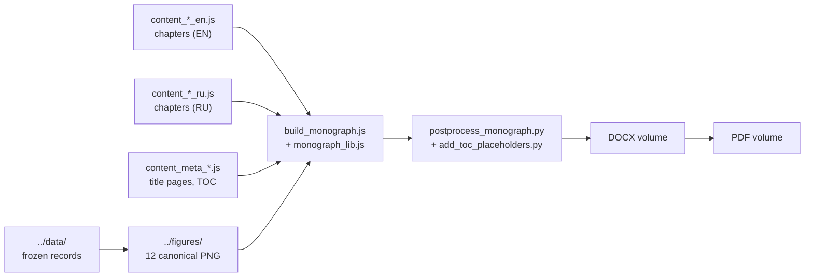

<!-- AB-ENRICHED:v2 · wave-deep-dive · monograph volumes -->

**🧭 [⬆ wave_attractors/](../README.md) · [🏠 Root README](../../../README.md)**

# 📕 `monograph/` — the W1 monograph in two editions

> **The W-1 monograph in RU and EN, one folder per edition.**

The publication layer of the wave-attractor study: [`ru/`](ru/) and [`en/`](en/) each hold that edition's assembled monograph — a `text/` folder with the DOCX/PDF volume and a `figures/` folder with the 12 chapter figures. The study itself is documented one level up (see the [package README](../README.md)), the numbers come from [`../data/`](../data/README.md) and the figures from [`../figures/`](../figures/README.md) — the volumes here are generated from those, never hand-edited.

> **🧭 Navigation:** [⬅ wave_attractors/](../README.md) · [→ report (RU)](../report/README.md) · [🏠 Repo root](../../../README.md)

## 📁 Contents

| Item | Kind | Size | What it is |
|---|---|---|---|
| `en/` | folder | 2 items | the English edition — `text/` (DOCX + PDF volume) + `figures/` (12 chapter figures) |
| `ru/` | folder | 2 items | the Russian edition — same structure, same numbers |

<strong>🏭 How a volume is assembled (click)</strong>

The build chain lives in [`../scripts/monograph/`](../scripts/monograph/README.md); the
TOC placeholders and the post-processing pass are part of that pipeline, so the two
editions stay structurally identical. The cold-start audit reproduced the monograph
DOCX (RU/EN) with `word/document.xml` **bitwise identical**.

## 🧭 Navigation

[⬅ wave_attractors/](../README.md) · [→ report (RU)](../report/README.md) · [→ figures](../figures/README.md) · [🏠 Repo root](../../../README.md)

---

🌀 <strong>Hyperbolic Wave Attractors — study W1</strong> · part of the
<a href="../../../README.md">AB-Cloud Research</a> repository ·
DOI <a href="https://doi.org/10.5281/zenodo.21825394">10.5281/zenodo.21825394</a> ·
© 2026 Isaev Iskhak Khamzatovich — personal proprietary use, see the
<a href="../../../LICENSE">license terms</a>

