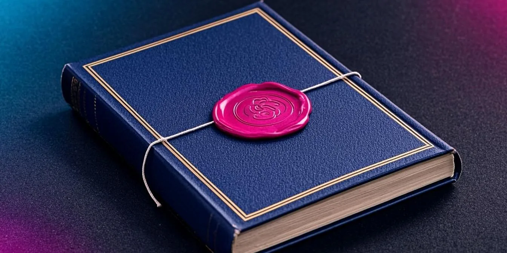
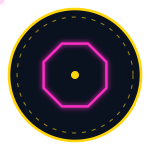

<!-- AB-ENRICHED:v2 · wave-deep-dive · official report -->

**🧭 [⬆ wave_attractors/](../README.md) · [🏠 Root README](../../../README.md)**

# 📄 `report/` — the Russian-language W1 report

> **The Russian-language W-1 report (hyperbolic wave attractors).**

The working report of the study as a single PDF — the process-level companion to the monograph volumes: same results, plus the operational details of how each experiment was run and what was ruled out along the way.

> **🧭 Navigation:** [⬅ wave_attractors/](../README.md) · [→ monograph](../monograph/README.md) · [🏠 Repo root](../../../README.md)

## 📁 Contents

| Item | Kind | Size | What it is |
|---|---|---|---|
| [`Отчёт_W1_гиперболические_волновые_аттракторы.pdf`](%D0%9E%D1%82%D1%87%D1%91%D1%82_W1_%D0%B3%D0%B8%D0%BF%D0%B5%D1%80%D0%B1%D0%BE%D0%BB%D0%B8%D1%87%D0%B5%D1%81%D0%BA%D0%B8%D0%B5_%D0%B2%D0%BE%D0%BB%D0%BD%D0%BE%D0%B2%D1%8B%D0%B5_%D0%B0%D1%82%D1%82%D1%80%D0%B0%D0%BA%D1%82%D0%BE%D1%80%D1%8B.pdf) | PDF | 13.1 MB | — |

<strong>🔬 What the report adds over the monograph (click)</strong>

Where the monograph argues, the report *works through it*: the operational narrative of
every experiment — parameter choices, dead ends, controls that were run and rejected,
the exact protocol order. The cold-start audit checked it the hard way: the rebuilt PDF
came out **14 pages with extracted text identical** to the committed copy. The build
chain (content → build → cover → merge) lives in
[`../scripts/report/`](../scripts/report/README.md).

## 🧭 Navigation

[⬅ wave_attractors/](../README.md) · [→ monograph](../monograph/README.md) · [🏠 Repo root](../../../README.md)

---

🌀 <strong>Hyperbolic Wave Attractors — study W1</strong> · part of the
<a href="../../../README.md">AB-Cloud Research</a> repository ·
DOI <a href="https://doi.org/10.5281/zenodo.21825394">10.5281/zenodo.21825394</a> ·
© 2026 Isaev Iskhak Khamzatovich — personal proprietary use, see the
<a href="../../../LICENSE">license terms</a>

