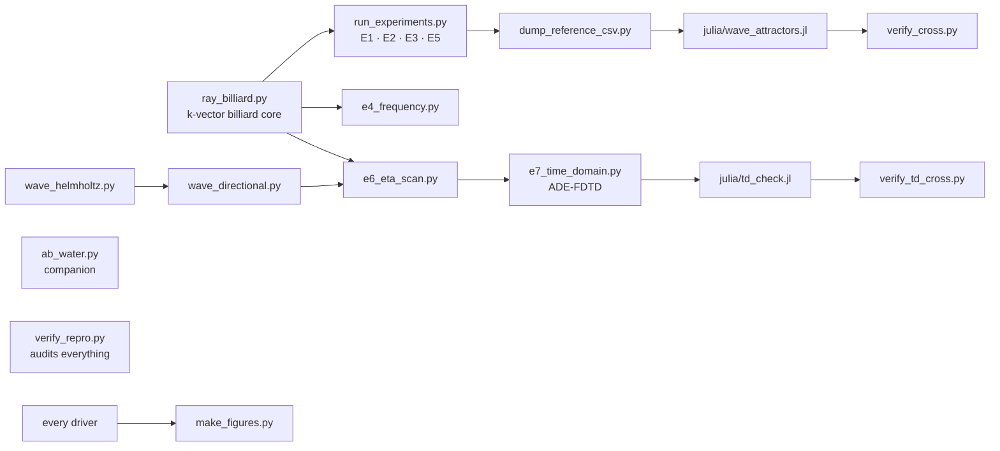

<!-- AB-ENRICHED:v2 · wave-deep-dive · executable layer -->

**🧭 [⬆ wave_attractors/](../README.md) · [🏠 Root README](../../../README.md)**

# ⚙️ `scripts/` — the study pipeline

> **The study's pipeline: simulator, experiments E1–E7, reference dumps and the figure builders.**

The executable layer of the W-1 study: [`ab_water.py`](ab_water.py) is the core simulator/analyser, the `e*_*.py` files are the per-experiment drivers (E4 frequency, E6 η-scan, E7 time-domain; E1–E3/E5 live in [`run_experiments.py`](run_experiments.py)) that wrote [`../data/`](../data/README.md), [`dump_reference_csv.py`](dump_reference_csv.py) maintains the frozen reference tables, and [`README_documents.md`](README_documents.md) explains how the document set is assembled. Start from `ab_water.py` if you want the physics, from an `e*` driver if you want a reproduction recipe.

> **🧭 Navigation:** [⬅ wave_attractors/](../README.md) · [→ data](../data/README.md) · [🏠 Repo root](../../../README.md)

## 📁 Contents

| Item | Kind | Size | What it is |
|---|---|---|---|
| [`ab_water.py`](ab_water.py) | Python | 7.5 KB | — |
| [`dump_reference_csv.py`](dump_reference_csv.py) | Python | 2.7 KB | — |
| [`e4_frequency.py`](e4_frequency.py) | Python | 5.5 KB | — |
| [`e6_eta_scan.py`](e6_eta_scan.py) | Python | 15.0 KB | — |
| [`e7_time_domain.py`](e7_time_domain.py) | Python | 18.7 KB | — |
| `julia/` | folder | 2 items | see inside — the Julia port and its TD kernel |
| [`make_figures.py`](make_figures.py) | Python | 36.2 KB | — |
| `monograph/` | folder | 11 items | see inside — the document build chain |
| [`ray_billiard.py`](ray_billiard.py) | Python | 22.1 KB | — |
| [`README_documents.md`](README_documents.md) | Markdown | 1.6 KB | — |
| `report/` | folder | 7 items | see inside — the report build chain |
| [`run_experiments.py`](run_experiments.py) | Python | 16.4 KB | — |
| [`verify_cross.py`](verify_cross.py) | Python | 5.9 KB | — |
| [`verify_repro.py`](verify_repro.py) | Python | 10.7 KB | — |
| [`verify_td_cross.py`](verify_td_cross.py) | Python | 3.6 KB | — |
| [`wave_directional.py`](wave_directional.py) | Python | 8.2 KB | — |
| [`wave_helmholtz.py`](wave_helmholtz.py) | Python | 8.2 KB | — |

<strong>🗺️ Who calls whom — the dependency spine (click)</strong>

The scripts follow the repository's seed discipline — **same input, same seed, same
bytes out** — so a re-run on the pinned platform reproduces the committed artifacts.
Nothing here is executed at import time by other modules; they are entry points.

## 🧭 Navigation

[⬅ wave_attractors/](../README.md) · [→ julia port](julia/README.md) · [→ monograph build](monograph/README.md) · [→ report build](report/README.md) · [🏠 Repo root](../../../README.md)

---

🌀 <strong>Hyperbolic Wave Attractors — study W1</strong> · part of the
<a href="../../../README.md">AB-Cloud Research</a> repository ·
DOI <a href="https://doi.org/10.5281/zenodo.21825394">10.5281/zenodo.21825394</a> ·
© 2026 Isaev Iskhak Khamzatovich — personal proprietary use, see the
<a href="../../../LICENSE">license terms</a>

