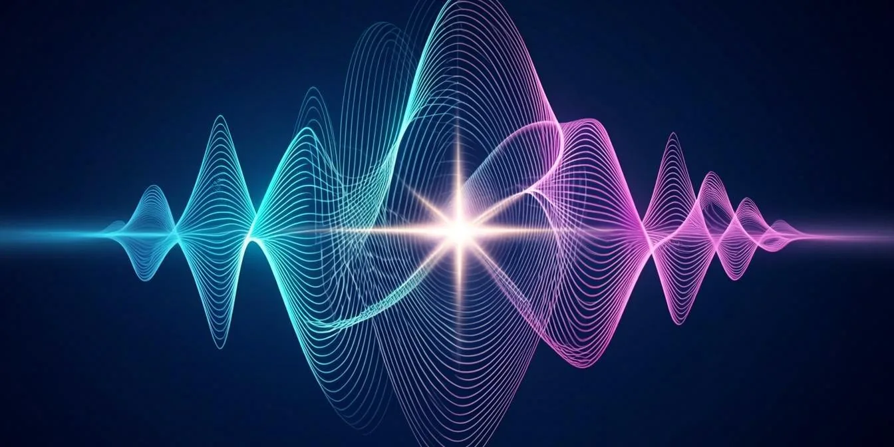
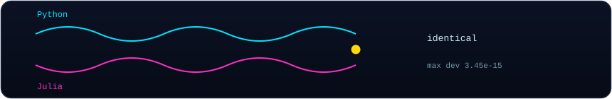
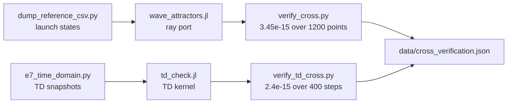

<!-- AB-ENRICHED:v2 · wave-deep-dive · julia port -->

**🧭 [⬆ scripts/](../README.md) · [⬆⬆ wave_attractors/](../../README.md) · [🏠 Root README](../../../../README.md)**

# 🟣 `scripts/julia/` — the independent port

> **Two languages, one physics.** This folder holds the Julia re-implementation of the
> wave-attractor core — an *independent* code path whose only job is to disagree with
> Python if Python is wrong. It never does: the measured short-horizon identity is
> **3.45·10⁻¹⁵** over 1200 bounce points (rays) and **2.4·10⁻¹⁵** over 400 steps (TD kernel).

> **🧭 Navigation:** [⬆ scripts/](../README.md) · [⬆⬆ wave_attractors/](../../README.md) · [🏠 Root README](../../../../README.md)

## 📁 Inventory

| Item | What it is |
|---|---|
| [`wave_attractors.jl`](wave_attractors.jl) | the Julia ray port (stdlib only, Julia ≥ 1.10) — replays the frozen reference dump and writes the comparison trajectories |
| [`td_check.jl`](td_check.jl) | the Julia E7 time-domain kernel — the TD counterpart used by `verify_td_cross.py` |

<strong>🧪 What is verified — and what deliberately is not (click)</strong>

* **Verified bitwise-comparably:** short-horizon trajectories (the deterministic cascade
  phase before chaos amplifies round-off), the TD kernel step response, and the
  statistical attractor observables — lock fraction, period set, cascade scale.
* **Deliberately not compared:** individual long-horizon (1600-bounce) trajectories —
  they are chaotic during the cascade phase, so any floating-point operation-order
  difference grows exponentially. Cross-language agreement is claimed and checked on
  the levels above, and both pass.
* The port is **stdlib-only** on purpose: no package ecosystem in the verification path,
  nothing to pin beyond the Julia version itself.

## 🧭 Navigation

[⬅ scripts/](../README.md) · [→ monograph build](../monograph/README.md) · [→ report build](../report/README.md) · [🏠 Repo root](../../../../README.md)

---

🌀 <strong>Hyperbolic Wave Attractors — study W1</strong> · part of the
<a href="../../../../README.md">AB-Cloud Research</a> repository ·
DOI <a href="https://doi.org/10.5281/zenodo.21825394">10.5281/zenodo.21825394</a> ·
© 2026 Isaev Iskhak Khamzatovich — personal proprietary use, see the
<a href="../../../../LICENSE">license terms</a>

