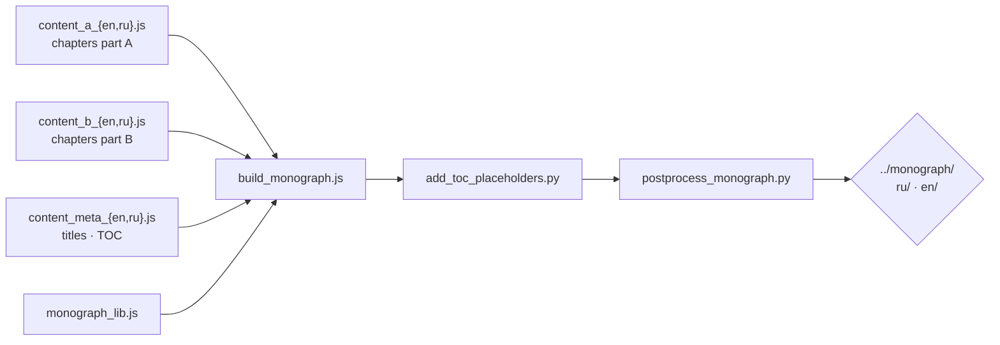

<!-- AB-ENRICHED:v2 · wave-deep-dive · monograph build chain -->

**🧭 [⬆ scripts/](../README.md) · [⬆⬆ wave_attractors/](../../README.md) · [🏠 Root README](../../../../README.md)**

# 🖨 `scripts/monograph/` — assembling the volumes

> **The npm-managed build chain that turns JavaScript chapter sources into the DOCX and
> PDF monograph volumes** of study W1 (RU and EN). The chapters are code, not
> word-processor files — which is exactly why the assembled volumes came out bitwise
> reproducible in the cold-start audit.

> **🧭 Navigation:** [⬆ scripts/](../README.md) · [⬆⬆ wave_attractors/](../../README.md) · [🏠 Root README](../../../../README.md)

## 📁 Inventory

| Item | What it is |
|---|---|
| [`add_toc_placeholders.py`](add_toc_placeholders.py) | inserts TOC placeholders before final assembly |
| [`build_monograph.js`](build_monograph.js) | the assembler — chapters + figures → DOCX |
| [`content_a_en.js`](content_a_en.js) · [`content_b_en.js`](content_b_en.js) | English chapter sources (parts A and B) |
| [`content_a_ru.js`](content_a_ru.js) · [`content_b_ru.js`](content_b_ru.js) | Russian chapter sources (parts A and B) |
| [`content_meta_en.js`](content_meta_en.js) · [`content_meta_ru.js`](content_meta_ru.js) | title pages, abstracts, TOC metadata per edition |
| [`monograph_lib.js`](monograph_lib.js) | shared layout/formatting library |
| [`package.json`](package.json) | npm manifest of the build chain |
| [`postprocess_monograph.py`](postprocess_monograph.py) | the final pass over the assembled documents |

<strong>📐 Why chapters-as-code (click)</strong>

Because the numbers must be **verbatim from the frozen data**: chapter sources reference
the experiment records, so a change in any result propagates through a rebuild, not
through hand-editing prose. The structure of both editions is fixed by the same builder,
which is why `ru/` and `en/` volumes stay chapter-aligned and why the audit could demand
— and obtain — a `word/document.xml` bitwise match for both languages.

## 🧭 Navigation

[⬅ scripts/](../README.md) · [→ report build](../report/README.md) · [→ julia port](../julia/README.md) · [🏠 Repo root](../../../../README.md)

---

🌀 <strong>Hyperbolic Wave Attractors — study W1</strong> · part of the
<a href="../../../../README.md">AB-Cloud Research</a> repository ·
DOI <a href="https://doi.org/10.5281/zenodo.21825394">10.5281/zenodo.21825394</a> ·
© 2026 Isaev Iskhak Khamzatovich — personal proprietary use, see the
<a href="../../../../LICENSE">license terms</a>

