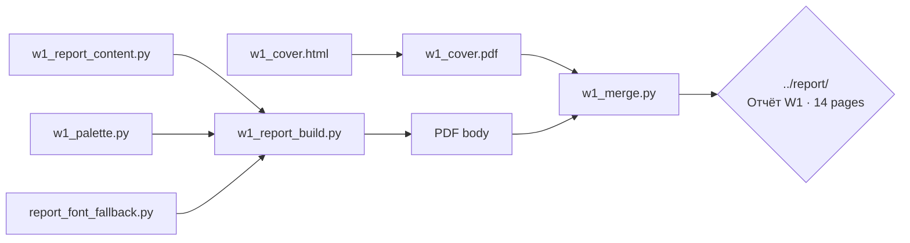
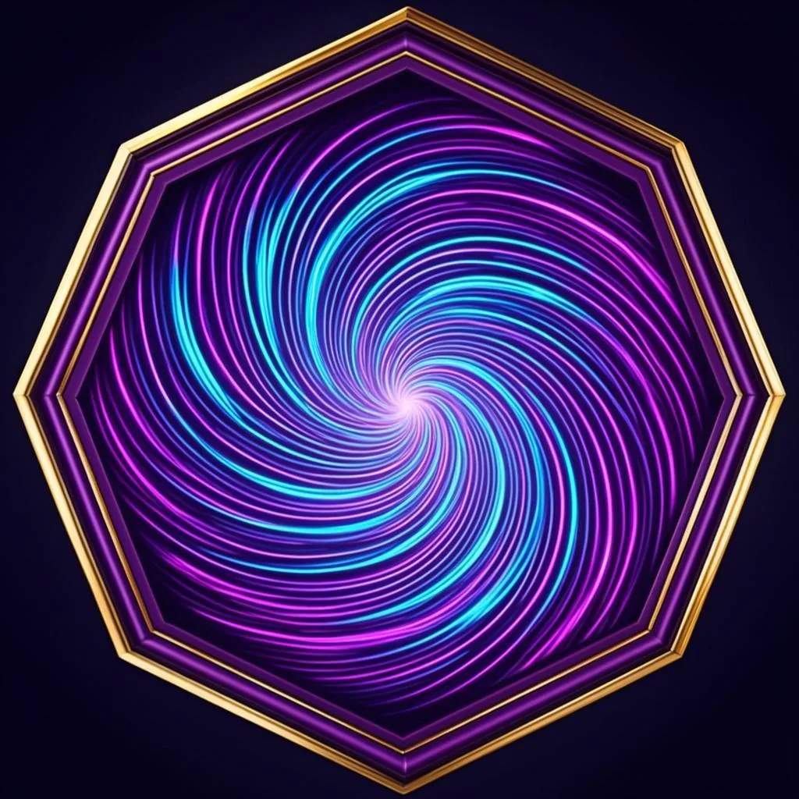

<!-- AB-ENRICHED:v2 · wave-deep-dive · report build chain -->

**🧭 [⬆ scripts/](../README.md) · [⬆⬆ wave_attractors/](../../README.md) · [🏠 Root README](../../../../README.md)**

# 🏷 `scripts/report/` — building the RU report

> **The typography chain behind the 14-page Russian working report** of study W1:
> content in code, layout in a palette module, cover as HTML→PDF, everything merged
> into the committed document. The audit's verdict on this chain: rebuilt PDF came out
> with **extracted text identical** to the committed copy.

> **🧭 Navigation:** [⬆ scripts/](../README.md) · [⬆⬆ wave_attractors/](../../README.md) · [🏠 Root README](../../../../README.md)

## 📁 Inventory

| Item | What it is |
|---|---|
| [`w1_report_content.py`](w1_report_content.py) | the report text, structured as data |
| [`w1_report_build.py`](w1_report_build.py) | the builder — content + palette → PDF body |
| [`w1_palette.py`](w1_palette.py) | the report's color/typography system |
| [`report_font_fallback.py`](report_font_fallback.py) | font availability guards for reproducible rendering |
| [`w1_cover.html`](w1_cover.html) · [`w1_cover.pdf`](w1_cover.pdf) | the cover page (source and rendered) |
| [`w1_merge.py`](w1_merge.py) | merges cover + body into the final PDF |

<strong>🎨 Why a dedicated palette module (click)</strong>

Because reproducibility extends to *look*: `w1_palette.py` pins the report's colors and
typography so that a rebuild does not merely carry identical text — it renders with the
same visual system. The font-fallback module guards the pipeline against environment
differences (missing typefaces would silently change pagination), which is one of the
quiet ways otherwise-deterministic PDF chains drift.

## 🧭 Navigation

[⬅ scripts/](../README.md) · [→ monograph build](../monograph/README.md) · [→ julia port](../julia/README.md) · [🏠 Repo root](../../../../README.md)

---

🌀 <strong>Hyperbolic Wave Attractors — study W1</strong> · part of the
<a href="../../../../README.md">AB-Cloud Research</a> repository ·
DOI <a href="https://doi.org/10.5281/zenodo.21825394">10.5281/zenodo.21825394</a> ·
© 2026 Isaev Iskhak Khamzatovich — personal proprietary use, see the
<a href="../../../../LICENSE">license terms</a>

