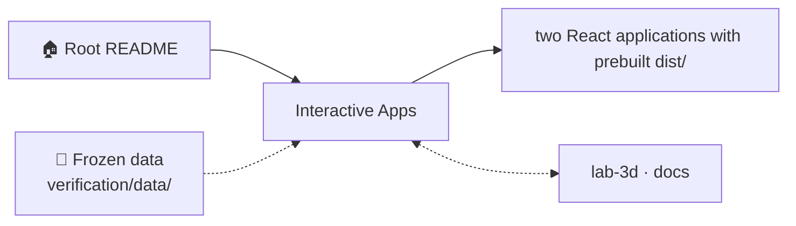
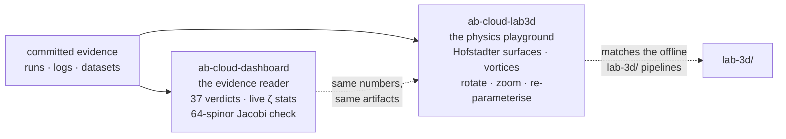
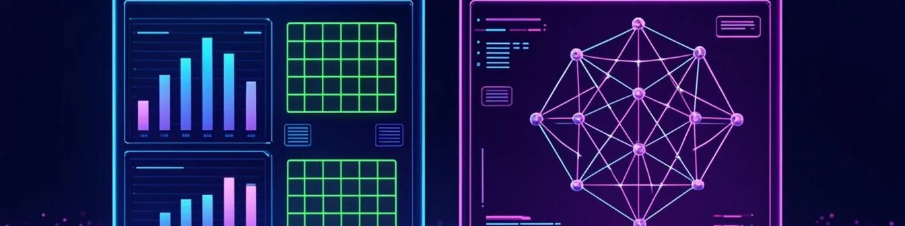

<!-- AB-ENRICHED:v1 · section=apps -->
<div align="center">


</div>
<details>
<summary><strong>🗺️ How <code>apps/</code> connects to the repository (click)</strong></summary>



</details>

<div align="center">



# 📱 Apps — Two Interactive React Applications

**Two self-contained web apps (React 18 + Vite) that make the project's results explorable
in a browser — no server, no Python, no Julia required.**

[](ab-cloud-dashboard/)
[](ab-cloud-dashboard/)
[](#-the-two-applications)
[](#-deploying-to-github-pages)
[](ab-cloud-dashboard/)
[](ab-cloud-lab3d/)
[](#-run-from-source)
[](#-serving-locally)

[The two applications](#-the-two-applications) · [Run from source](#-run-from-source) · [Deploying](#-deploying-to-github-pages) · [Deep dive](#-deep-dive--what-the-two-applications-are-for) · [Related layers](#-related-layers-of-the-project)

</div>

---

## 🗂 Table of contents

<details open>
<summary><strong>Expand / collapse</strong></summary>

1. [🖥 The two applications](#-the-two-applications)
2. [⚡ Run from source](#-run-from-source)
3. [🚀 Deploying to GitHub Pages](#-deploying-to-github-pages)
4. [🧭 Serving locally](#-serving-locally)
5. [🔬 Deep dive — what the two applications are for](#-deep-dive--what-the-two-applications-are-for)
6. [📁 Complete file inventory](#-complete-file-inventory)
7. [🔗 Related layers of the project](#-related-layers-of-the-project)

</details>

---

## 🖥 The two applications

<div align="center">


</div>

| App | What it shows | Source | Prebuilt |
|---|---|---|---|
| [`ab-cloud-dashboard/`](ab-cloud-dashboard) | 37-test verdict dashboard + real-time ζ statistics (Web Worker) + in-browser 64-spinor Jacobi verification | `src/` | `dist/` |
| [`ab-cloud-lab3d/`](ab-cloud-lab3d) | WebGL 3D laboratory: Hofstadter lattice with vortices, Dirac cone, ζ critical strip (Three.js) | `src/` | `dist/` |

Both ship **prebuilt static bundles** in `dist/` (committed, GitHub Pages ready, relative
base `./`), so you can serve them with any static file server or open the Pages deployment
directly.

---

## ⚡ Run from source

```bash
# app 1 — dashboard
cd apps/ab-cloud-dashboard
npm install
npm run dev          # Vite dev server with HMR
npm run build        # production build → dist/
npm run preview      # serve the production build locally

# app 2 — 3D laboratory
cd ../ab-cloud-lab3d
npm install && npm run dev
```

No environment variables, no backend. The dashboard's heavy data — the 50 000
embedded ζ zeros and the run summary — is bundled in its `public/data/` and
copied to `dist/data/` at build time; the 3D laboratory needs no data files —
every scene is computed procedurally in the browser.

---

## 🚀 Deploying to GitHub Pages

Each `dist/` is built with a relative base, so the folders can be served from any path —
e.g. via Pages from the `/docs` root, from a `gh-pages` branch, or by copying `dist/` to any
static host.

## 🧭 Serving locally

```bash
cd apps/ab-cloud-dashboard && python3 -m http.server 8080 -d dist
cd apps/ab-cloud-lab3d   && python3 -m http.server 8081 -d dist
```

Then open `http://localhost:8080` / `:8081`. Rebuilding from source requires Node 18+:
`npm ci && npm run build` inside the app folder.

---

## 🔬 Deep dive — what the two applications are for

The repository ships **two independent React applications**, and a subtle design decision
matters here: **both apps are committed prebuilt** (`ab-cloud-dashboard/dist/` and
`ab-cloud-lab3d/dist/`). That means the apps can be served as static files — GitHub Pages,
any static host, or a local `python3 -m http.server` — **without Node, without npm, without a
build step**. On a phone, in a review meeting, or ten years from now, the bundles still open;
the source next to them guarantees they can be rebuilt, audited and modified.

The division of labour between the two apps mirrors the division between *reading the
evidence* and *playing with the physics*:



- **ab-cloud-dashboard** is the evidence reader: the verification results, the test ledger,
  the dataset charter and the monograph metadata in a point-and-click interface. If a number
  in a talk looks suspicious, the dashboard is the fastest way to trace it to the artifact
  that produced it.
- **ab-cloud-lab3d** is the physics playground: the 3D lattice laboratory in the browser —
  Hofstadter surfaces and vortex textures you can rotate, zoom and re-parameterise, matching
  the offline pipelines in [`lab-3d/`](../lab-3d/README.md).

Both apps read from the same committed evidence as everything else in the repository; neither
contains private copies of the numbers. A figure in the dashboard and the corresponding PNG in
the monograph directory trace back to the same run artifact — that is the whole integrity
model of the project, extended to the browser.

---

## 📁 Complete file inventory

| Entry | Size | Kind |
|---|---|---|
| `ab-cloud-dashboard/` | directory, 21 files inside | folder |
| `ab-cloud-lab3d/` | directory, 13 files inside | folder |
| `README.md` | 2.1 KB | markdown guide |
| **Total (files)** | **2.1 KB** | 1 files + 2 subdirectories |

---

## 🔗 Related layers of the project

| Layer | What it adds |
|---|---|
| [`docs/`](../docs/README.md) | the MkDocs Material documentation site (the narrative layer) |
| [`lab-3d/`](../lab-3d/README.md) | the offline 3D branch the WebGL laboratory mirrors |
| [`results/`](../results/README.md) | the committed run artifacts the dashboard reads from |
| [`verification/`](../verification/README.md) | the 10-language verification package |

---

<p align="center">
  <sub><em>Reading the evidence and playing with the physics — same numbers, two windows.</em></sub>
</p>

<div align="center">


<!-- AI end-cap — prompt P-12, registry: assets/prompts/AI_PROMPTS.md -->


<sub>🖼️ Section art: <a href="../assets/prompts/AI_PROMPTS.md">P-12</a> · palette <code>#05060f · #00e5ff · #ff2ec4 · #a78bfa · #ffd60a</code></sub>

<sub>⚡ Part of <a href="../README.md">AB-Cloud Research</a> — phase resonator for the zeros of the Riemann zeta function · <a href="../README.md">🏠 Root README</a></sub>
</div>
