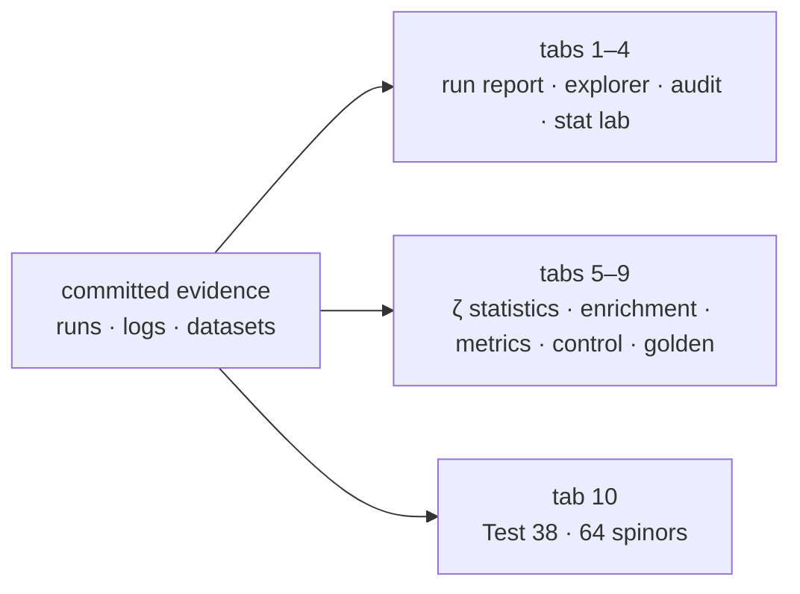

<!-- AB-ENRICHED:v1 · sub -->
<div align="center">


**🧭 [⬆ apps/](../README.md) · [🏠 Root README](../../README.md)**

</div>
# AB-Cloud Dashboard — React Application №1

> **🧭 Navigation:** [apps/](../README.md) · [lab3d](../ab-cloud-lab3d/README.md) · [Root](../../README.md)

Interactive real-time dashboard of the AB-Cloud verification suite.
React 19 + Vite, **no charting dependencies** — every plot is hand-rolled
SVG, so the whole app is a few source files with a tiny bundle.

## The ten tabs

### 1. Run report (37 tests)

The verdict table of the two-pass run `run_20260902_134759` (Julia 1.12.0,
50 000 Odlyzko zeros, HARDCORE pass 2 at 96×96) loaded from
`public/data/run_summary.json`. Each row: test id, name, per-pass verdict
(PASS / WARN / FAIL), the WARN-band calibration note is displayed so nobody
mistakes calibrated warnings for failures.

### 2. Test explorer — 37 deep-dive panels

Every test of the run gets its own panel, parsed from its frozen report by
`scripts/prepare-test-explorer-data.py` into `public/data/test_reports.json`:
what the test verifies, the hardcore sub-checks, the headline Result line,
the metrics of the FULL COMPUTATION LOG (3 280 `calc:` numbers), the numeric
console tables (rendered as data tables **and** SVG charts), every
PASS/WARN/FAIL verdict line of the console capture, the reproduce command
and the trimmed console capture itself. Searchable, grouped into 10
research categories, deep-linkable via `#T<n>` fragments.

### 3. HP audit H1–H8

The standalone Hilbert–Pólya deep-audit battery
(`results/Test H1-H8 hp_audit_standalone.jl/`): battery verdicts, the
per-test sub-check tables (43 sub-checks), the preset parameters of each
run and the method notes — including the honest WARNs (H1 prime-oscillation
fingerprint, H5 large-ensemble showdown).

### 4. Stat lab — 9 live tests

The suite's statistics layer re-implemented in the Web Worker: pair
correlation R₂(s) vs the sine kernel, spacing histogram vs the Wigner–GUE
surmise (KS), QQ plot vs the exact GUE ratio law, Pearson χ² GOF with
incomplete-gamma p-value, autocorrelation of the ratios, Wald–Wolfowitz
runs test, even/odd and height-split two-sample KS, Shannon entropy of the
ratio law. Each card recomputes its diagnostic live from the embedded
50 000 zeros — “mirror of Test N” ties it back to the frozen result.

### 5. Real-time ζ statistics

The same diagnostics as suite tests 1–5, 13, 14 — computed **live in a Web
Worker** from the embedded 50 000-zero dataset
(`public/data/zeta_zeros_50000_embedded.txt`):

- b(N) convergence table (N = 100 … 50 000) with the power-law fit;
- ⟨r⟩ with KS test against the **exact GUE ratio law** (not just the
  surmise);
- number variance Σ²(L) and spectral rigidity Δ₃(L).

The UI stays responsive while the worker crunches; sliders let you change
the sample size and unfolding parameters.

### 6–9. Enrichment run · Metrics ×38 · GUE control · Golden values

The frozen artifacts of `results/RH_Sweep_Pro_Enrichment/` (curves,
per-config metrics, the GUE error floor) and the 206 golden values of
`verification/data/`.

### 10. Test 38 — 64 spinors

The frozen spinor classes of `verification/spinor64/` with the **28
odd-structure spectra computed live in the browser** by a hand-written
cyclic-Jacobi eigensolver (port of Test 38, no LAPACK — plain JS on
`Float64Array`s). You can pick any structure and watch its spectrum match
the orbit representative to ≈ 1e-14 — a direct in-browser refutation of the
all 64 spinor structures verified in-browser.

## Architecture

The ten tabs as data flows from the committed evidence (bundle committed
prebuilt in `dist/` — runs without Node):



| Piece | Where | Notes |
|---|---|---|
| Pages | `src/pages/*.jsx` | one tab each (RunReport, Tests, HAudit, StatLab, ZerosStats, …) |
| Worker | `src/worker/stats.worker.js` | all heavy numerics: `stats`, `lab` (9 tests), `spinor` |
| UI kit | `src/components/ui.jsx` | SVG charts, Stat cards, skeletons (hand-rolled) |
| Data | `public/data/*.json`, `public/data/zeta_zeros_50000_embedded.txt` | frozen by `scripts/prepare-dashboard-data.py` and `scripts/prepare-test-explorer-data.py` |
| Styles | `src/styles.css` | dark scientific theme (landing design tokens) |

## Run / build

```bash
cd apps/ab-cloud-dashboard
npm install
npm run dev        # Vite dev server
npm run build      # production build → dist/
npm run preview    # serve dist/ locally
```

The committed `dist/` is a ready-to-serve static build (GitHub Pages
compatible, relative base `./`). Data files are duplicated into
`dist/data/` at build time.

## 📁 Complete file inventory

| Entry | Size | Kind |
|---|---|---|
| `dist/` | directory, 6 files inside | folder |
| `public/` | directory, 2 files inside | folder |
| `src/` | directory, 8 files inside | folder |
| `README.md` | 3.1 KB | markdown guide |
| `index.html` | 322 B | HTML page |
| `package-lock.json` | 55.9 KB | JSON data |
| `package.json` | 356 B | JSON data |
| `vite.config.js` | 236 B | JavaScript source |
| **Total (files)** | **59.9 KB** | 5 files + 3 subdirectories |

## 🔬 Deep dive — the dashboard tab by tab

The dashboard is organised around one question: *where does each claimed
number live?* Every panel resolves to a concrete artifact path, so a talk,
a paper and the raw run can be cross-examined in seconds:

- **Results overview** — the headline quantities ([r], Montgomery KS,
  Byers–Yang defect, Connes zero modes, Dirac R²) with their verdicts and
  the artifact path printed next to each value.
- **Test ledger** — all 37 + 1 tests with pass-1 / hardcore-pass-2 verdicts
  and per-test timing stamps, mirroring
  `results/Test 1-37 ab_cloud_full.jl/ab_cloud_v19_verify_report_2026-09-02_23-33-45.txt`.
- **Spinor64 panel** — the 64-structure orbit table (28/21/7/7/1), the E2
  holonomy classes and the 64/64 GUE-consistency verdict.
- **Dataset charter** — the frozen ζ dataset inventory with checksums,
  file sizes and the loading rules every language port obeys.
- **Monograph browser** — the five editions with formats and direct links
  into `monographs/`.

### Architecture notes

Static React bundle, no backend, no analytics, no external requests: the
app is a pure view over committed files. This is what makes it suitable
for long-term archival — there is no service to keep alive.

<div align="center">


<sub>⚡ Part of <a href="../../README.md">AB-Cloud Research</a> — numbers are verbatim from the unified registry; no result on this page is a claim about the Riemann hypothesis · <a href="../README.md">⬆ parent section</a></sub>

</div>
