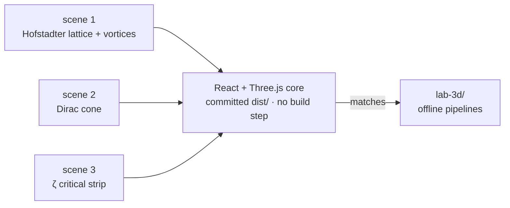

<!-- AB-ENRICHED:v1 · sub -->
<div align="center">


**🧭 [⬆ apps/](../README.md) · [🏠 Root README](../../README.md)**

</div>
# AB-Cloud Lab 3D — React Application №2

> **🧭 Navigation:** [apps/](../README.md) · [dashboard](../ab-cloud-dashboard/README.md) · [Root](../../README.md)

Interactive WebGL laboratory (React 19 + Vite + **Three.js**) visualizing
the 3D-1…3D-34 experiments of the Julia suite. Every scene is computed in
the browser — the γ values are not pre-baked pictures but live geometry.

## The three scenes

### 1. Hofstadter lattice with vortices

An L×L lattice with Landau-gauge phases (site bars colored by 2πα·j) and
q = +1 vortices drawn as red flux cones — the suite's GUE mechanism made
visible (the `:monumental` phase field of the spinor64/AB-cloud model).
Vortex positions follow the deterministic jittered-grid placement used in
the E2 experiment of `verification/spinor64/`.

### 2. Dirac cone

E(k) = v_F·|k| linear dispersion at α = 1/2 — the QED correspondence point
(suite tests 19/30, v_F(2π) = 1.9). The cone can be rotated/zoomed; the
folds of the dispersion reproduce the finite-size ripples of the test
plots.

### 3. ζ critical strip

The surface |ζ(σ+it)| with the critical line and the embedded zeros
γ₁…γ₁₅. The ζ evaluator is a **self-anchored Euler–Maclaurin** port of
experiment 3D-34: on startup it verifies itself against the known anchors
ζ(2), ζ(4), ζ(1/2) before rendering — if the self-check fails, the scene
refuses to draw (so a silent numerical bug can never fake the picture).

## Architecture

The three scenes over one shared React + Three.js core (bundle committed
prebuilt in `dist/` — runs without Node):



| Piece | Where | Notes |
|---|---|---|
| Scenes | `src/modules/scenes.js` | three Three.js scene factories + orbit controls |
| ζ evaluator | `src/modules/zeta.js` | Euler–Maclaurin summation with self-anchoring |
| App shell | `src/App.jsx`, `src/main.jsx` | tab switcher, resize handling |
| Styles | `src/styles.css` | dark scientific theme |

No data files needed — the lattice geometry and ζ surface are computed
procedurally; the only inputs are the suite's published constants.

## Run / build

```bash
cd apps/ab-cloud-lab3d
npm install
npm run dev        # Vite dev server
npm run build      # production build → dist/
npm run preview    # serve dist/ locally
```

The committed `dist/` is a ready-to-serve static build (GitHub Pages
compatible, relative base `./`). WebGL 2 capable browser required
(anything modern); the app degrades to a warning card otherwise.

## 📁 Complete file inventory

| Entry | Size | Kind |
|---|---|---|
| `dist/` | directory, 3 files inside | folder |
| `src/` | directory, 5 files inside | folder |
| `README.md` | 3.0 KB | markdown guide |
| `index.html` | 313 B | HTML page |
| `package-lock.json` | 56.2 KB | JSON data |
| `package.json` | 377 B | JSON data |
| `vite.config.js` | 208 B | JavaScript source |
| **Total (files)** | **60.1 KB** | 5 files + 2 subdirectories |

## 🔬 Deep dive — the lattice lab in the browser

The browser twin of `lab-3d/` trades batch throughput for immediacy:
choose α, lattice size and gauge, and the Hofstadter surface or the vortex
texture renders in real time, camera-rotatable and zoomable. The
visualization parameters mirror the offline pipelines exactly — same
Hamiltonian convention, same gauge bookkeeping, same color mapping as the
600-dpi plates of the monograph — so a screenshot from the lab and a
printed figure are visually comparable without translation.

Use it for: building intuition about where the flux lives (vortex cores
versus empty plaquettes), demonstrating the α = 1/2 Dirac touching, and
checking that a parameter change that should move a topological invariant
actually does. For publication-grade output use the offline pipelines in
`lab-3d/code/` — the browser is the sketchbook, the pipeline is the press.

The reference scene — the **36³ Hofstadter configuration** — is the same
one the 3D-lab preprint ([lab-3d/preprint/](../../lab-3d/preprint/)) opens
with, so the app and the paper start from identical ground.

<div align="center">


<sub>⚡ Part of <a href="../../README.md">AB-Cloud Research</a> — numbers are verbatim from the unified registry; no result on this page is a claim about the Riemann hypothesis · <a href="../README.md">⬆ parent section</a></sub>

</div>
