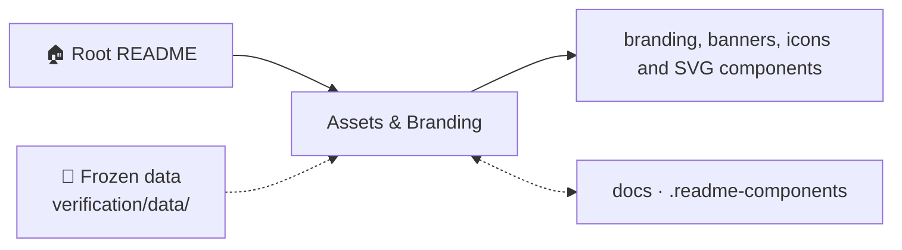

<!-- AB-ENRICHED:v1 · section=assets -->

<strong>🗺️ How <code>assets/</code> connects to the repository (click)</strong>

# assets — Project Branding & Visual Library

The single source of every shared visual in the repository. Two layers:

**1. Vector layer (hand-authored, animated)** — `banner.svg`, `banner-v2.svg`
(root README heritage), `visuals/` (animated + AI concept art + charts),
and `svg/` — the live component set (SMIL-animated, referenced via ``):

| File | Purpose |
|---|---|
| `banner-v2.svg` | the repository banner rendered at the top of the root README (project title, the AB-cloud motif: a Hofstadter-style phase field with vortex flux tubes over the critical-line zeros) |
| `banner.svg` | the earlier v1 banner of the same motif (superseded at the root README by `banner-v2.svg`) |
| `svg/divider-*.svg` | animated gradient dividers — 9 palette variants (cyan/magenta/violet/gold/green/purple/blue/gray + universal) |
| `svg/badge-tests-passing.svg` | pulsing live badge «ALL 39 TESTS PASSING» |
| `svg/progress-*.svg` | animated progress bars traced to the results registry (tests, verification, formal, dataset, spinor64, monographs) |

**2. AI-rendered raster layer (generated, prompt-registered)** — produced by
the project image model, one prompt per asset in
[prompts/AI_PROMPTS.md](prompts/AI_PROMPTS.md), mapped in
[manifest.json](manifest.json), validated by the `assets-validate` workflow:

| Folder | Contents |
|---|---|
| `banners/` | `hero-main.webp` (16:9 root hero, P-01) + 15 section end-caps 4:1 (P-02…P-16) |
| `icons/` | 9 flat-line icons (resonator, ζ-spiral, Julia, shield, book, chip, globe, crystal, atom — P-17…P-25) |
| `backgrounds/` | 2 tileable backgrounds: starfield, formula matrix (P-26…P-27) |
| `og/` | social preview card (P-28) — upload via *Settings → Social preview* |
| `avatar/` | avatar art + 256 px copy (P-29) |
| `prompts/` | the centralized prompt registry (regeneration workflow inside) |

## Notes

- SVG is used deliberately: it stays crisp on retina displays and costs a
  few kilobytes, unlike a raster banner. Inline `<svg>` in Markdown is
  forbidden (GitHub sanitizes it) — always reference SVG files via ``.
- WebP is used for all generated raster assets: GitHub renders it natively
  and every banner is 19–109 KB (limits: STYLE §6 in
  `../.readme-components/STYLE_GUIDE.md`).
- Component snippets for README composition live in
  `../.readme-components/` — the visual style guide is the authoritative
  palette reference.
- Adding a new asset? Generate → optimize → register in `manifest.json` →
  add its prompt to `prompts/AI_PROMPTS.md`. The CI validator will fail on
  orphans and on missing manifest entries.

## 🔬 Deep dive — shared visual identity, single source

Everything visual that appears in more than one place lives here, exactly
once. The banner SVG at the top of the root README is this folder's most
visible resident; the shared figure media reused across the monograph
editions and the documentation site are the rest. The duplication-avoidance
rule is strict: a plate rendered in `monographs/ru/figures/`,
`monographs/en/figures/` and `monographs/zh/figures/` is three *copies* of
one generation decision, never three different images — and shared raw
media (logos, banner layers, base textures) is referenced from here rather
than re-embedded per edition.

Provenance discipline: every file in this folder is either generated by a
committed script or is original artwork of the author; nothing is
downloaded third-party media. That keeps the strictly-personal licensing
of the whole repository clean and traceable — there is no inherited
third-party copyright anywhere in the visual layer.

⚡ Part of <a href="../README.md">AB-Cloud Research</a> — phase resonator for the zeros of the Riemann zeta function · <a href="../README.md">🏠 Root README</a>

