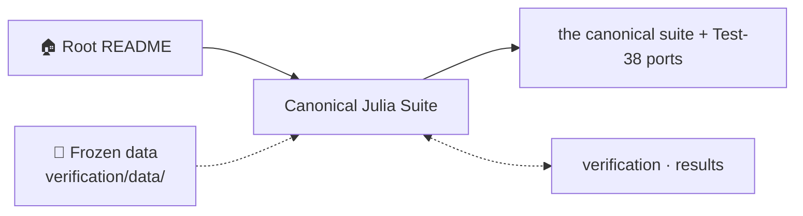
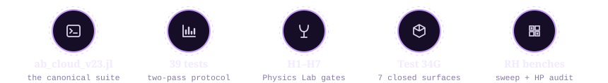
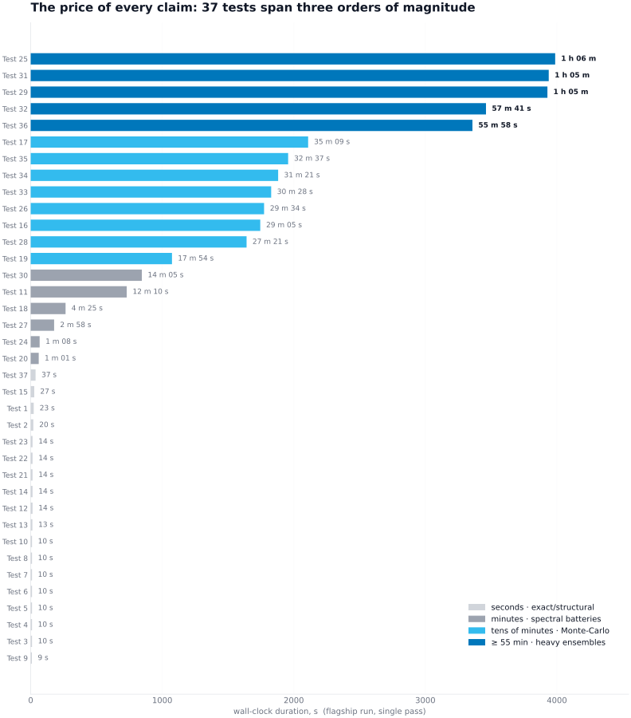
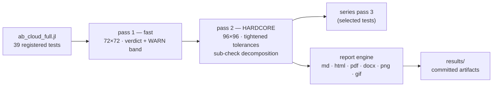
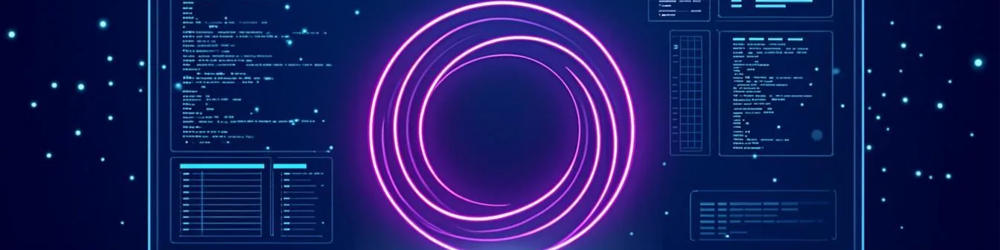

<!-- AB-ENRICHED:v1 · section=code -->
<div align="center">


</div>
<details>
<summary><strong>🗺️ How <code>code/</code> connects to the repository (click)</strong></summary>



</details>

<div align="center">



# ⌨️ Code — The Canonical Julia Suite

> **🧭 Navigation:** [Root README](../README.md) · [verification/](../verification/README.md) · [results/](../results/README.md)

**`ab_cloud_full.jl` — the single-file, dependency-free numerical program that produces every
number the monographs quote.**

[](https://julialang.org)
[](#-the-39-tests-grouped)
[](#-files)
[](#-files)
[](https://github.com/wild8highlander/ab-cloud-research/actions/workflows/julia.yml)
[-1.2126-4FB3BE?style=flat-square)](#-the-39-tests-grouped)
[](#-the-39-tests-grouped)
[](#-running)

[Files](#-files) · [The 39 tests](#-the-39-tests-grouped) · [Running](#-running) · [CLI flags](#-cli-flags-selection) · [Two-pass protocol](#-two-pass-protocol)

</div>

---

## 🗂 Table of contents

<details open>
<summary><strong>Expand / collapse</strong></summary>

1. [📁 Files](#-files)
2. [🧪 The 39 tests, grouped](#-the-39-tests-grouped)
3. [🚀 Running](#-running)
4. [🎚 CLI flags (selection)](#-cli-flags-selection)
5. [🔁 Two-pass protocol](#-two-pass-protocol)
6. [🔗 Related layers of the project](#-related-layers-of-the-project)

</details>

---

## 📁 Files

<div align="center">



</div>

This folder holds the **canonical numerical program** of the project. Language: Julia ≥ 1.10
(reference runs: Julia 1.12.0); stdlib only — nothing to `Pkg.add()`.

| File | Size | What it is |
|---|---|---|
| `ab_cloud_full.jl` | 32 187 lines | **canonical suite** — 39 registered tests, two-pass protocol, report engine (md/html/pdf/docx/png/gif), interactive menu, Physics Lab (H1–H7 gates), 3D lab, Test-34G geometry sweep |
| `RH_Unified_D.jl` · `RH_Sweep_Pro_D.jl` | ~8 800 lines | standalone RH sweep benches |
| `hp_audit_standalone.jl` | 6 054 lines | standalone Hilbert–Pólya audit battery |
| `julia/` | provenance copy | suite provenance archive — see [`julia/README.md`](julia/README.md) |

---

## 🧪 The 39 tests, grouped

The full price list of the suite as a picture — every test ranked by its
wall-clock duration in the flagship run, coloured by cost tier:

<p align="center">
<picture>
  <source media="(prefers-color-scheme: dark)" srcset="../assets/visuals/charts/test_cost_ranking.dark.svg">
  
</picture>
</p>

> **Data:** real timings of the flagship run `run_20260902_134759`
> (see the [root README ledger](../README.md#computational-cost-of-every-test-real-timings-of-the-flagship-run)).
> Exact/structural tests cost seconds; Monte-Carlo honesty costs up to an hour.

| Group | Tests | Verifies |
|---|---|---|
| Convergence | 1–3 | b(N) = (1/N)Σ\|γₖ−γ̃ₖ\| — table, monotonicity, rate; b(50000) = 1.2126, empirical law b(N) ≈ 7.0312·N^(−0.1685) (R² = 0.9895) |
| GUE statistics | 4–5, 9–17 | KS/CvM vs the GUE surmise, ⟨r⟩ = 0.5848 ± 0.0260 (GUE 0.5992), Σ²(L), Δ₃(L), K(τ), bootstrap CIs |
| Physics of the cloud | 6–8, 18–22 | Byers–Yang flux defect 3.5·10⁻¹⁵, Connes self-duality zero modes, AIII class, Dirac cone v_F ≈ 0.125 (R² = 0.9997), Berry R₂(0) |
| Spinor / topology | 23–28 | Arf invariant, PSL(2,7) orbit structure, zero-mode counts 2/3/3/3/7 |
| Robustness | 29–38 | chaos/decay rate, half-factorial γ, byte-level robustness, form factor K(τ), residual diagnostics, Test 38 — 64-spinor isospectrality |
| Geometry sweep | 39 | **TEST 34G** — Test 34 laboratory ported onto 7 closed surfaces: torus, Klein bottle, pillow orbifold, cube sphere, Hurwitz PSL(2,7)/PSL(2,8)/PSL(2,13) magnetic Cayley graphs |

(Verdict semantics: PASS / WARN / FAIL against thresholds printed with each test; the WARN
band is calibration, documented in the run reports.)

---

## 🚀 Running

```bash
# smoke run: one test on the embedded 50 000-zero dataset, ~1 min
julia code/ab_cloud_full.jl --test 1

# the full two-pass 39-test suite (30–60 min, 50 000 zeros, 72×72 → 96×96)
julia code/ab_cloud_full.jl --test all

# one test only, single pass
julia code/ab_cloud_full.jl --test 33 --no-two-pass

# TEST 34G geometry sweep with knobs
julia code/ab_cloud_full.jl --test 39 --t34g-l 96 --t34g-reps 2 --t34g-geoms all

# interactive menu: 39 tests + Physics Lab (H-gates) + 3D lab
julia code/ab_cloud_full.jl
```

The embedded 50 000-zero dataset means the suite runs out of the box; to point it at larger
frozen datasets use `--data-dir verification/data`.

---

## 🎚 CLI flags (selection)

| Flag | Effect |
|---|---|
| `--test N` / `--test all` | run one test / the whole suite |
| `--data-dir DIR` | where the frozen ζ datasets live |
| `--output-dir DIR` | where run reports are written |
| `--no-two-pass` | single pass (pass 1 only) |
| `--t34g-l / --t34g-reps / --t34g-geoms` | Test 34G geometry-sweep knobs |
| `--t38-quick` | Test 38 smoke mode (tiny lattices) |
| `--lang en / ru` | UI language |
| `--help` | full flag list |

---

## 🔁 Two-pass protocol

Every test runs twice: a fast **pass 1**, then a **hardcore pass 2** with tightened
tolerances and sub-check decomposition; selected tests add a **series pass 3**. A WARN in
pass 1 is not a failure — it flags a finite-size/calibration effect that pass 2 re-derives at
sub-check level. The stored flagship run (era, 2026-09-02) is documented in
[`results/README.md`](../results/README.md) with 202 machine verdict lines.


---

## 🔗 Related layers of the project

| Layer | What it adds |
|---|---|
| [`meridian-spectral-observatory/`](../meridian-spectral-observatory/README.md) | the standalone observatory — the current supercombo and the H1–H7 audit |
| [`results/`](../results/README.md) | the committed run artifacts of the suite |
| [`verification/`](../verification/README.md) | the 10-language independent verification |
| [`dirac-lab/`](../dirac-lab/README.md) | the Dirac-skeleton laboratory (D1–D14) |

---

<p align="center">
  <sub><em>One file, thirty-two thousand lines, every quoted number — reproducible.</em></sub>
</p>

<div align="center">


<!-- AI end-cap — prompt P-11, registry: assets/prompts/AI_PROMPTS.md -->


<sub>🖼️ Section art: <a href="../assets/prompts/AI_PROMPTS.md">P-11</a> · palette <code>#05060f · #00e5ff · #ff2ec4 · #a78bfa · #ffd60a</code></sub>

<sub>⚡ Part of <a href="../README.md">AB-Cloud Research</a> — phase resonator for the zeros of the Riemann zeta function · <a href="../README.md">🏠 Root README</a></sub>
</div>
