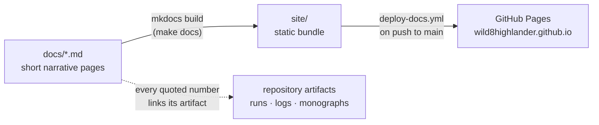

<div align="center">



# 📚 Docs — MkDocs Material Documentation Site

**The sources of the GitHub Pages documentation site
(<https://wild8highlander.github.io/ab-cloud-research>) — the narrative layer of the project,
built with MkDocs Material and auto-deployed on every push to `main`.**

[](https://squidfunk.github.io/mkdocs-material/)
[](https://wild8highlander.github.io/ab-cloud-research)
[](#-pages)
[](#-conventions)
[](https://github.com/wild8highlander/ab-cloud-research/actions/workflows/deploy-docs.yml)
[](https://github.com/wild8highlander/ab-cloud-research/actions/workflows/link-checker.yml)
[](../mkdocs.yml)

[Pages](#-pages) · [Build locally](#-build-locally) · [Conventions](#-conventions) · [Deep dive](#-deep-dive--the-mkdocs-material-site) · [Кратко (по-русски)](#-кратко-по-русски)

</div>

---

## 🗂 Table of contents

<details open>
<summary><strong>Expand / collapse</strong></summary>

1. [📄 Pages](#-pages)
2. [🔧 Build locally](#-build-locally)
3. [📐 Conventions](#-conventions)
4. [🔬 Deep dive — the MkDocs Material site](#-deep-dive--the-mkdocs-material-site)
5. [📁 Complete file inventory](#-complete-file-inventory)
6. [🇷🇺 Кратко (по-русски)](#-кратко-по-русски)
7. [🔗 Related layers of the project](#-related-layers-of-the-project)

</details>

---

## 📄 Pages

<div align="center">


</div>

| Page | Contents |
|---|---|
| [`index.md`](index.md) | landing: what the project is, headline results |
| [`quickstart.md`](quickstart.md) | fastest paths: Julia suite, Python verification, apps |
| [`julia-suite.md`](julia-suite.md) | the 39-test two-pass suite explained (modes, flags, outputs) |
| [`verification.md`](verification.md) | the 10-language verification suite and the three objections |
| [`monographs.md`](monographs.md) | the trilingual v22 monograph package and formats |
| [`monograph-v21.md`](monograph-v21.md) | the original v21 monograph and the v21.1 corrections |
| [`results.md`](results.md) | how to read `results/run_20260902_134759/` and the reference logs |
| [`lab3d.md`](lab3d.md) | the 3D laboratory: modes A–J, committed runs |
| [`citation.md`](citation.md) | citation formats, DOI, ORCID |
| [`faq.md`](faq.md) | frequent questions and misconceptions |
| [`license.md`](license.md) | CC BY-NC-SA 4.0 summary |
| [`javascripts/mathjax.js`](javascripts/mathjax.js) | MathJax bootstrap for inline formulas |

Navigation is defined in [`../mkdocs.yml`](../mkdocs.yml); deployment is automated by the
`deploy-docs` workflow (`.github/workflows/deploy-docs.yml`).

---

## 🔧 Build locally

```bash
pip install mkdocs mkdocs-material
mkdocs serve        # live-reload on http://localhost:8000
mkdocs build        # static site into site/
```

Or from the repository root: `make docs` / `make docs-serve`.

---

## 📐 Conventions

- Pages stay short and link into the repository (the deep documentation lives next to the
  code, in the per-folder READMEs).
- Math is rendered by MathJax; keep formulas in `$…$` / `$$…$$`.
- New pages must be registered in `../mkdocs.yml` `nav:` — otherwise they are orphaned and
  the link-checker workflow flags them.



---

## 🔬 Deep dive — the MkDocs Material site

The `docs/` folder is the source of the hosted documentation site
([wild8highlander.github.io/ab-cloud-research](https://wild8highlander.github.io/ab-cloud-research)),
built with MkDocs Material and published automatically by the `deploy-docs.yml` workflow on
every push to `main`. The site is the *narrative* layer of the project: where the README
gives the ledger, the site gives the tour — install guides, theory walkthroughs, per-language
instructions and the gallery, all cross-linked and searchable.

Working with it:

```bash
make docs          # build into site/
make docs-serve    # live-reload preview on localhost:8000
```

Content rules: the site never introduces a number that is not already in a committed
artifact; every page that quotes a result links the artifact, not the other way around.
Navigation order mirrors the reading paths of the root README, so a reader can switch between
README and site without losing their place. The built output (`site/`) is disposable —
`make clean-all` removes it — while sources here are versioned with everything else.

---

## 📁 Complete file inventory

| Entry | Size | Kind |
|---|---|---|
| `javascripts/` | directory, 1 files inside | folder |
| `README.md` | 2.1 KB | markdown guide |
| `citation.md` | 983 B | markdown guide |
| `faq.md` | 1.7 KB | markdown guide |
| `index.md` | 1.6 KB | markdown guide |
| `julia-suite.md` | 1.4 KB | markdown guide |
| `lab3d.md` | 875 B | markdown guide |
| `license.md` | 1.2 KB | markdown guide |
| `monograph-v21.md` | 1.1 KB | markdown guide |
| `monographs.md` | 1.6 KB | markdown guide |
| `quickstart.md` | 1.5 KB | markdown guide |
| `results.md` | 1.2 KB | markdown guide |
| `verification.md` | 1.3 KB | markdown guide |
| **Total (files)** | **16.6 KB** | 12 files + 1 subdirectories |

---

## 🇷🇺 Кратко (по-русски)

- Исходники сайта документации (MkDocs Material), публикуемого на GitHub Pages воркфлоу
  `deploy-docs`.
- Локально: `pip install mkdocs mkdocs-material && mkdocs serve`.
- Страницы: quickstart, julia-suite, verification, monographs (+v21), results, lab3d,
  citation, faq, license; навигация — в `mkdocs.yml`.
- Правило контента: сайт не вводит чисел, которых нет в закоммиченных артефактах; каждая
  страница ссылается на артефакт, а не наоборот.

---

## 🔗 Related layers of the project

| Layer | What it adds |
|---|---|
| [`apps/`](../apps/README.md) | the interactive layer — dashboard + WebGL 3-D laboratory |
| [`monographs/`](../monographs/README.md) | the trilingual monograph editions |
| [`results/`](../results/README.md) | the committed run artifacts the pages link into |
| [`code/`](../code/README.md) | the canonical Julia suite |

---

<p align="center">
  <sub><em>The README gives the ledger; the site gives the tour.</em></sub>
</p>
