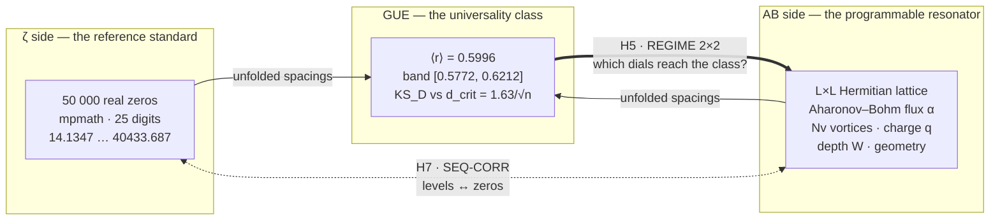
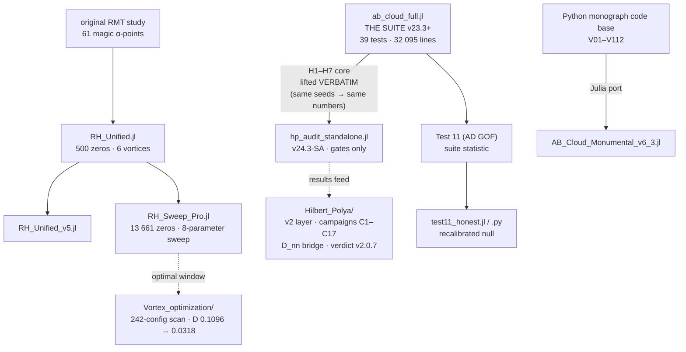

<picture>
  <source media="(prefers-color-scheme: dark)" srcset="assets/banner_dark.svg">
  
</picture>

# 🧭 Meridian Spectral Observatory

**Language / Язык:** [🇬🇧 English](README.md) · [🇷🇺 Русский](README.ru.md)

> **A standalone laboratory of 13 self-contained codes — 12 Julia benches and 1 Python audit —
> that watch spectra: lattice Aharonov–Bohm "cloud" Hamiltonians on one side, the zeros of the
> Riemann zeta function on the other, and the GUE universality class as the reference frame.
> One question beneath everything: the Hilbert–Pólya programme.**

<p>
  
  
  
  
  
  
  
  
</p>

> Author of all codes and research: **Isaev, Iskhak Khamzatovich** ·
> ORCID [0009-0003-7299-0701](https://orcid.org/0009-0003-7299-0701) ·
> DOI [10.5281/zenodo.21825394](https://doi.org/10.5281/zenodo.21825394) ·
> this folder is part of [`ab-cloud-research`](https://github.com/wild8highlander/ab-cloud-research)

---

## 🗂 Table of contents

<details open>
<summary><b>Expand / collapse</b></summary>

1. [⚡ What this is — in a nutshell](#-what-this-is--in-a-nutshell)
2. [🏛 The three pillars](#-the-three-pillars)
3. [🏆 Headline result — Gate H5](#-headline-result--gate-h5)
4. [🗺 Repository map — the 13 codes](#-repository-map--the-13-codes)
5. [🧬 How the codes relate](#-how-the-codes-relate)
6. [🚪 The seven HP gates](#-the-seven-hp-gates)
7. [🚀 Quick start](#-quick-start)
8. [⏱ Typical runtimes](#-typical-runtimes)
9. [📚 Full documentation](#-full-documentation)
10. [🛡 Honesty protocol](#-honesty-protocol)
11. [🔗 Related layers of the project](#-related-layers-of-the-project)
12. [📖 Citation](#-citation)

</details>

---

## ⚡ What this is — in a nutshell

The folder name is the mission statement. A **spectral observatory** is exactly what this is:
a bench of instruments pointed at three kinds of spectra, taking measurements night after night
(the changelogs read like an observation log — dated, versioned, honest about the weather).

- **The AB cloud** — a lattice quantum model: a Hermitian Hamiltonian on an `L×L` lattice whose
  hopping phases are deformed by **magnetic-flux vortices** (the Aharonov–Bohm effect, flux `α`
  per plaquette). Its eigenvalues are the "experimental material" — a programmable resonator
  whose dials (`Nv` vortex count, charge `q`, depth `W`, flux `α`, geometry, boundaries) span a
  whole landscape of 2D physics: from a rarefied Onsager gas to overlapping eddy fields to an
  Abrikosov vortex lattice.
- **The zeros of ζ(s)** — 50 000 real, computationally verified zeta zeros
  (`zeros50k.txt`, from γ₁ = 14.134725142 to γ₅₀₀₀₀ = 40433.687385462, `mpmath.zetazero`
  at 25 digits). The reference standard every instrument is calibrated against.
- **GUE statistics** — the Gaussian Unitary Ensemble (β = 2): the nearest-neighbour statistics
  the ζ zeros are known to follow (⟨r⟩ → 0.5996, project confidence band [0.5772, 0.6212]).
  The question every code circles around: **at which dial settings does the AB cloud join the
  zeros' universality class — and what else does it bring with it?**

Each file is a **standalone "supercombo" bench**: open it in Julia and you get an interactive
console menu with dozens of tests, plots, reports and a built-in self-check system. No external
project modules, no builds: copy one file — it works (or honestly tells you what is missing).
`julia> include("any_file.jl")` is the entire installation.

> **The Hilbert–Pólya programme in this folder.** The gates H1–H7 of `hp_audit_standalone.jl`
> measure, with positive controls and decoys, whether the cloud's spectrum carries the
> arithmetic of the primes (H1), the right counting law (H2), the right correlations (H7) —
> the necessary conditions any Hilbert–Pólya operator must satisfy. The companion layer
> [`Hilbert_Polya/`](../Hilbert_Polya/README.md) (campaign C3, correction v2.0.7) completes the
> level measurement: the gates sit at **D_nn 0.0079 — the level of the actual ζ-zero windows
> themselves** (shifted zero windows and the GUE zero class: 0.0079 ± 0.0005); the bit-level
> branch remains the open part (T18).

---

## 🏛 The three pillars



**Reading.** Both spectra are projected onto the same statistical screen (GUE). The H5 gate asks
*which vortex regime lands the cloud inside the class*; the H7 gate asks *whether the level
sequence itself correlates with the zeros*; the H1 gate asks *whether the prime numbers are
audible in the spectrum* (a Bragg comb at ω = log p, with composite decoys that must stay silent).

---

## 🏆 Headline result — Gate H5

**40 dense eigensolves of 5184×5184 matrices · 4 regimes × 7 realizations + α-profile · 46 minutes on a smartphone · 2026-09-09**

| Regime | Vortex density | Flux α | ⟨r⟩ | in GUE band | individual KS pass | median KS_D | Verdict |
|:---:|---|:---:|:---:|:---:|:---:|:---:|---|
| **A** baseline | Nv=4 (0.08%) | 0.5000 | 0.5898±0.0102 | 6/7 | 0/7 | 0.3531 | misses GUE |
| **B** monograph density | Nv=144=L²/36 (2.78%) | 0.5000 | 0.6000±0.0052 | 7/7 | 1/7 | 0.0559 | GUE reached — *OR-clause only* |
| **C** sharp flux | Nv=4 (0.08%) | 0.0278 | 0.5937±0.0041 | 7/7 | 0/7 | 0.0646 | GUE reached — *OR-clause only* |
| **D** combined | Nv=144=L²/36 (2.78%) | 0.0278 | 0.6003±0.0050 | 7/7 | **7/7** | **0.0148** | **GUE reached (clean)** |

**Reading.** GUE statistics recover in regimes B, C, D — but only the combination
**[D] = monograph density + sharp flux α = 25/900** passes *cleanly*: every single realization
passes the KS test at p > 0.01, and the median KS_D sits 2× below the critical value
d_crit = 1.63/√n ≈ 0.031. The published baseline regime [A] is a systematic outlier
(median D ≈ 0.35, worsening with L). The measured lesson — *the spectral distance is a pure
function of the vortex configuration* — is exactly what the companion
[`Vortex_optimization/`](../Vortex_optimization/README.md) scan quantifies at full scale
(D: 0.1096 → 0.0318 across the dial window, within 0.010 of the finite-sample GUE floor).

📎 Full interpretation: [docs/05_gate_H5_regimy.md](docs/05_gate_H5_regimy.md)

---

## 🗺 Repository map — the 13 codes

### 🧪 The verification suite — `ab_cloud_full.jl`

| File | Lines | What it is |
|---|---:|---|
| **`ab_cloud_full.jl`** | **32 095** | ⭐ **THE SUITE — supercombo v23.3+** (changelog through v3.3, 2026-09-19): the v23 core — **39 numbered tests** + Physics Lab + 3D Lab (sparse engine) × the v22 journal-grade plotting engine (`ABPlotV23`) × THREE-PASS Test 38 (38a + 38b hardcore + 38c ladder) × H1 deepen-protocol × H5 α-profile × decoy controls × presets FAST L=16 / FULL L=56. **NEW in v3.3 — TEST 39 “Geometry Sweep”**: Test 34 on 7 closed surfaces (torus, Klein bottle, pillow orbifold, cube sphere, Hurwitz PSL(2,7)/(2,8)/(2,13) magnetic Cayley graphs), big-matrix parity, values-only windowed diagonalization. Interactive menu, CLI flags, CSV/JSON/PNG reports, seeds fixed. |

> The suite's earlier evolution line (`ab_cloud_v19` → `ab_cloud_v23_v2`, the 23k–31k-line
> ancestors) is preserved in the parent repository:
> [`code/julia/`](../code/julia/) and [`verification/julia/`](../verification/julia/).
> This folder keeps the *current* supercombo.

### 🎯 HP·MERIDIAN — `hp_audit_standalone.jl` (v24.3-SA)

| File | Lines | What it is |
|---|---:|---|
| **`hp_audit_standalone.jl`** | **6087** | ⭐ Compact standalone audit of **gates H1–H7 only** — the Hilbert–Pólya hypothesis, nothing else. The core is lifted VERBATIM from the v23 supercombo (equal seeds → bit-identical numbers). H5 budget ≤ 40 diagonalizations (v24.1); the targeted **FOCUS-D** mode (`hp_regime_mode = :regime_d`, command `5d`, v24.2); live progress bar during LAPACK calls; 60 s heartbeat (v23.8); environment doctor; battery-cost estimator. Config profile: `p_myset.cfg`. |

### 🌀 RH line — maximizing the cloud ↔ zeros correlation

| File | Lines | What it is |
|---|---:|---|
| `RH_Unified.jl` | 1 885 | single self-contained file: 500 real ζ-zeros, 61 "magic" α-points, 6 vortices (hexagon), `RHConfig` (33 parameters), jitter, 4 vortex layouts, 9 presets |
| `RH_Unified_v5.jl` | 2 204 | evolution: extended presets and diagnostics |
| **`RH_Sweep_Pro.jl`** | **6 450** | ⭐ **professional parameter sweep**: 13 661 real ζ-zeros (`mpmath.zetazero`, 25 digits), dynamic sweep of 8 parameters over 10 key points, CSV/TXT(ASCII)/JSON reports, Plots.jl graphics, timing logs |

### 🏛 Monumental line — the monograph, re-derived in Julia

| File | Lines | What it is |
|---|---:|---|
| `AB_Cloud_Monumental_v6_3.jl` | 6 711 | module `AB_Cloud_Monumental` — a Julia port of the Python code base: **V01–V112 verifications** of the AB-Cloud monograph. `run_all()`, `run_all(quick=true)`, `run_only(["V11","V35"])`; clean CSV + JSON + PNG dashboard; optional Arpack.jl (large L) and Plots.jl |

### 🧰 Utilities, data, configuration

| File | Lines / Size | What it is |
|---|---:|---|
| `Magic_Alpha_Points_v1.jl` | 131 | library of **61 "magic" α-points**: π/30…π×5, √2…√15, rationals, φ, e, ln 2, 1/e, 1/π and specials — from the original RMT study of the AB cloud |
| `test11_honest.jl` | 322 | honest recalibration of Test 11 (Anderson–Darling GOF of ζ-zero spacings vs the Wigner surmise GUE β=2): removes the bootstrap artifact of ties; the null is built i.i.d. from `gue2_surmise_cdf` |
| `test11_honest.py` | 178 | the same protocol in Python (default input — `zeta_zeros_50k.txt`); verified to run: **A² = 61.49 vs the exact GUE CDF, honest MC p = 0.0005, H0 rejected at α = 0.05** — at n = 49 999 spacings the surmise is *distinguishable* from the zeros, which is exactly why the suite's KS acceptance bands are calibrated the way they are |
| `zeros50k.txt` | 50 000 lines | **50 000 real zeros of ζ(s)**, one per line: 14.134725142 … 40433.687385462 |
| `zeta_zeros_50k.txt` | 5 000 lines | the same 50 000 zeros, 10 per line (compact format for `test11_honest.py`) |
| `p_myset.cfg` | 37 lines | the "myset" configuration profile for HP·MERIDIAN: `hp_L=20`, ensemble 8, seed 2026, ladder lattice [16,20,24], showdown mode, … |

> Files with the **`_D`** suffix (`RH_Sweep_Pro_D.jl`, `RH_Unified_D.jl`,
> `AB_Cloud_Monumental_v6_3_D.jl`) are the same versions dressed in the
> **MERIDIAN DESIGN SYSTEM v1.0**: a unified console identity — double-frame banners,
> ◆-sections, ✓/✗/⚠ statuses, live ▰▰▰▱▱ progress bars, true-TTY colours.
> The physics and the numbers are **bit-identical**; only the console "clothing" changes.

---

## 🧬 How the codes relate



**Design principle — *supercombo, not library*.** Every bench is one file on purpose: no
`Project.toml`, no package resolution, no hidden dependency graph. The cost is duplication
(each `_D` file re-carries its twin); the payoff is that **any single file is a complete,
archival, reproducible instrument** — open it years later and it runs, or tells you honestly
what it lacks. For a research bench where provenance matters more than DRY, this is the right
trade-off.

---

## 🚪 The seven HP gates

| Gate | Name | What it measures |
|:---:|---|---|
| **H1** | PRIME-TRACE | the Bragg comb at ω = log p in the spectrum — do the *primes* leave a trace? composite decoy controls (21, 33, 54, 56) must stay silent; regime-matched null models; deepen protocol (P95 ceiling from 20+20 realizations) |
| **H2** | WEYL-DOS | the counting law N(E) — a ladder of Weyl / quantum-matrix-model fits with an AICc model showdown |
| **H3** | POWER-LAW | the exponent ladder — dictionary falsification against candidate power laws |
| **H4** | CRITICAL-Q | sharpness scan of the signal peak over the q-grid, with a domain guard: claimed criticals (0.3/0.5/1.0) must lie inside the scanned span, else an honest FAIL — no silent degradation |
| **H5** | REGIME 2×2 | the four-regime ensemble showdown (A/B/C/D) + α-profile: *finetuning vs plateau* — which dials reach GUE, and how robustly |
| **H6** | HERMIT-STRESS | self-adjointness and numerical stability under stress |
| **H7** | SEQ-CORR | the level sequence ↔ zero sequence correlation: sign/rank correlations of the unfolded fluctuation sequences — the direct Hilbert–Pólya witness (per correction v2.0.7: the level-matching verdict of the companion layer is **YES at the zeros' own level**, D_nn 0.0079; this gate measures the sequence-correlation branch) |

📎 The formulas, thresholds and verdict hierarchy for every gate:
[docs/04_fizika_matematika.md](docs/04_fizika_matematika.md)

---

## 🚀 Quick start

Requires [Julia](https://julialang.org) ≥ 1.10 (tested on 1.12; also runs on Termux/Android —
the headline H5 run was made on a smartphone). The main benches use **only the standard
library** — nothing to install.

```bash
# 1) THE SUITE — 39 tests, interactive menu, presets
julia -e 'include("ab_cloud_full.jl")'          # then: `f` = FAST preset (L=16)
                                                #       `F` = FULL preset (L=56)
                                                #       `38` = THREE-PASS Test 38
                                                #       `39` = geometry sweep (7 surfaces)

# 2) HP·MERIDIAN — the compact H1–H7 audit
julia -e 'include("hp_audit_standalone.jl")'    # then: `f` = FAST (L=72, 40-solve budget)
                                                #       `5` = gate H5 showdown
                                                #       `5d` = FOCUS-D (all budget → regime D)
                                                #       `z` = point to zeros50k.txt if not found

# 3) Monumental verifications V01–V112
julia -e 'include("AB_Cloud_Monumental_v6_3.jl"); AB_Cloud_Monumental.run_all(quick=true)'

# 4) The professional sweep (13 661 zeros)
julia -e 'include("RH_Sweep_Pro.jl")'

# 5) Honest Test 11 (Python — no Julia needed)
python3 test11_honest.py
```

<details>
<summary><b>🎯 Where the zeros files are looked up</b></summary>

The codes deliberately ship their own reference data. Lookup order:
`joinpath(@__DIR__, "zeros50k.txt")` (next to the script) → `joinpath(pwd(), "zeros50k.txt")`
(working directory) → the `HP_ZEROS` environment variable → the console command `z`
(interactive) → CLI `zeros=path`. If the file is missing, the ζ-hungry gates print an explicit
warning and continue *without the ζ side* — silent degradation is treated as a bug.

</details>

<details>
<summary><b>⌨️ Console cheat-sheet (HP·MERIDIAN)</b></summary>

| Key | Action |
|:---:|---|
| <kbd>f</kbd> / <kbd>F</kbd> | FAST (L=72, 40-solve budget) / FULL (L=56, deep) run |
| <kbd>1</kbd>–<kbd>7</kbd> | run gate H1 … H7 individually |
| <kbd>5d</kbd> | FOCUS-D — the entire H5 budget into regime D |
| <kbd>z</kbd> | set the zeros-file path interactively |
| <kbd>?</kbd> | environment doctor + battery-cost estimate |
| <kbd>q</kbd> | quit (report summary printed) |

</details>

---

## ⏱ Typical runtimes

(mid-range smartphone, Termux — the reference platform of this project)

| Run | Time |
|---|---|
| HP·MERIDIAN `:smoke` (L=20, validation) | ~ minutes |
| HP·MERIDIAN <kbd>f</kbd> FAST (L=72, H5 with the 40-solve budget) | **46 min** (measured 2026-09-09) |
| HP·MERIDIAN <kbd>F</kbd> FULL (L=56, deep) | hours |
| H5 single solve 64×64 (4096×4096 eigen) | ~ 49 s |
| H5 single solve 72×72 (5184×5184 eigen) | ~ 69 s |
| `test11_honest.py` | seconds |
| Suite FAST preset (L=16) | ~ 10 min |

> Each diagonalization is a dense `L²×L²` problem (L=72 → 5184×5184). Cost grows as ≈ L⁶,
> memory as ≈ L⁴. The suite's Test 39 switches to values-only windowed diagonalization
> (LAPACK `hetrd!` + chunked `stebz!`) to keep RAM at ~n²·16 B for the ~9216-site geometries.

---

## 📚 Full documentation

Eight documents in [`docs/`](docs/) (Russian; the tables and formulas are universal):

| # | Document | Contents |
|:---:|---|---|
| 01 | [Обзор проекта](docs/01_obzor_proekta.md) | what this is, the mission, the honesty philosophy |
| 02 | [Каталог кодов](docs/02_katalog_kodov.md) | every code annotated: purpose, entry points, menu map |
| 03 | [Руководство запуска](docs/03_rukovodstvo_zapuska.md) | installation, Termux, presets, CLI flags, troubleshooting |
| 04 | [Физика и математика](docs/04_fizika_matematika.md) | the Hamiltonian, vortex geometry, RMT statistics, all gate formulas and verdict rules |
| 05 | [Гейт H5: режимы](docs/05_gate_H5_regimy.md) | the 2×2 regime showdown, the A/B/C/D story, FOCUS-D |
| 06 | [Данные ζ-нулей](docs/06_dannye_zeta_nulej.md) | how the 50 000 zeros were computed, verified and are loaded |
| 07 | [Хронология версий](docs/07_hronologiya_versij.md) | the version log — every fix, every honesty patch |
| 08 | [Воспроизводимость](docs/08_reproduciuemost.md) | seeds, determinism, bit-level reproduction protocol |

---

## 🛡 Honesty protocol

The observatory's first law — **an honest verdict is worth more than a beautiful one** — is
enforced in code, not in prose:

1. **DONE-line prints the actual verdict** — the summary line cannot contradict the sub-check
   table (the v22 bug class, fixed in v23.6).
2. **No PASS over MARGINAL** — a sweep's mixed status enters the test's overall `ok`.
3. **Absent-with-confidence is PASS** for the deepen protocol (regime-stable emptiness at
   ≤ P95), not an oversight.
4. **A bump above P95 escalates to WARN** — pessimism is not the default; measurement is.
5. **The α-profile is headline, never scored** — it informs (finetuning vs plateau) but does
   not move the count.
6. **Every null is regime-matched** — vortex-free lattices, GUE matched-size matrices,
   composite decoys that *must* stay silent.
7. **Missing data degrades loudly** — without `zeros50k.txt` the ζ-side gates say so and skip.

<details>
<summary><b>📜 A few entries from the honesty log</b></summary>

- **v3.2 Patch A** — Test 34's ζ-side unfolding had a 2500-zero sliding window that lagged the
  log-growing density (a mixture artifact — the root cause of the pooled D = 0.1096).
  Predicted post-fix D = 0.03–0.06, *falsifiable before the run*.
- **v3.2 Patch C** — a cartesian `for i, j … break` exited **both** loops (Julia semantics):
  the R₂ histogram had silently held only i = 1 pairs. Found, fixed, logged.
- **v23.6 №1** — the "WARN over PASS" bug class eliminated: the DONE-line and the sub-check
  table can no longer disagree.
- **v23.8** — a 60-second heartbeat: long LAPACK calls can no longer look like a hang.
- **Julia 1.12 hotfix** — `Base.fd` stopped accepting Libuv streams; every gate died at
  00:00:00. Caught by the environment doctor, fixed same day.

</details>

---

## 🔗 Related layers of the project

This folder is the **standalone observatory** layer of
[`ab-cloud-research`](https://github.com/wild8highlander/ab-cloud-research). The bigger
programme lives around it:

| Layer | What it adds |
|---|---|
| [`Hilbert_Polya/`](../Hilbert_Polya/README.md) | the v2 research programme: campaigns C1–C17, theorems T1–T18, the **D_nn bridge measurement** (gates at the zeros' own level — verdict v2.0.7), bilingual monographs, infographics |
| [`Vortex_optimization/`](../Vortex_optimization/README.md) | the 242-configuration dial scan: the spectral distance to ζ is a pure function of the vortex configuration (D: 0.1096 → 0.0318, ×3.4, ~89% of the way to the GUE floor) |
| [`AB_Cloud_Quantum_Research/`](../AB_Cloud_Quantum_Research/README.md) | the parent study: V01–V19 campaigns, theorems Th1–Th6, pre-registered verdicts, the spinor study ES1–ES5 |
| [`lab-3d/`](../lab-3d/README.md) | the 3D branch: a 36³ non-Hermitian Hofstadter Hamiltonian, 5000 embedded zeros, the preprint |
| [`verification/`](../verification/README.md) | independent Julia verification of the suite's numbers |

---

## 📖 Citation

```bibtex
@software{isaev_meridian_2026,
  author  = {Isaev, Iskhak Khamzatovich},
  title   = {Meridian Spectral Observatory: standalone verification codes
             for the AB-Cloud and the Hilbert--P\'olya programme},
  year    = {2026},
  doi     = {10.5281/zenodo.21825394},
  url     = {https://github.com/wild8highlander/ab-cloud-research}
}
```

Citation metadata: [`CITATION.cff`](CITATION.cff) · zeros data: Odlyzko-verified first zero,
`mpmath.zetazero` at 25 digits · banner: `assets/banner_{light,dark}.svg` (animated SVG,
generated by the project's own tooling).

---

<p align="center">
  
</p>

<p align="center">
  <sub><i>Zeros are measured, not typed. — the observatory's epistemology</i></sub>
</p>
