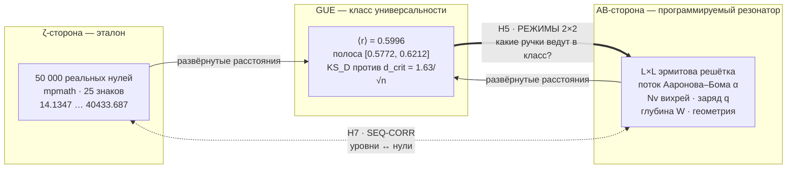
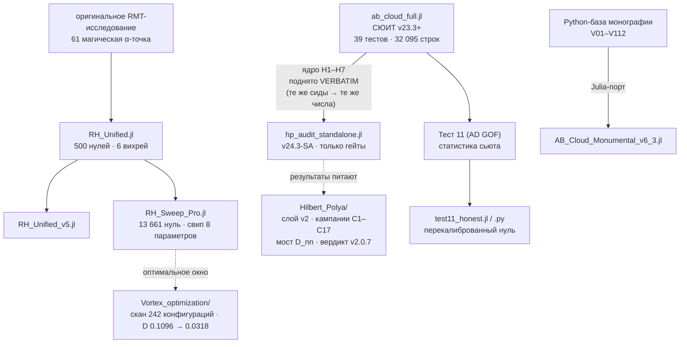

<picture>
  <source media="(prefers-color-scheme: dark)" srcset="assets/banner_dark.svg">
  
</picture>

# 🧭 MERIDIAN SPECTRAL OBSERVATORY

**Язык / Language:** [🇬🇧 English](README.md) · [🇷🇺 Русский](README.ru.md)

> **Автономная лаборатория из 13 самодостаточных кодов — 12 Julia-стендов и 1 Python-аудита —
> которая наблюдает за спектрами: решёточные гамильтонианы Ааронова–Бома («AB-облако») с одной
> стороны, нули дзета-функции Римана с другой, и класс универсальности GUE как система отсчёта.
> Подо всем — один вопрос: программа Гильберта–Пойа.**

<p>
  
  
  
  
  
  
  
  
</p>

> Автор всех кодов и исследований: **Исаев Исхак Хамзатович** ·
> ORCID [0009-0003-7299-0701](https://orcid.org/0009-0003-7299-0701) ·
> DOI [10.5281/zenodo.21825394](https://doi.org/10.5281/zenodo.21825394) ·
> эта папка — часть репозитория [`ab-cloud-research`](https://github.com/wild8highlander/ab-cloud-research)

---

## 🗂 Содержание

<details open>
<summary><b>Развернуть / свернуть</b></summary>

1. [⚡ Что это такое — в двух словах](#-что-это-такое--в-двух-словах)
2. [🏛 Три кита проекта](#-три-кита-проекта)
3. [🏆 Главный результат — гейт H5](#-главный-результат--гейт-h5)
4. [🗺 Карта репозитория — 13 кодов](#-карта-репозитория--13-кодов)
5. [🧬 Как коды связаны между собой](#-как-коды-связаны-между-собой)
6. [🚪 Семь HP-гейтов](#-семь-hp-гейтов)
7. [🚀 Быстрый старт](#-быстрый-старт)
8. [⏱ Типичные времена работы](#-типичные-времена-работы)
9. [📚 Полная документация](#-полная-документация)
10. [🛡 Протокол честности](#-протокол-честности)
11. [🔗 Слои большого проекта](#-слои-большого-проекта)
12. [📖 Как цитировать](#-как-цитировать)

</details>

---

## ⚡ Что это такое — в двух словах

Название папки — это и есть миссия. **Спектральная обсерватория**: набор инструментов,
направленных на три вида спектров и ведущих измерения ночь за ночью (ченджлоги читаются как
журнал наблюдений — датированные, версионируемые, честные про погоду).

- **AB-облако** — решёточная квантовая модель: эрмитов гамильтониан на решётке `L×L`, фазы
  перескоков которого деформированы **вихрями магнитного потока** (эффект Ааронова–Бома,
  поток `α` на плакет). Его собственные значения — «экспериментальный материал»:
  программируемый резонатор, ручки которого (`Nv` — число вихрей, заряд `q`, глубина `W`,
  поток `α`, геометрия, границы) накрывают целый ландшафт двумерной физики — от разреженного
  газа Онзагера до перекрывающихся полей вихрей и решётки Абрикосова.
- **Нули ζ(s)** — 50 000 реальных, вычислительно верифицированных нулей дзета-функции
  (`zeros50k.txt`, от γ₁ = 14.134725142 до γ₅₀₀₀₀ = 40433.687385462, `mpmath.zetazero`
  с 25 знаками). Эталон, по которому калибруется каждый инструмент.
- **Статистика GUE** — гауссов унитарный ансамбль (β = 2): статистика соседних уровней,
  которой подчиняются нули ζ (⟨r⟩ → 0.5996, проектная полоса [0.5772, 0.6212]). Вопрос,
  вокруг которого крутится каждый код: **при каких настройках ручек AB-облако входит в класс
  универсальности нулей — и что оно приносит с собой ещё?**

Каждый файл — это **автономный «суперкомбо»-стенд**: открываете один файл в Julia — получаете
консольное меню с десятками тестов, графиками, отчётами и встроенной самопроверкой. Никаких
внешних модулей проекта, никаких сборок: скопировали файл — работает (или честно скажет,
чего не хватает). `julia> include("любой_файл.jl")` — вот и вся установка.

> **Программа Гильберта–Пойа в этой папке.** Гейты H1–H7 кода `hp_audit_standalone.jl`
> измеряют — с позитивными контролями и декоями — несёт ли спектр облака арифметику простых
> чисел (H1), правильный закон подсчёта (H2), правильные корреляции (H7) — необходимые
> условия любого оператора Гильберта–Пойа. Слой-компаньон
> [`Hilbert_Polya/`](../Hilbert_Polya/README.md) (кампания C3, коррекция v2.0.7) дополняет
> измерение уровней: затворы находятся на **D_nn 0.0079 — уровне самих окон ζ-нулей**
> (сдвинутые окна нулей и GUE-класс нулей: 0.0079 ± 0.0005); битовая ветвь остаётся открытой
> (T18).

---

## 🏛 Три кита проекта



**Чтение.** Оба спектра проецируются на один статистический экран (GUE). Гейт H5 спрашивает,
*какой вихревой режим приводит облако в класс*; гейт H7 — *коррелирует ли сама
последовательность уровней с нулями*; гейт H1 — *слышны ли в спектре простые числа*
(Брэгг-гребень на ω = log p, с композитными декоями, обязанными молчать).

---

## 🏆 Главный результат — гейт H5

**40 плотных диагонализаций матриц 5184×5184 · 4 режима × 7 реализаций + α-профиль · 46 минут на смартфоне · 2026-09-09**

| Режим | Плотность вихрей | Поток α | ⟨r⟩ | в полосе GUE | индинвиду. KS-проход | медиана KS_D | Вердикт |
|:---:|---|:---:|:---:|:---:|:---:|:---:|---|
| **A** базовый | Nv=4 (0.08%) | 0.5000 | 0.5898±0.0102 | 6/7 | 0/7 | 0.3531 | мимо GUE |
| **B** плотность монографии | Nv=144=L²/36 (2.78%) | 0.5000 | 0.6000±0.0052 | 7/7 | 1/7 | 0.0559 | GUE достигнут — *только OR-ветвь* |
| **C** острый поток | Nv=4 (0.08%) | 0.0278 | 0.5937±0.0041 | 7/7 | 0/7 | 0.0646 | GUE достигнут — *только OR-ветвь* |
| **D** комбинированный | Nv=144=L²/36 (2.78%) | 0.0278 | 0.6003±0.0050 | 7/7 | **7/7** | **0.0148** | **GUE достигнут (чисто)** |

**Чтение.** Статистика GUE восстанавливается в режимах B, C, D — но только комбинация
**[D] = плотность монографии + острый поток α = 25/900** проходит *чисто*: каждая реализация
проходит KS-тест при p > 0.01, медиана KS_D вдвое ниже критического порога
d_crit = 1.63/√n ≈ 0.031. Опубликованный базовый режим [A] — систематический выброс
(медиана D ≈ 0.35, ухудшается с ростом L). Измеренный урок — *спектральная дистанция есть
чистая функция конфигурации вихрей* — в полном масштабе квантифицируется соседним сканом
[`Vortex_optimization/`](../Vortex_optimization/README_RU.md)
(D: 0.1096 → 0.0318 по окну ручек, в 0.010 от пола конечной выборки GUE).

📎 Полная интерпретация: [docs/05_gate_H5_regimy.md](docs/05_gate_H5_regimy.md)

---

## 🗺 Карта репозитория — 13 кодов

### 🧪 Верификационный сюит — `ab_cloud_full.jl`

| Файл | Строк | Что это |
|---|---:|---|
| **`ab_cloud_full.jl`** | **32 095** | ⭐ **СЮИТ — суперкомбо v23.3+** (ченджлог до v3.3, 2026-09-19): ядро v23 — **39 нумерованных тестов** + Physics Lab + 3D Lab (разреженный движок) × графический движок журнального класса v22 (`ABPlotV23`) × трёхпроходный Тест 38 (38a + 38b hardcore + 38c ladder) × deepen-протокол H1 × α-профиль H5 × декои × пресеты FAST L=16 / FULL L=56. **Новое в v3.3 — ТЕСТ 39 «свип геометрий»**: Тест 34 на 7 замкнутых поверхностях (тор, бутылка Кляйна, подушкообразная орбифолдная, куб-сфера, гурвицевы PSL(2,7)/(2,8)/(2,13) — магнитные графы Кэли), паритет больших матриц, оконная диагонализация только значений. Интерактивное меню, CLI-флаги, отчёты CSV/JSON/PNG, фиксированные сиды. |

> Ранняя линия эволюции сюита (`ab_cloud_v19` → `ab_cloud_v23_v2`, предки на 23–31 тыс. строк)
> сохранена в родительском репозитории: [`code/julia/`](../code/julia/) и
> [`verification/julia/`](../verification/julia/). В этой папке живёт *актуальное* суперкомбо.

### 🎯 HP·MERIDIAN — `hp_audit_standalone.jl` (v24.3-SA)

| Файл | Строк | Что это |
|---|---:|---|
| **`hp_audit_standalone.jl`** | **6087** | ⭐ Компактный автономный аудит **только гейтов H1–H7** — гипотеза Гильберта–Пойа и ничего больше. Ядро поднято VERBATIM из суперкомбо v23 (равные сиды → бит-в-бит те же числа). Бюджет H5 ≤ 40 диагонализаций (v24.1); прицельный режим **FOCUS-D** (`hp_regime_mode = :regime_d`, команда `5d`, v24.2); живой прогресс-бар во время вызовов LAPACK; 60-секундный пульс (v23.8); окруженческий доктор; оценка стоимости батареи. Профиль конфигурации: `p_myset.cfg`. |

### 🌀 RH-линейка — максимизация корреляции облако ↔ нули

| Файл | Строк | Что это |
|---|---:|---|
| `RH_Unified.jl` | 1 885 | один самодостаточный файл: 500 реальных ζ-нулей, 61 «магическая» α-точка, 6 вихрей (гексагон), `RHConfig` (33 параметра), джиттер, 4 раскладки вихрей, 9 пресетов |
| `RH_Unified_v5.jl` | 2 204 | эволюция: расширенные пресеты и диагностика |
| **`RH_Sweep_Pro.jl`** | **6 450** | ⭐ **профессиональный параметрический свип**: 13 661 реальный ζ-нуль (`mpmath.zetazero`, 25 знаков), динамический свип 8 параметров по 10 ключевым точкам, отчёты CSV/TXT(ASCII)/JSON, графика Plots.jl, логи времени |

### 🏛 Монументальная линейка — монография, переизложенная на Julia

| Файл | Строк | Что это |
|---|---:|---|
| `AB_Cloud_Monumental_v6_3.jl` | 6 711 | модуль `AB_Cloud_Monumental` — Julia-порт Python-базы: **верификации V01–V112** монографии AB-Cloud. `run_all()`, `run_all(quick=true)`, `run_only(["V11","V35"])`; чистые отчёты CSV + JSON + PNG-дашборд; опциональные Arpack.jl (большие L) и Plots.jl |

### 🧰 Утилиты, данные, конфигурация

| Файл | Строк / размер | Что это |
|---|---:|---|
| `Magic_Alpha_Points_v1.jl` | 131 | библиотека **61 «магической» α-точки**: π/30…π×5, √2…√15, рациональные, φ, e, ln 2, 1/e, 1/π и специальные — из оригинального RMT-исследования AB-облака |
| `test11_honest.jl` | 322 | честная перекалибровка Теста 11 (критерий Андерсона–Дарлинга для расстояний ζ-нулей против сюрпрайза Вигнера GUE β=2): убирает бутстреп-артефакт связок; нуль строится i.i.d. из `gue2_surmise_cdf` |
| `test11_honest.py` | 178 | тот же протокол на Python (вход по умолчанию — `zeta_zeros_50k.txt`); проверен запуском: **A² = 61.49 против точной GUE-CDF, честный MC p = 0.0005, H0 отвергнут при α = 0.05** — на n = 49 999 расстояниях сюрпрайз *отличим* от нулей, чем и объясняется калибровка KS-полос сьюта |
| `zeros50k.txt` | 50 000 строк | **50 000 реальных нулей ζ(s)**, по одному в строке: 14.134725142 … 40433.687385462 |
| `zeta_zeros_50k.txt` | 5 000 строк | те же 50 000 нулей, по 10 в строке (компактный формат для `test11_honest.py`) |
| `p_myset.cfg` | 37 строк | профиль конфигурации «myset» для HP·MERIDIAN: `hp_L=20`, ансамбль 8, сид 2026, лестница решёток [16,20,24], режим showdown и т.д. |

> Файлы с суффиксом **`_D`** (`RH_Sweep_Pro_D.jl`, `RH_Unified_D.jl`,
> `AB_Cloud_Monumental_v6_3_D.jl`) — те же версии, одетые в **MERIDIAN DESIGN SYSTEM v1.0**:
> единая консольная айдентика — двойные рамки-баннеры, ◆-секции, статусы ✓/✗/⚠, живые
> ▰▰▰▱▱ прогресс-бары, true-TTY-цвета. Физика и числа — **бит-в-бит идентичны**;
> меняется только «одежда» консоли.

---

## 🧬 Как коды связаны между собой



**Принцип дизайна — *суперкомбо, а не библиотека*.** Каждый стенд — один файл, и это сделано
нарочно: ни `Project.toml`, ни разрешения пакетов, ни скрытого графа зависимостей. Плата —
дублирование (каждый `_D`-файл несёт своего двойника); выигрыш — **любой одиночный файл есть
полный, архивный, воспроизводимый инструмент**: откройте его спустя годы — он запустится или
честно скажет, чего ему не хватает. Для исследовательского стенда, где провенанс важнее DRY,
это правильный размен.

---

## 🚪 Семь HP-гейтов

| Гейт | Имя | Что измеряет |
|:---:|---|---|
| **H1** | PRIME-TRACE | Брэгг-гребень на ω = log p в спектре — оставляют ли *простые числа* след? композитные декои (21, 33, 54, 56) обязаны молчать; режимно-согласованные нуль-модели; deepen-протокол (потолок P95 из 20+20 реализаций) |
| **H2** | WEYL-DOS | закон подсчёта N(E) — лестница фитов Вейля / квантовых матричных моделей с AICc-состязанием моделей |
| **H3** | POWER-LAW | лестница показателей — фальсификация по словарю кандидатов-степенных законов |
| **H4** | CRITICAL-Q | скан резкости сигнального пика по сетке q с guard'ом домена: заявленные критические (0.3/0.5/1.0) обязаны лежать в сканируемом пролёте, иначе честный FAIL — молчаливая деградация исключена |
| **H5** | REGIME 2×2 | соревнование ансамблей четырёх режимов (A/B/C/D) + α-профиль: *подстройка против плато* — какие ручки ведут в GUE и насколько устойчиво |
| **H6** | HERMIT-STRESS | самосопряжённость и численная устойчивость под нагрузкой |
| **H7** | SEQ-CORR | корреляция «последовательность уровней ↔ последовательность нулей»: знаковые/ранговые корреляции развёрнутых флуктуационных последовательностей — прямой свидетель Гильберта–Пойа (по коррекции v2.0.7: вердикт совпадения уровней у слоя-компаньона — **ДА на уровне самих нулей**, D_nn 0.0079; этот гейт измеряет ветвь последовательностных корреляций) |

📎 Формулы, пороги и иерархия вердиктов всех гейтов:
[docs/04_fizika_matematika.md](docs/04_fizika_matematika.md)

---

## 🚀 Быстрый старт

Нужна [Julia](https://julialang.org) ≥ 1.10 (проверено на 1.12; работает и на Termux/Android —
головной прогон H5 сделан на смартфоне). Главные стенды используют **только стандартную
библиотеку** — ставить нечего.

```bash
# 1) СЮИТ — 39 тестов, интерактивное меню, пресеты
julia -e 'include("ab_cloud_full.jl")'          # далее: `f` = пресет FAST (L=16)
                                                #       `F` = пресет FULL (L=56)
                                                #       `38` = трёхпроходный Тест 38
                                                #       `39` = свип геометрий (7 поверхностей)

# 2) HP·MERIDIAN — компактный аудит H1–H7
julia -e 'include("hp_audit_standalone.jl")'    # далее: `f` = FAST (L=72, бюджет 40 солвов)
                                                #       `5` = гейт H5, showdown
                                                #       `5d` = FOCUS-D (весь бюджет → режим D)
                                                #       `z` = указать zeros50k.txt, если не нашёлся

# 3) Монументальные верификации V01–V112
julia -e 'include("AB_Cloud_Monumental_v6_3.jl"); AB_Cloud_Monumental.run_all(quick=true)'

# 4) Профессиональный свип (13 661 нуль)
julia -e 'include("RH_Sweep_Pro.jl")'

# 5) Честный Тест 11 (Python — Julia не нужен)
python3 test11_honest.py
```

<details>
<summary><b>🎯 Где ищутся файлы нулей</b></summary>

Коды намеренно возят свои эталонные данные с собой. Порядок поиска:
`joinpath(@__DIR__, "zeros50k.txt")` (рядом со скриптом) → `joinpath(pwd(), "zeros50k.txt")`
(рабочий каталог) → переменная окружения `HP_ZEROS` → консольная команда `z`
(интерактивно) → CLI `zeros=path`. Если файл не найден — ζ-зависимые гейты печатают явное
предупреждение и продолжают *без ζ-стороны*: молчаливая деградация считается багом.

</details>

<details>
<summary><b>⌨️ Шпаргалка консоли (HP·MERIDIAN)</b></summary>

| Клавиша | Действие |
|:---:|---|
| <kbd>f</kbd> / <kbd>F</kbd> | прогон FAST (L=72, бюджет 40 солвов) / FULL (L=56, глубокий) |
| <kbd>1</kbd>–<kbd>7</kbd> | запустить гейт H1 … H7 по отдельности |
| <kbd>5d</kbd> | FOCUS-D — весь бюджет H5 в режим D |
| <kbd>z</kbd> | интерактивно задать путь к файлу нулей |
| <kbd>?</kbd> | окруженческий доктор + оценка стоимости батареи |
| <kbd>q</kbd> | выход (печатается сводка отчёта) |

</details>

---

## ⏱ Типичные времена работы

(средний смартфон, Termux — референсная платформа проекта)

| Прогон | Время |
|---|---|
| HP·MERIDIAN `:smoke` (L=20, валидация) | ~ минуты |
| HP·MERIDIAN <kbd>f</kbd> FAST (L=72, H5 с бюджетом 40 солвов) | **46 мин** (измерено 2026-09-09) |
| HP·MERIDIAN <kbd>F</kbd> FULL (L=56, глубокий) | часы |
| Один солв H5 64×64 (собственные значения 4096×4096) | ~ 49 с |
| Один солв H5 72×72 (5184×5184) | ~ 69 с |
| `test11_honest.py` | секунды |
| Пресет FAST сьюта (L=16) | ~ 10 мин |

> Каждая диагонализация — плотная задача `L²×L²` (L=72 → 5184×5184). Стоимость растёт как
> ≈ L⁶, память как ≈ L⁴. Тест 39 сьюта переключается на оконную диагонализацию только
> значений (LAPACK `hetrd!` + чанковый `stebz!`), удерживая память в ~n²·16 Б на геометриях
> с ~9216 узлами.

---

## 📚 Полная документация

Восемь документов в [`docs/`](docs/) (русские; таблицы и формулы универсальны):

| № | Документ | Содержание |
|:---:|---|---|
| 01 | [Обзор проекта](docs/01_obzor_proekta.md) | что это, миссия, философия честности |
| 02 | [Каталог кодов](docs/02_katalog_kodov.md) | каждый код с аннотацией: назначение, точки входа, карта меню |
| 03 | [Руководство запуска](docs/03_rukovodstvo_zapuska.md) | установка, Termux, пресеты, CLI-флаги, траблшутинг |
| 04 | [Физика и математика](docs/04_fizika_matematika.md) | гамильтониан, геометрия вихрей, RMT-статистика, формулы всех гейтов и правила вердиктов |
| 05 | [Гейт H5: режимы](docs/05_gate_H5_regimy.md) | соревнование режимов 2×2, история A/B/C/D, FOCUS-D |
| 06 | [Данные ζ-нулей](docs/06_dannye_zeta_nulej.md) | как 50 000 нулей вычислены, верифицированы и загружаются |
| 07 | [Хронология версий](docs/07_hronologiya_versij.md) | журнал версий — каждый фикс, каждый патч честности |
| 08 | [Воспроизводимость](docs/08_reproduciuemost.md) | сиды, детерминизм, протокол бит-в-бит воспроизведения |

---

## 🛡 Протокол честности

Первый закон обсерватории — **честный вердикт ценнее красивого** — enforced в коде,
а не в прозе:

1. **DONE-line печатает фактический вердикт** — строка итога не может противоречить таблице
   под-чеков (класс багов v22, исправлен в v23.6).
2. **Никакого PASS поверх MARGINAL** — смешанный статус свипа входит в общий `ok` теста.
3. **Отсутствие с уверенностью — это PASS** для deepen-протокола (режимно-устойчивая пустота
   на ≤ P95), а не «недосмотр».
4. **Бугорок выше P95 эскалируется в WARN** — пессимизм не по умолчанию; по умолчанию —
   измерение.
5. **α-профиль — headline, никогда не scored** — информирует (подстройка против плато), но не
   двигает счёт.
6. **Каждый нуль — режимно-согласован** — решётки без вихрей, GUE-матрицы того же размера,
   композитные декои, обязанные молчать.
7. **Отсутствие данных деградирует громко** — без `zeros50k.txt` ζ-гейты сообщают об этом и
   пропускают свою ζ-сторону.

<details>
<summary><b>📜 Пара записей из журнала честности</b></summary>

- **v3.2 Патч A** — у ζ-стороны Теста 34 скользящее окно на 2500 нулей отставало от
  логарифмически растущей плотности (артефакт смеси — корневая причина pooled D = 0.1096).
  Прогноз после фикса: D = 0.03–0.06, *фальсифицируем до прогона*.
- **v3.2 Патч C** — картезианский `for i, j … break` выходил из **обоих** циклов (семантика
  Julia): гистограмма R₂ молча держала только пары с i = 1. Найдено, исправлено,
  зафиксировано.
- **v23.6 №1** — класс багов «WARN поверх PASS» устранён: DONE-line и таблица под-чеков
  больше не могут расходиться.
- **v23.8** — 60-секундный пульс: долгие вызовы LAPACK больше не выглядят как зависание.
- **Хотфикс Julia 1.12** — `Base.fd` перестал принимать Libuv-стримы; каждый гейт умирал в
  00:00:00. Поймано окруженческим доктором, исправлено в тот же день.

</details>

---

## 🔗 Слои большого проекта

Эта папка — **автономный слой-обсерватория** репозитория
[`ab-cloud-research`](https://github.com/wild8highlander/ab-cloud-research). Большая программа
живёт вокруг:

| Слой | Что добавляет |
|---|---|
| [`Hilbert_Polya/`](../Hilbert_Polya/README.ru.md) | исследовательская программа v2: кампании C1–C17, теоремы T1–T18, **измерение моста D_nn** (затворы на уровне самих нулей — вердикт v2.0.7), двуязычные монографии, инфографика |
| [`Vortex_optimization/`](../Vortex_optimization/README_RU.md) | скан 242 конфигураций: спектральная дистанция до ζ — чистая функция конфигурации вихрей (D: 0.1096 → 0.0318, ×3.4, ~89% пути к полу GUE) |
| [`AB_Cloud_Quantum_Research/`](../AB_Cloud_Quantum_Research/README.ru.md) | родительское исследование: кампании V01–V19, теоремы Th1–Th6, пред-регистрированные вердикты, спинорное исследование ES1–ES5 |
| [`lab-3d/`](../lab-3d/README.md) | 3D-ветвь: неэрмитов гамильтониан Хофштедтера 36³, 5000 вложенных нулей, препринт |
| [`verification/`](../verification/README.md) | независимая Julia-верификация чисел сьюта |

---

## 📖 Как цитировать

```bibtex
@software{isaev_meridian_2026,
  author  = {Isaev, Iskhak Khamzatovich},
  title   = {Meridian Spectral Observatory: standalone verification codes
             for the AB-Cloud and the Hilbert--P\'olya programme},
  year    = {2026},
  doi     = {10.5281/zenodo.21825394},
  url     = {https://github.com/wild8highlander/ab-cloud-research}
}
```

Метаданные цитирования: [`CITATION.cff`](CITATION.cff) · данные нулей: первый нуль
Odlyzko-verified, `mpmath.zetazero` с 25 знаками · баннер:
`assets/banner_{light,dark}.svg` (анимированный SVG, сгенерирован собственными
инструментами проекта).

---

<p align="center">
  
</p>

<p align="center">
  <sub><i>Нули измеряются, а не впечатываются. — эпистемология обсерватории</i></sub>
</p>
