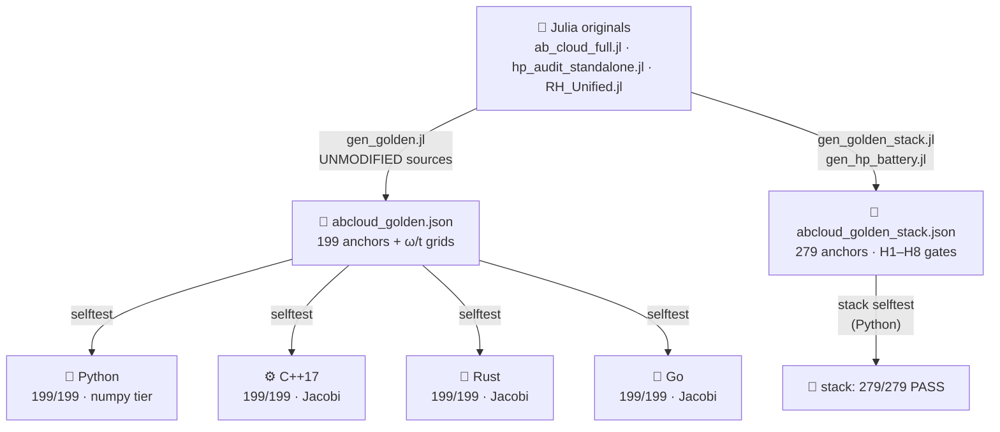

<div align="center">


# 🌍 AB-Cloud Multi-Language Ports

**One computational kernel — 84,000 lines of Julia, nine files, three suites —
rebuilt in Python, C++17, Rust and Go, and verified against a single committed
golden file generated from the unmodified Julia originals.**

*Golden parity · bit-matched MT19937 · honest tolerances · every deviation documented*

<picture>
  <source media="(prefers-color-scheme: dark)" srcset="https://readme-typing-svg.demolab.com?font=Fira+Code&size=15&pause=1400&color=E8DDB8&center=true&vCenter=true&random=false&width=700&height=34&lines=One+kernel%3A+9+Julia+files+%C2%B7+84+000+lines%3BFour+ports%3A+Python+%C2%B7+C%2B%2B17+%C2%B7+Rust+%C2%B7+Go%3B199+golden+anchors%2C+MT19937+bit-matched%3Bselftest+199%2F199+in+every+language">
  
</picture>

[](#-the-ports-cast)
[](#-verification-ledger)
[](#-verification-ledger)
[](#-the-golden-system)
[](#-the-golden-system)
[](PORT_SPEC.md)
[](#-provenance--license)

[Cast](#-the-ports-cast) · [Ledger](#-verification-ledger) · [Quick start](#-quick-start) · [Golden](#-the-golden-system) · [§8 tier](#8-vector-tier--the-numpylapack-tier) · [Theorems](#-exact-theorems-verified-against-the-original) · [Deviations](#-documented-port-deviations) · [Layout](#-layout)

</div>

---


## 🌍 The ports cast

<div align="center">


</div>

Four programs, one contract. Every port re-implements the same computational
kernel — the lattice Aharonov–Bohm "cloud" Hamiltonians, the full GOF/RMT
statistics stack, the Hilbert–Pólya H1 detector and the b(N)/Gram/Gram-point
scalar engines — and every port is **verified the same way**: it recomputes the
reference numbers from [`ports/golden/abcloud_golden.json`](golden/abcloud_golden.json)
(a file of anchors generated from the **unmodified** Julia originals by
[`golden/gen_golden.jl`](golden/gen_golden.jl)) and prints a PASS/FAIL verdict
per anchor. No port is trusted because it looks right; it is trusted because it
reproduces the Julia numbers inside documented tolerances.

| Port | Entry | Style | Golden selftest | Suite (25 portable tests) |
|---|---|---|---|---|
| 🐍 **Python 3.8+** | [`python/abcloud/`](python/README.md) | package, numpy/LAPACK tier | **199/199 PASS** (~57 s) | 19 PASS · 0 FAIL · 3 WARN · 3 INFO |
| ⚙️ **C++17** | [`cpp/abcloud_port.cpp`](cpp/README.md) | single file, own Jacobi eigensolver | **199/199 PASS** (~0.6 s) | 19 PASS · 0 FAIL · 3 WARN · 3 INFO |
| 🦀 **Rust** | [`rust/src/main.rs`](rust/README.md) | single file, `std` only | **199/199 PASS** (~1 s) | 19 PASS · 0 FAIL · 3 WARN · 3 INFO |
| 🐹 **Go** | [`go/main.go`](go/README.md) | single file, `std` only | **199/199 PASS** (~0.8 s) | 20 PASS · 0 FAIL · 2 WARN · 3 INFO |



> [!IMPORTANT]
> **The golden file is the only source of truth.** No "known correct values"
> from documentation, papers or memory are part of the contract — if a number
> is not in `abcloud_golden.json`, no port is allowed to test against it. The
> generator (`gen_golden.jl`) includes the original Julia sources unmodified
> and runs every section through them; the JSON is written with `%.17g`
> precision so every anchor round-trips exactly.

## ✅ Verification ledger

Reproducible verdicts, not claims. Run `selftest` in any port and you get the
same table; the numbers below were produced on a single reference machine
(one core, no SIMD tricks) and are re-verified on every change.

| Check | Python | C++17 | Rust | Go |
|---|---|---|---|---|
| **Base golden selftest** (199 anchors: scalars, GOF, RMT tables, lattice theorems, §8 vectors) | ✅ 199/199 | ✅ 199/199 | ✅ 199/199 | ✅ 199/199 |
| Wall time, `selftest` | ~57 s | ~0.6 s | ~1 s | ~0.8 s |
| **§8 vector tier** (mon_entropy · topo_tee · rh_metrics) | ✅ via `numpy.linalg.eigh` | ✅ via own Jacobi + vectors | ✅ via own Jacobi + vectors | ✅ via own Jacobi + vectors |
| **Stack tier** (`abcloud_golden_stack.json`: HP gates H1–H8, RH SP/v5, Monumental gallery) | ✅ **279/279 anchors** (~89 s) | — | — | — |
| Portable suite of the 39-test battery | 25 tests | 25 tests | 25 tests | 25 tests |
| MT19937 window sampling | bit-identical | bit-identical | bit-identical | bit-identical |

- The **base tier** is 199 anchors = 133 historical + 66 of the §8 vector tier
  (three degeneracy-safe open scenarios × entropy/IPR/TEE/KS/⟨r⟩ observables).
- The **stack tier** is Python-only for now: `abcloud.stack_golden` recomputes
  the whole `abcloud_golden_stack.json` — the eight Hilbert–Pólya gates H1–H8
  (1:1 port of `hp_audit_standalone.jl`'s numeric surface in
  [`python/abcloud/hp_standalone.py`](python/abcloud/hp_standalone.py)), the
  RH_Sweep_Pro SP/v5 metrics and the Monumental gallery — and passes with
  **279/279 anchors, 0 sections skipped**. Provenance tiers: bit-exact for the
  MT19937 kernels (rng_semantics, rh_\*, mon_\*), honest 1e-5…1e-3 tolerance
  for the HP gates (L≤24 LAPACK eigenvalues enter the detector chains).
- The 14 non-portable suite tests print an honest `[SKIP]` with a reason —
  graphics, specialized protocols, dSFMT-dependent disorder — and are counted
  as neither PASS nor FAIL.

## 🚀 Quick start

```bash
# Python — no install, run from ports/python/
cd ports/python && python3 -m abcloud selftest && python3 -m abcloud zeros --n 2000

# C++ — one file, one command
cd ports/cpp && g++ -O2 -std=c++17 -o abcloud abcloud_port.cpp && ./abcloud selftest

# Rust — std only, no dependencies
cd ports/rust && cargo build --release && ./target/release/abcloud selftest

# Go — std only, no dependencies
cd ports/go && go build -o abcloud . && ./abcloud selftest
```

Every selftest recomputes all 199 anchors from the committed golden JSON —
no network, no downloads, no Julia required. The zeros file
`zeros50k.txt` (50,000 Odlyzko zeros, already in the meridian root) is picked
up relative to the executable/package; the embedded scenario grids ω (726
points) and t (30 points) ship inside the golden JSON, so no port ever
re-derives a grid locally.

### CLI — identical across all four languages

```
selftest                      — golden parity check against the Julia originals (199 checks)
zeros  [--data P] [--n N]     — full zero-analysis battery
                                (KS / CvM / A² / χ² / <r> / Σ² / Δ₃ / K(t) / H1-SNR)
suite  [--test N|all]         — portable subset of the 39-test suite
ham                           — §8 vector tier: entropy/TEE/IPR/RH metrics of
                                three degeneracy-safe scenarios
bN     --N n… [--offset k]    — the b(N) statistic
gram   --n n…                 — Gram points
test11 --mc N --seed S        — honest Anderson–Darling test + MC null
hp     [--data P] [--n N]     — H1 primary detector (Bragg peaks at ω = log p)
sweep  --N n…                  — b(N) ladder sweep
```

## 🥞 The golden system

* [`golden/gen_golden.jl`](golden/gen_golden.jl) includes the **unmodified**
  originals (`ab_cloud_full.jl` and friends), runs every section and writes
  JSON with `%.17g` — the base 199 anchors plus the ω/t grids.
* [`golden/gen_golden_stack.jl`](golden/gen_golden_stack.jl) +
  [`golden/gen_hp_battery.jl`](golden/gen_hp_battery.jl) (with its
  [`checkpoint`](golden/hp_battery_checkpoint.jl)) produce the stack layer:
  [`abcloud_golden_stack.json`](golden/abcloud_golden_stack.json) (27 sections,
  279 anchors — HP gates H1–H8, rh_\*, mon_\*, rng_semantics) and
  [`hp_battery_golden.json`](golden/hp_battery_golden.json) (the 8 gates alone).
* All Σ²/Δ₃ window sampling uses the **classic MT19937** (init_genrand),
  embedded identically in all five programs (including the generator) —
  window sampling is bit-identical across languages.
* The frequency grids ω (726 points) and t (30 points) are stored in the
  JSON — no dependence on language `colon`/`arange` semantics.
* Section keys use Julia `string(Float64)` formatting — shortest round-trip
  with a decimal point (`1.0 → "1.0"`, never `"1"`).

**The honest tolerance table** (full details in [`PORT_SPEC.md`](PORT_SPEC.md) §3):

| Section class | rtol | Why |
|---|---|---|
| Pure scalars (bN, Gram, spacings, KS stat, linreg…) | 1e-9 | same IEEE-754 ops, same order |
| Special functions (gue2_cdf, gamma_p, chi2_cdf…) | 1e-7 | cross-libm exp/log: openlibm vs glibc ~2e-8 |
| Eigen-anchored (ham_\*, byers_yang, dirac_flux…) | 1e-7 / 1e-8 abs | LAPACK zheevr vs the ports' Jacobi |
| Fourier sums (h1_zeta, K_zeros) | 1e-6 | summation-order sensitivity |
| §8 vectors (mon_entropy, topo_tee) | 1e-6 | eigenvector bases, phase-invariant observables |
| §8 rh_metrics | 1e-7 | eigenvalue-driven band extraction |

## 📦 What is ported (computational kernel, 1:1 with the original)

* **Scalar math**: Lanczos lgamma, regularized incomplete gamma (series +
  Lentz continued fraction), exact χ² CDF (any df), asymptotic KS p-value
  (dual theta series with the correct −2k²λ² exponent), Wigner surmises
  GUE β=2 / GOE β=1, Lambert W₀ (Halley), Gram points (corrected theta
  asymptotics 1/(48t)+7/(5760t³)), the b(N) ladder.
* **RMT reference-law engine**: CDF interpolation table (32768 points,
  |ΔF|≤1e-9), inverse-CDF quantile grid (4096, 48 bisections) — the
  law-exact MC sampler of Test 11.
* **GOF statistics**: KS (Stephens correction), two-sample KS with full
  tie discipline, Cramér–von Mises W², Anderson–Darling A², χ² histogram
  (overflow bin, exp≥5 gate), ⟨r⟩ (0/0 degeneracy guard), smooth counting
  function N̄(T), unfolding, Σ²(L), Δ₃(L) (via linreg residuals, as in the
  original), two-level form factor K(t) with local unfolding and smoothing.
* **AB-cloud lattice**: Vortex, ABCloudConfig, the monumental smooth-gauge
  vertical-bond phase (atan2 differences ·0.5), the :dirac model (smooth
  part + explicit Dirac string: −2πq up-bond, +2πq down-bond, torus
  branch), vortex Coulomb potential + residual disorder ε (see deviations),
  Hermitian symmetrization (H+H†)/2, canonical plaquette_flux (CCW sum of
  angle(−H)), flux_circdist (circular distance — ±π branch phantom guard),
  central band extraction.
* **HP audit (H1)**: raw-position periodogram detector
  P(ω)=|Σwₖe^{−iωTₖ}|²/Σwₖ² (Hann window), SNR yardstick vs the band
  median over 0.3:0.004:3.2, PASS/STRONG verdicts (≥4 of 6 prime harmonics
  above SNR 10 / all above 100), GUE envelope K_box(t)=t(1−sinc(2πt)),
  AICc, Wald CI, Spearman (average ranks), fluctuation high-pass.
* **HP battery H1–H8 (Python stack tier)**: the full numeric surface of
  `hp_audit_standalone.jl` — all eight gate runners, regime sweeps, the
  GUE ensemble, arithmetic tables — in [`python/abcloud/hp_standalone.py`](python/abcloud/hp_standalone.py).

## 8️⃣ Vector tier — the numpy/LAPACK tier

The tier that needs eigenvectors and an LS fit. **Python leans on
`numpy.linalg.eigh`**; C++/Rust/Go run it on their own cyclic Jacobi solver
with rotation-matrix accumulation (PORT_SPEC §8):

* **mon_entropy** — von Neumann entropy of the rank-1 reduced matrix
  C_A = ψ_A ψ_A† (clamps [1e-12, 1−1e-12], natural log,
  round(Int,·) = half-even) for the three central states at
  f=0.25/0.5/0.75, plus IPR = Σ|ψ|⁴;
* **topo_tee** — topological entanglement entropy (V90): full
  eigendecomposition of H, the 53 original fractions, the
  `[boundaries ones] \ S_mean` fit via Householder QR → slope_alpha,
  gamma_top;
* **rh_metrics** — KS D/p on the central 0.6 band (local-mean unfolding,
  Test 16 protocol) + ⟨r⟩.

Scenarios (W=0, open, cleared by the degeneracy guard gap > 1e-9):
`L8_open_a025_2vort`, `L10_open_a03_clean`, `L12_open_a03_clean`.
The α=0.5 scenarios and the L=10 torus are excluded: exact doublets make
the eigenvector basis incomparable between LAPACK and Jacobi.

> [!WARNING]
> **Layout trap, documented the hard way.** Julia indexes sites as
> `i = x·L + y` (y fast) while the ports build rows as `i = y·L + x` (x fast).
> Julia's subsystem cut `psi_mat[1:L_A, :]` is the strip **y < L_A**, which in
> the ports' (iy, ix) layout is the strip **x < L_A**. Partition on the wrong
> axis and every x↔y-symmetric state still passes — only asymmetric states
> (the L8 two-vortex c2) betray it. The Python tier fixed exactly this bug
> when the §8 anchors were switched on; see the comment in
> [`python/abcloud/golden.py`](python/abcloud/golden.py).

## 📐 Exact theorems (verified against the original)

| Theorem | Golden anchor |
|---------|--------------|
| Byers–Yang (q→q+1, neutral config, :dirac) | 2.66e-15 |
| Dirac-string flux (plaquette_flux, :dirac) | 1.78e-15 |
| Chiral AIII (α=1/2, W=0) | exactly 0 |
| Connes α↔1/α defect (open, W=0, boundary-spoiled) | 0.359127159… |
| b(50000) | 1.21255267725886… |
| A² (full zero set) | 61.4924262420973 |
| ⟨r⟩ of the zeros (n_r=49998) | 0.611879890720840 |

## ⚖️ Documented port deviations

1. **Disorder at W>0**: ε ~ U(−0.01,0.01) is drawn from the classic
   MT19937 (seed = disorder_seed). The original uses Julia's built-in
   dSFMT, which no other language reproduces. **All golden anchors use
   W=0**, where no ε is drawn at all.
2. **Eigenvalues**: cyclic Jacobi for Hermitian matrices (C++/Rust/Go)
   instead of LAPACK zheevr — agreement ~1e-12, inside the golden
   tolerances 1e-7/1e-8. Python uses `numpy.linalg.eigh` (LAPACK itself).
3. **Suite lattice sizes**: without LAPACK, statistical tests 12/16/34 in
   C++/Rust/Go use lattices 200²/24²/28² (Python uses 400²/32²/40² via
   numpy). These are STATISTICAL tests with finite-size-calibrated gates;
   the golden selftest uses the full sizes (64/100/144) and is verified
   everywhere.
4. **Suite coverage**: 25 of 39 tests are ported (the computational
   core); the other 14 print an honest `[SKIP]` with a reason (graphics,
   specialized protocols, dSFMT-dependent disorder).

## 🗂 Layout

```
ports/
├── golden/                     — the golden system (see golden/README.md)
│   ├── gen_golden.jl           — base generator from UNMODIFIED Julia
│   ├── abcloud_golden.json     — 199 anchors + ω/t grids
│   ├── gen_golden_stack.jl     — stack generator (HP gates + RH + Monumental)
│   ├── gen_hp_battery.jl / hp_battery_checkpoint.jl
│   ├── abcloud_golden_stack.json — 27 sections · 279 anchors
│   └── hp_battery_golden.json    — the 8 HP gates alone
├── python/
│   ├── abcloud/                — canonical package (see python/README.md)
│   │   ├── mt19937 · special · rmt_table · gof · lattice · unfold
│   │   ├── hp_audit · hp_standalone (H1–H8) · mon_stack · rh_stack
│   │   ├── golden (selftest 199/199) · stack_golden (279/279) · suite · cli
│   │   └── data/               — embedded ζ-zero tables (see data README)
│   └── extract_rh_zeros.py · extract_monumental_zeros.py
├── cpp/abcloud_port.cpp        — single-file C++17 port (same CLI)
├── rust/ (Cargo)               — single-file Rust port (std only)
├── go/main.go + go.mod         — single-file Go port (std only)
├── data/monumental_zeta_zeros_1000.txt — shared zero table (see data/README.md)
├── assets/                     — this README's animated banner/divider/cast
├── PORT_SPEC.md                — parity specification (golden format,
│                                 tolerances, MT19937, porting rules, §8)
└── README.md / README.ru.md    — this file · language note (RU version retired)
```

## 🛠 Regenerating the golden

```bash
julia ports/golden/gen_golden.jl <meridian_dir> <out.json>
# default: julia ports/golden/gen_golden.jl . ports/golden/abcloud_golden.json
julia ports/golden/gen_golden_stack.jl . ports/golden/abcloud_golden_stack.json
julia ports/golden/gen_hp_battery.jl   . ports/golden/hp_battery_golden.json
```

Requires Julia 1.10+ with stdlib (LinearAlgebra, DelimitedFiles, Printf)
and the `zeros50k.txt` file in the meridian directory root. The committed
JSONs are the contract; regenerate only to re-derive them, never to "fix" them.

## 📎 Provenance & license

The ports re-implement the seeded, deterministic suites of
[`meridian-spectral-observatory`](../README.md) and are verified against
anchors generated from the unmodified originals; the golden JSONs are
committed provenance. All content is proprietary under the repository-wide
strictly personal licence — see [`../LICENSE`](../../LICENSE) and the
repository landing page [`../README.md`](../../README.md). You may view,
read and cite with attribution; redistribution is not licensed without the
Author's written consent.

---

<div align="center">


*One kernel, four languages, one golden file —
and every deviation is a documented paragraph, not a surprise.*

**[↑ back to top](#-the-ports-cast)** · [PORT_SPEC.md](PORT_SPEC.md) · [golden/](golden/README.md) · [Observatory root](../README.md) · [Repository](../../README.md)

</div>
