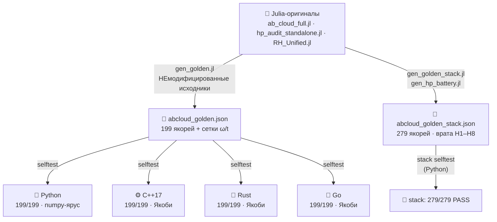
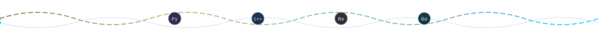

<div align="center">



# 🌍 Многоязычные порты AB-Cloud

**Одно вычислительное ядро — 84 000 строк Julia, девять файлов, три сюиты —
пересобранное на Python, C++17, Rust и Go и сверенное с единым закоммиченным
эталоном, сгенерированным из НЕмодифицированных Julia-оригиналов.**

*Золотой паритет · бит-в-бит MT19937 · честные допуски · каждое отклонение задокументировано*

<picture>
  <source media="(prefers-color-scheme: dark)" srcset="https://readme-typing-svg.demolab.com?font=Fira+Code&size=15&pause=1400&color=E8DDB8&center=true&vCenter=true&random=false&width=700&height=34&lines=Одно+ядро%3A+9+Julia-файлов+%C2%B7+84+000+строк%3BЧетыре+порта%3A+Python+%C2%B7+C%2B%2B17+%C2%B7+Rust+%C2%B7+Go%3B199+золотых+якорей%2C+MT19937+бит-в-бит%3Bselftest+199%2F199+на+каждом+языке">
  
</picture>

[](#-портреты-портов)
[](#-ведомость-верификации)
[](#-ведомость-верификации)
[](#-эталонная-система)
[](#-эталонная-система)
[](PORT_SPEC.md)
[](#-происхождение-и-лицензия)

[Портреты](#-портреты-портов) · [Ведомость](#-ведомость-верификации) · [Быстрый старт](#-быстрый-старт) · [Эталоны](#-эталонная-система) · [§8](#8-vector-tier--numpylapack-ярус) · [Теоремы](#-точные-теоремы-сверены-с-оригиналом) · [Отклонения](#-документированные-отклонения-портов) · [Структура](#-структура)

</div>

---


## 🌍 Портреты портов

<div align="center">



</div>

Четыре программы — один контракт. Каждый порт пере-реализует то же самое
вычислительное ядро — решёточные гамильтонианы Ааронова–Бома «облака», полный
стек статистик GOF/RMT, детектор Хилберта–Польи H1 и скалярные движки b(N)/Грама —
и каждый порт **верифицируется одинаково**: он пересчитывает опорные числа из
[`ports/golden/abcloud_golden.json`](golden/abcloud_golden.json) (файла якорей,
сгенерированного из **немодифицированных** Julia-оригиналов скриптом
[`golden/gen_golden.jl`](golden/gen_golden.jl)) и печатает вердикт PASS/FAIL по
каждому якорю. Ни один порт не является доверенным потому, что «выглядит
правильно»; он доверенный, потому что воспроизводит числа Julia внутри
задокументированных допусков.

| Порт | Вход | Стиль | Golden selftest | Сюита (25 переносимых тестов) |
|---|---|---|---|---|
| 🐍 **Python 3.8+** | [`python/abcloud/`](python/README.md) | пакет, numpy/LAPACK-ярус | **199/199 PASS** (~57 с) | 19 PASS · 0 FAIL · 3 WARN · 3 INFO |
| ⚙️ **C++17** | [`cpp/abcloud_port.cpp`](cpp/README.md) | один файл, собственный Якоби-солвер | **199/199 PASS** (~0.6 с) | 19 PASS · 0 FAIL · 3 WARN · 3 INFO |
| 🦀 **Rust** | [`rust/src/main.rs`](rust/README.md) | один файл, только `std` | **199/199 PASS** (~1 с) | 19 PASS · 0 FAIL · 3 WARN · 3 INFO |
| 🐹 **Go** | [`go/main.go`](go/README.md) | один файл, только `std` | **199/199 PASS** (~0.8 с) | 20 PASS · 0 FAIL · 2 WARN · 3 INFO |



> [!IMPORTANT]
> **Эталонный файл — единственный источник истины.** Никакие «известные
> правильные значения» из документации, статей или памяти контрактом не
> являются — если числа нет в `abcloud_golden.json`, порту запрещено
> тестироваться по нему. Генератор (`gen_golden.jl`) включает оригинальные
> Julia-исходники без изменений и прогоняет через них каждую секцию; JSON
> пишется с точностью `%.17g`, так что каждый якорь ходит туда-обратно
> без потерь.

## ✅ Ведомость верификации

Воспроизводимые вердикты, а не заявления. Запустите `selftest` в любом порту —
вы получите ту же таблицу; числа ниже получены на одной референсной машине
(одно ядро, без SIMD-трюков) и перепроверяются при каждом изменении.

| Проверка | Python | C++17 | Rust | Go |
|---|---|---|---|---|
| **Базовый golden selftest** (199 якорей: скаляры, GOF, RMT-таблицы, теоремы решётки, §8-векторы) | ✅ 199/199 | ✅ 199/199 | ✅ 199/199 | ✅ 199/199 |
| Время работы `selftest` | ~57 с | ~0.6 с | ~1 с | ~0.8 с |
| **§8 векторный ярус** (mon_entropy · topo_tee · rh_metrics) | ✅ через `numpy.linalg.eigh` | ✅ свой Якоби + векторы | ✅ свой Якоби + векторы | ✅ свой Якоби + векторы |
| **Stack-ярус** (`abcloud_golden_stack.json`: врата HP H1–H8, RH SP/v5, галерея Monumental) | ✅ **279/279 якорей** (~89 с) | — | — | — |
| Переносимая сюита из 39 тестов | 25 тестов | 25 тестов | 25 тестов | 25 тестов |
| Выборка окон MT19937 | бит-в-бит | бит-в-бит | бит-в-бит | бит-в-бит |

- **Базовый ярус** — 199 якорей = 133 исторических + 66 векторного яруса §8
  (три вырождениебезопасных открытых сценария × наблюдаемые entropy/IPR/TEE/KS/⟨r⟩).
- **Stack-ярус** пока только в Python: `abcloud.stack_golden` пересчитывает
  весь `abcloud_golden_stack.json` — восемь врат Хилберта–Польи H1–H8 (порт 1:1
  числовой поверхности `hp_audit_standalone.jl` в
  [`python/abcloud/hp_standalone.py`](python/abcloud/hp_standalone.py)),
  метрики RH_Sweep_Pro SP/v5 и галерею Monumental — и проходит с
  **279/279 якорей, 0 секций пропущено**. Ярусы происхождения: бит-в-бит для
  MT19937-ядер (rng_semantics, rh_\*, mon_\*), честный допуск 1e-5…1e-3 для
  врат HP (собственные значения LAPACK при L≤24 входят в цепочки детекторов).
- 14 непереносимых тестов сюиты печатают честный `[SKIP]` с причиной —
  графика, специализированные протоколы, зависящий от dSFMT беспорядок —
  и не считаются ни PASS, ни FAIL.

## 🚀 Быстрый старт

```bash
# Python — без установки, запуск из ports/python/
cd ports/python && python3 -m abcloud selftest && python3 -m abcloud zeros --n 2000

# C++ — один файл, одна команда
cd ports/cpp && g++ -O2 -std=c++17 -o abcloud abcloud_port.cpp && ./abcloud selftest

# Rust — только std, без зависимостей
cd ports/rust && cargo build --release && ./target/release/abcloud selftest

# Go — только std, без зависимостей
cd ports/go && go build -o abcloud . && ./abcloud selftest
```

Каждый selftest пересчитывает все 199 якорей из закоммиченного эталонного JSON —
без сети, без загрузок, без Julia. Файл нулей `zeros50k.txt` (50 000 нулей
Одлыжко, уже лежит в корне меридиана) подхватывается относительно
исполняемого файла/пакета; встроенные сетки сценариев ω (726 точек) и t
(30 точек) едут внутри эталонного JSON, так что ни один порт не строит сетку
локально.

### CLI — одинаковый на всех четырёх языках

```
selftest                      — проверка золотого паритета с оригиналами Julia (199 проверок)
zeros  [--data P] [--n N]     — полный батарейный анализ нулей
                                (KS / CvM / A² / χ² / <r> / Σ² / Δ₃ / K(t) / H1-SNR)
suite  [--test N|all]         — переносимое подмножество сюиты из 39 тестов
ham                           — §8 векторный ярус: энтропия/TEE/IPR/RH-метрики
                                трёх вырождениебезопасных сценариев
bN     --N n… [--offset k]    — статистика b(N)
gram   --n n…                 — точки Грама
test11 --mc N --seed S        — честный тест Андерсона–Дарлинга + MC-нуль
hp     [--data P] [--n N]     — первичный детектор H1 (брэгговские пики при ω = log p)
sweep  --N n…                  — лестница b(N)
```

## 🥞 Эталонная система

* [`golden/gen_golden.jl`](golden/gen_golden.jl) включает **немодифицированные**
  оригиналы (`ab_cloud_full.jl` и компания), прогоняет каждую секцию и пишет
  JSON с `%.17g` — базовые 199 якорей плюс сетки ω/t.
* [`golden/gen_golden_stack.jl`](golden/gen_golden_stack.jl) +
  [`golden/gen_hp_battery.jl`](golden/gen_hp_battery.jl) (со своим
  [`чекпоинтом`](golden/hp_battery_checkpoint.jl)) делают stack-слой:
  [`abcloud_golden_stack.json`](golden/abcloud_golden_stack.json) (27 секций,
  279 якорей — врата H1–H8, rh_\*, mon_\*, rng_semantics) и
  [`hp_battery_golden.json`](golden/hp_battery_golden.json) (одни 8 врат).
* Вся выборка окон Σ²/Δ₃ использует **классический MT19937** (init_genrand),
  встроенный одинаково во все пять программ (включая генератор) — выборка окон
  бит-в-бит совпадает между языками.
* Частотные сетки ω (726 точек) и t (30 точек) хранятся в JSON — никакой
  зависимости от семантики `colon`/`arange` конкретного языка.
* Ключи секций используют форматирование Julia `string(Float64)` — кратчайший
  round-trip с десятичной точкой (`1.0 → "1.0"`, никогда `"1"`).

**Честная таблица допусков** (полностью — в [`PORT_SPEC.md`](PORT_SPEC.md) §3):

| Класс секций | rtol | Почему |
|---|---|---|
| Чистые скаляры (bN, Грам, спейсинги, KS-статистика, linreg…) | 1e-9 | те же IEEE-754 операции, тот же порядок |
| Спецфункции (gue2_cdf, gamma_p, chi2_cdf…) | 1e-7 | кросс-libm exp/log: openlibm vs glibc ~2e-8 |
| Эталон-якоренные на спектре (ham_\*, byers_yang, dirac_flux…) | 1e-7 / 1e-8 abs | LAPACK zheevr против Якоби портов |
| Фурье-суммы (h1_zeta, K_zeros) | 1e-6 | чувствительность к порядку суммирования |
| §8-векторы (mon_entropy, topo_tee) | 1e-6 | базисы векторов, фаза-инвариантные наблюдаемые |
| §8 rh_metrics | 1e-7 | извлечение полосы по собственным значениям |

## 📦 Что портировано (вычислительное ядро, 1:1 с оригиналом)

* **Скалярная математика**: lgamma Ланцоша, регуляризованная неполная гамма
  (ряд + цепная дробь Ленца), точный CDF χ² (любой df), асимптотическое
  p-значение KS (двойной тета-ряд с правильной экспонентой −2k²λ²), сёрмисы
  Вигнера GUE β=2 / GOE β=1, Lambert W₀ (Галлей), точки Грама (исправленные
  тета-асимптотики 1/(48t)+7/(5760t³)), лестница b(N).
* **Движок RMT-опорных законов**: таблица интерполяции CDF (32768 точек,
  |ΔF|≤1e-9), сетка квантилей по обратной CDF (4096, 48 бисекций) —
  точный по закону MC-сэмплер Теста 11.
* **Статистики GOF**: KS (поправка Стивенса), двухвыборочный KS с полной
  дисциплиной связок, Крамер–фон Мизес W², Андерсон–Дарлинг A², χ²-гистограмма
  (бинар переполнения, гейт exp≥5), ⟨r⟩ (защита от вырождения 0/0), гладкая
  функция счёта N̄(T), развёртка, Σ²(L), Δ₃(L) (через остатки linreg, как в
  оригинале), двухуровневый форм-фактор K(t) с локальной развёрткой и сглаживанием.
* **Решётка AB-облака**: Vortex, ABCloudConfig, монументальная гладкая калибровка
  вертикальной связи (разности atan2 ·0.5), модель :dirac (гладкая часть +
  явная дираковская струна: −2πq вверх, +2πq вниз, ветвь тора), кулоновский
  потенциал вихрей + остаточный беспорядок ε (см. отклонения), эрмитово
  симметрирование (H+H†)/2, канонический plaquette_flux (сумма CCW углов
  angle(−H)), flux_circdist (круговое расстояние — защита от фантомов ±π),
  извлечение центральной полосы.
* **HP-аудит (H1)**: периодограммный детектор сырых позиций
  P(ω)=|Σwₖe^{−iωTₖ}|²/Σwₖ² (окно Ханна), линейка SNR против медианы полосы
  по 0.3:0.004:3.2, вердикты PASS/STRONG (≥4 из 6 простых гармоник выше SNR 10 /
  все выше 100), GUE-огибающая K_box(t)=t(1−sinc(2πt)), AICc, вальдовский ДИ,
  Спирмен (средние ранги), флуктуационный фильтр верхних частот.
* **Батарея HP H1–H8 (Python stack-ярус)**: полная числовая поверхность
  `hp_audit_standalone.jl` — все восемь раннеров врат, свипы режимов, GUE-ансамбль,
  арифметические таблицы — в [`python/abcloud/hp_standalone.py`](python/abcloud/hp_standalone.py).

## 8️⃣ Vector tier — numpy/LAPACK-ярус

Ярус, которому нужны собственные векторы и LS-фит. **Python опирается на
`numpy.linalg.eigh`**; C++/Rust/Go гоняют его на собственном циклическом
Якоби-солвере с накоплением матрицы поворотов (PORT_SPEC §8):

* **mon_entropy** — энтропия фон Неймана ранг-1 редуцированной матрицы
  C_A = ψ_A ψ_A† (clamps [1e-12, 1−1e-12], натуральный логарифм,
  round(Int,·) = half-even) для трёх центральных состояний при
  f=0.25/0.5/0.75, плюс IPR = Σ|ψ|⁴;
* **topo_tee** — топологическая энтропия запутанности (V90): полное
  разложение H, 53 исходные фракции, фит `[boundaries ones] \ S_mean` через
  Хаусхолдер QR → slope_alpha, gamma_top;
* **rh_metrics** — KS D/p на центральной полосе 0.6 (локально-средняя
  развёртка, протокол Теста 16) + ⟨r⟩.

Сценарии (W=0, открытые, очищены защитой от вырождения gap > 1e-9):
`L8_open_a025_2vort`, `L10_open_a03_clean`, `L12_open_a03_clean`.
Сценарии α=0.5 и тор L=10 исключены: точные дуплеты делают базис векторов
несравнимым между LAPACK и Якоби.

> [!WARNING]
> **Ловушка раскладки, задокументированная на практике.** Julia индексирует
> узлы как `i = x·L + y` (y быстрый), а порты строят строки как `i = y·L + x`
> (x быстрый). Разрез подсистемы у Julia `psi_mat[1:L_A, :]` — это полоса
> **y < L_A**, что в раскладке портов (iy, ix) есть полоса **x < L_A**.
> Разрежь не по той оси — и все x↔y-симметричные состояния всё равно пройдут:
> выдаст её только несимметричное (c2 решётки L8 с двумя вихрями). Python-ярус
> чинил именно этот баг при включении §8-якорей; см. комментарий в
> [`python/abcloud/golden.py`](python/abcloud/golden.py).

## 📐 Точные теоремы (сверены с оригиналом)

| Теорема | Золотой якорь |
|---------|--------------|
| Байерс–Янг (q→q+1, нейтральная конфигурация, :dirac) | 2.66e-15 |
| Поток дираковской струны (plaquette_flux, :dirac) | 1.78e-15 |
| Хиральность AIII (α=1/2, W=0) | ровно 0 |
| Дефект Конна α↔1/α (открытая, W=0, испорченная границей) | 0.359127159… |
| b(50000) | 1.21255267725886… |
| A² (полный набор нулей) | 61.4924262420973 |
| ⟨r⟩ нулей (n_r=49998) | 0.611879890720840 |

## ⚖️ Документированные отклонения портов

1. **Беспорядок при W>0**: ε ~ U(−0.01,0.01) берётся из классического
   MT19937 (seed = disorder_seed). Оригинал использует встроенный dSFMT
   Julia, который не воспроизводится ни одним другим языком. **Все золотые
   якоря сняты при W=0**, где ε вообще не разыгрывается.
2. **Собственные значения**: циклический Якоби для эрмитовых матриц
   (C++/Rust/Go) вместо LAPACK zheevr — совпадение ~1e-12, внутри золотых
   допусков 1e-7/1e-8. Python использует `numpy.linalg.eigh` (сам LAPACK).
3. **Размеры решёток в сюите**: без LAPACK статистические тесты 12/16/34 в
   C++/Rust/Go идут на решётках 200²/24²/28² (Python — 400²/32²/40² через
   numpy). Это СТАТИСТИЧЕСКИЕ тесты с калиброванными по конечному размеру
   гейтами; золотой selftest использует полные размеры (64/100/144) и
   верифицирован везде.
4. **Покрытие сюиты**: 25 из 39 тестов портированы (вычислительное ядро);
   остальные 14 печатают честный `[SKIP]` с причиной (графика,
   специализированные протоколы, зависящий от dSFMT беспорядок).

## 🗂 Структура

```
ports/
├── golden/                     — эталонная система (см. golden/README.md)
│   ├── gen_golden.jl           — базовый генератор из НЕмодифицированной Julia
│   ├── abcloud_golden.json     — 199 якорей + сетки ω/t
│   ├── gen_golden_stack.jl     — stack-генератор (врата HP + RH + Monumental)
│   ├── gen_hp_battery.jl / hp_battery_checkpoint.jl
│   ├── abcloud_golden_stack.json — 27 секций · 279 якорей
│   └── hp_battery_golden.json    — одни 8 врат HP
├── python/
│   ├── abcloud/                — канонический пакет (см. python/README.md)
│   │   ├── mt19937 · special · rmt_table · gof · lattice · unfold
│   │   ├── hp_audit · hp_standalone (H1–H8) · mon_stack · rh_stack
│   │   ├── golden (selftest 199/199) · stack_golden (279/279) · suite · cli
│   │   └── data/               — встроенные таблицы нулей ζ (см. README в data)
│   └── extract_rh_zeros.py · extract_monumental_zeros.py
├── cpp/abcloud_port.cpp        — однофайловый порт C++17 (тот же CLI)
├── rust/ (Cargo)               — однофайловый порт Rust (только std)
├── go/main.go + go.mod         — однофайловый порт Go (только std)
├── data/monumental_zeta_zeros_1000.txt — общая таблица нулей (см. data/README.md)
├── assets/                     — анимированные баннер/разделитель/каст этого README
├── PORT_SPEC.md                — спецификация паритета (формат эталона,
│                                 допуски, MT19937, правила портирования, §8)
└── README.md / README.ru.md    — этот файл · English version
```

## 🛠 Пересборка эталона

```bash
julia ports/golden/gen_golden.jl <каталог_meridian> <out.json>
# по умолчанию: julia ports/golden/gen_golden.jl . ports/golden/abcloud_golden.json
julia ports/golden/gen_golden_stack.jl . ports/golden/abcloud_golden_stack.json
julia ports/golden/gen_hp_battery.jl   . ports/golden/hp_battery_golden.json
```

Требуется Julia 1.10+ со stdlib (LinearAlgebra, DelimitedFiles, Printf)
и файл `zeros50k.txt` в корне каталога меридиана. Закоммиченные JSON — это
контракт; пересобирайте их только чтобы заново вывести, а не чтобы «поправить».

## 📎 Происхождение и лицензия

Порты пере-реализуют засеянные детерминированные сюиты
[`meridian-spectral-observatory`](../README.md) и верифицируются по якорям,
сгенерированным из немодифицированных оригиналов; золотые JSON — закоммиченное
происхождение. Весь контент проприетарен под лицензией strictly personal на
весь репозиторий — см. [`../../LICENSE`](../../LICENSE) и титульную страницу
[`../../README.md`](../../README.md). Можно просматривать, читать и цитировать
с атрибуцией; ре-дистрибуция без письменного согласия Автора не лицензируется.

---

<div align="center">



*Одно ядро, четыре языка, один эталонный файл —
и каждое отклонение это задокументированный абзац, а не сюрприз.*

**[↑ наверх](#-портреты-портов)** · [PORT_SPEC.md](PORT_SPEC.md) · [golden/](golden/README.md) · [Корень обсерватории](../README.md) · [Репозиторий](../../README.md)

</div>
