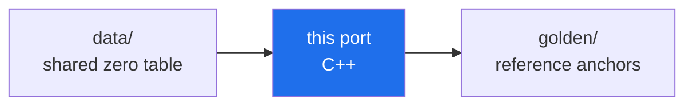

<!-- AB-ENRICHED:v1 · sub -->
<div align="center">


**🧭 [⬆ ports/](../README.md) · [🏠 Root README](../../../README.md)**

</div>
<div align="center">

# ⚙️ C++17 Port — `abcloud_port.cpp`

**The whole AB-Cloud computational kernel in one 2,228-line C++17 file:
no dependencies beyond the standard library, its own Hermitian eigensolver,
and a golden selftest that reproduces the Julia originals at 199/199.**

*single file · std only · cyclic Jacobi with rotation accumulation · ~0.6 s selftest*


</div>

> **🧭 Navigation:** [ports/](../README.md) · [meridian-spectral-observatory/](../../README.md) · [Root README](../../../README.md)


## What this is

`abcloud_port.cpp` is the C++17 mirror of the meridian-spectral-observatory
kernel — the same MT19937, the same Lanczos lgamma / incomplete gamma / χ² CDF
/ Wigner surmises / Lambert W / Gram points, the same GOF statistics, the same
AB-cloud lattice with the monumental smooth-gauge phases and the :dirac
string, and the full §8 vector tier. The parity contract, tolerances and
algorithmic traps it honours are specified in
[`../PORT_SPEC.md`](../PORT_SPEC.md); the CLI is identical to the other three
ports (see [`../README.md`](../README.md#cli--identical-across-all-four-languages)).

## Build & run

```bash
g++ -O2 -std=c++17 -o abcloud abcloud_port.cpp   # GCC 9+ / clang++ / MSVC 2019+ also work
./abcloud selftest          # → RESULT: 199/199 checks passed
./abcloud zeros --n 2000    # full zero-analysis battery
./abcloud ham               # §8 vector tier on the three golden scenarios
```

> [!NOTE]
> **Path anchoring.** The executable resolves `../golden/` and
> `../../zeros50k.txt` **relative to its own directory**, so keep the binary
> beside the sources (or copy it anywhere under `ports/` of a full checkout).
> A bare `./abcloud` from an arbitrary directory will not find the golden.

## What's inside (one file, six layers)

| Layer | Highlights |
|---|---|
| **MT19937** | classic init_genrand, 53-bit Float64 assembly `(a>>5·2²⁶ + b>>6)/2⁵³`, wrapper init at `idx=625` — bit-identical to the other ports |
| **Special functions** | Lanczos lgamma, gamma P(a,x) (series + Lentz), exact χ² CDF, KS asymptotic p (dual theta series), GUE/GOE surmises, Lambert W₀ (Halley), Gram points |
| **RMT table engine** | 32768-point CDF interpolation (|ΔF|≤1e-9) + 4096-point quantile grid (48 bisections) |
| **GOF statistics** | KS (Stephens), two-sample KS with tie discipline, CvM W², AD A², χ² histogram, ⟨r⟩ guard, Σ²/Δ₃ via linreg residuals, K(t) form factor |
| **AB-cloud lattice** | Vortex/ABCloudConfig, monumental phases, :dirac string (−2πq/+2πq, torus branch), plaquette_flux, flux_circdist, central band |
| **§8 vector tier** | cyclic Jacobi `jacobi_eig_full` with U accumulation, von Neumann entropy (clamped rank-1 C_A), IPR, Householder-QR `lsfit2`, 53-fraction TEE, central-band KS + ⟨r⟩ |

## Verification

| Check | Verdict |
|---|---|
| Base golden selftest (`abcloud_golden.json`, 199 anchors incl. §8) | ✅ **199/199 PASS** (~0.6 s) |
| Eigenvalues vs LAPACK zheevr (Julia) | ~1e-12, inside the 1e-7/1e-8 gates |
| Portable suite (25 tests) | 19 PASS · 0 FAIL · 3 WARN · 3 INFO |

The remaining 14 suite tests print an honest `[SKIP]` with a reason — no
silent omissions anywhere.

<div align="center">

**[↑ Ports overview](../README.md)** · [golden/](../golden/README.md) · [PORT_SPEC.md](../PORT_SPEC.md)

</div>

---

<!-- enriched-r3 -->

This folder is part of the **port matrix of the Meridian Spectral Observatory**: one kernel re-expressed across languages, sharing the frozen zero table and checked against the same golden anchors. The [`golden/`](../golden/README.md) shelf defines the reference values; the [`data/`](../data/README.md) shelf holds the shared input. A port that reproduces the anchors bit-for-bit demonstrates that the observatory's arithmetic is a property of the specification, not of one runtime. The matrix overview is in [`ports/`](../README.md).

The C++17 port of the observatory kernel: a compact translation that must reproduce the golden anchors.



*Every port reads the same table and must reproduce the same anchors.*

## Folder contents

| File | Size | What it is |
|---|---|---|
| `abcloud_port.cpp` | 98 KB | C++ source |
| `abcloud_unified.cpp` | 1.2 MB | C++ source |


**Where next:** [golden anchors](../golden/README.md) · [data/](../data/README.md)

<div align="center">


<sub>⚡ Part of <a href="../../../README.md">AB-Cloud Research</a> — numbers are verbatim from the unified registry; no result on this page is a claim about the Riemann hypothesis · <a href="../README.md">⬆ parent section</a></sub>

</div>
