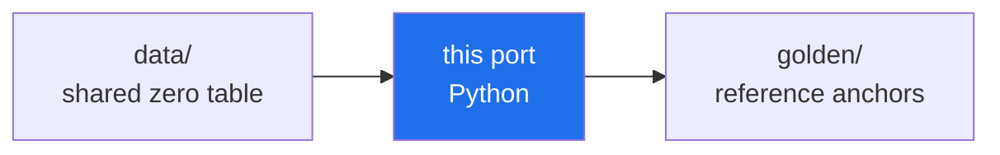

<div align="center">

# 🐍 Python Port — the `abcloud` package

**The reference port of the AB-Cloud computational kernel: a NumPy-backed
package with the base golden selftest at 199/199 and — unique among the four
ports — the full stack tier (HP gates H1–H8, RH SP/v5, Monumental gallery)
at 279/279.**

*package · numpy/LAPACK tier · H1–H8 battery included · ~57 s selftest*


</div>

> **🧭 Navigation:** [ports/](../README.md) · [meridian-spectral-observatory/](../../README.md) · [Root README](../../../README.md)


## What this is

`abcloud` is the canonical Python mirror of the meridian-spectral-observatory
kernel — bit-matched MT19937, the full scalar/special-function stack, the GOF
statistics, the AB-cloud lattice, the §8 vector tier on `numpy.linalg.eigh`,
and the same 9-command CLI as the C++/Rust/Go single files. On top of the
shared kernel it hosts the **stack tier**: a 1:1 port of the numeric surface
of `hp_audit_standalone.jl` (all eight Hilbert–Pólya gates) plus the
RH_Sweep_Pro and Monumental galleries, checked against
[`../golden/abcloud_golden_stack.json`](../golden/abcloud_golden_stack.json).
The parity contract lives in [`../PORT_SPEC.md`](../PORT_SPEC.md).

## Quick start

```bash
cd ports/python            # no install needed; Python 3.8+ with numpy
python3 -m abcloud selftest          # → RESULT: 199/199 checks passed (~57 s)
python3 -m abcloud zeros --n 2000
python3 -m abcloud ham               # §8 vector tier

# stack tier (H1–H8 gates + RH + Monumental, 279 anchors):
python3 -c "from abcloud.stack_golden import run_stack_selftest; \
    run_stack_selftest('../golden/abcloud_golden_stack.json')"
```

> [!NOTE]
> **Path anchoring.** The package resolves `../golden/` and
> `../../zeros50k.txt` relative to `ports/python/`, so run it from there
> (or from a full checkout's `ports/python` directory). Requires
> `numpy` — the only dependency in the whole ports family.

## The package, module by module

| Module | Lines | Role |
|---|---|---|
| `mt19937.py` | 71 | classic MT19937 + 53-bit Float64 — bit-identical across all five programs |
| `special.py` | 158 | Lanczos lgamma, gamma P(a,x), χ² CDF, KS p-value, Wigner surmises, Lambert W₀, Gram points, b(N) |
| `rmt_table.py` | 114 | the 32768-point GUE CDF table + 4096-point quantile grid (Test 11 law-exact sampler) |
| `gof.py` | 274 | KS (Stephens), two-sample KS, CvM, AD, χ² histogram, ⟨r⟩, Σ²/Δ₃, K(t) form factor |
| `lattice.py` | 309 | Vortex/ABCloudConfig, monumental + :dirac builders, plaquette_flux, central band |
| `unfold.py` | 216 | local unfolding, AICc, Wald CI, Spearman, raw FT, ω grid |
| `hp_audit.py` | 114 | H1 detector primitives (periodogram, SNR yardstick, GUE envelope) |
| `suite.py` | 425 | the portable subset of the 39-test battery |
| `golden.py` | 455 | base golden selftest — all 199 anchors incl. the §8 vector tier on `numpy.linalg.eigh` |
| `hp_standalone.py` | 2 217 | **H1–H8 battery, 1:1** — the numeric surface of `hp_audit_standalone.jl` (7722 lines): configs, builders, eight gate runners, regimes, GUE ensemble, arithmetic tables |
| `rh_stack.py` | 2 732 | RH_Sweep_Pro SP/v5 galleries: sweeps, presets, byte-semantics, alphas |
| `mon_stack.py` | 959 | Monumental gallery: spectrum/stats/topology/sweep tasks |
| `stack_golden.py` | 533 | stack selftest — recomputes all 27 sections of `abcloud_golden_stack.json` |
| `cli.py` | 218 | the shared 9-command CLI |
| `data/` | — | embedded ζ-zero tables ([see data README](abcloud/data/README.md)) |

## Verification

| Check | Verdict |
|---|---|
| Base golden selftest (199 anchors incl. §8 via `numpy.linalg.eigh`) | ✅ **199/199 PASS** (~57 s) |
| Stack selftest (27 sections: HP gates H1–H8, rh_\*, mon_\*, rng_semantics) | ✅ **279/279 anchors, 0 sections skipped** (~89 s) |
| Portable suite (25 tests) | 19 PASS · 0 FAIL · 3 WARN · 3 INFO |

> [!IMPORTANT]
> **Why Python is ~100× slower than the single files here.** The base
> selftest computes three full lattice eigendecompositions plus the 53-fraction
> TEE fits on every run; the C++/Rust/Go ports race through it with Jacobi in
> under a second, Python's numpy path takes about a minute. The verdicts are
> identical — pick speed for CI loops, pick Python to hack on the kernel.

<div align="center">

**[↑ Ports overview](../README.md)** · [data/](abcloud/data/README.md) · [golden/](../golden/README.md) · [PORT_SPEC.md](../PORT_SPEC.md)

</div>

---

<!-- enriched-r3 -->

This folder is part of the **port matrix of the Meridian Spectral Observatory**: one kernel re-expressed across languages, sharing the frozen zero table and checked against the same golden anchors. The [`golden/`](../golden/README.md) shelf defines the reference values; the [`data/`](../data/README.md) shelf holds the shared input. A port that reproduces the anchors bit-for-bit demonstrates that the observatory's arithmetic is a property of the specification, not of one runtime. The matrix overview is in [`ports/`](../README.md).

The Python port — the `abcloud` package: the reference implementation of the port matrix.



*Every port reads the same table and must reproduce the same anchors.*

## Folder contents

| File | Size | What it is |
|---|---|---|
| `abcloud_unified_standalone.py` | 1.1 MB | Python source |
| `extract_monumental_zeros.py` | 1.8 KB | Python source |
| `extract_rh_zeros.py` | 2.6 KB | Python source |

**Subfolders:** `abcloud/`


**Where next:** [golden anchors](../golden/README.md) · [data/](../data/README.md)
