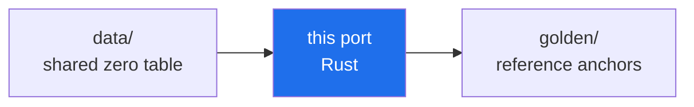

<!-- AB-ENRICHED:v1 · sub -->
<div align="center">


**🧭 [⬆ ports/](../README.md) · [🏠 Root README](../../../README.md)**

</div>
<div align="center">

# 🦀 Rust Port — `abcloud`

**The whole AB-Cloud computational kernel in one 2,536-line `main.rs`:
`std` only, zero crates, its own Hermitian eigensolver, and a golden
selftest that reproduces the Julia originals at 199/199.**

*single file · std only · cyclic Jacobi with rotation accumulation · ~1 s selftest*


</div>

> **🧭 Navigation:** [ports/](../README.md) · [meridian-spectral-observatory/](../../README.md) · [Root README](../../../README.md)


## What this is

The Rust mirror of the meridian-spectral-observatory kernel — bit-matched
MT19937, the full scalar/special-function stack, the GOF statistics, the
AB-cloud lattice with monumental and :dirac flux books, the §8 vector tier,
and the identical 9-command CLI. The parity contract it satisfies lives in
[`../PORT_SPEC.md`](../PORT_SPEC.md); the shared CLI and golden system are
documented in [`../README.md`](../README.md).

## Build & run

```bash
cargo build --release
./target/release/abcloud selftest          # → RESULT: 199/199 checks passed
./target/release/abcloud zeros --n 2000
./target/release/abcloud ham               # §8 vector tier
```

> [!NOTE]
> **Path anchoring.** Like the C++ port, the binary resolves `../golden/`
> and `../../zeros50k.txt` **relative to its own directory** — run it from
> `ports/rust/target/release/`, or copy it anywhere under `ports/` of a full
> checkout. (`cargo run` also works: cargo places the binary in the same
> layout.) `Cargo.lock` is committed for reproducible builds.

## What's inside (one file, six layers)

| Layer | Highlights |
|---|---|
| **MT19937** | classic init_genrand, 53-bit Float64 `(a>>5·2²⁶ + b>>6)/2⁵³`, wrapper init at `idx=625` |
| **Special functions** | Lanczos lgamma, gamma P(a,x) (series + Lentz), exact χ² CDF, KS asymptotic p, GUE/GOE surmises, Lambert W₀ (Halley), Gram points |
| **RMT table engine** | 32768-point CDF table (|ΔF|≤1e-9) + 4096-point quantile grid |
| **GOF statistics** | KS (Stephens), two-sample KS, CvM W², AD A², χ² histogram, ⟨r⟩ guard, Σ²/Δ₃, K(t) |
| **AB-cloud lattice** | Vortex/ABCloudConfig, monumental phases, :dirac string, plaquette_flux, flux_circdist, central band |
| **§8 vector tier** | Jacobi with U accumulation, von Neumann entropy (clamped rank-1 C_A), IPR, Householder-QR `lsfit2`, 53-fraction TEE, central-band KS + ⟨r⟩ |

## Verification

| Check | Verdict |
|---|---|
| Base golden selftest (199 anchors incl. §8) | ✅ **199/199 PASS** (~1 s) |
| Eigenvalues vs LAPACK zheevr (Julia) | ~1e-12, inside the 1e-7/1e-8 gates |
| Portable suite (25 tests) | 19 PASS · 0 FAIL · 3 WARN · 3 INFO |
| Build hygiene | `cargo build --release` warnings: dead-code notes only, zero unsafe blocks |

The remaining 14 suite tests print an honest `[SKIP]` with a reason — no
silent omissions anywhere.

<div align="center">

**[↑ Ports overview](../README.md)** · [golden/](../golden/README.md) · [PORT_SPEC.md](../PORT_SPEC.md)

</div>

---

<!-- enriched-r3 -->

This folder is part of the **port matrix of the Meridian Spectral Observatory**: one kernel re-expressed across languages, sharing the frozen zero table and checked against the same golden anchors. The [`golden/`](../golden/README.md) shelf defines the reference values; the [`data/`](../data/README.md) shelf holds the shared input. A port that reproduces the anchors bit-for-bit demonstrates that the observatory's arithmetic is a property of the specification, not of one runtime. The matrix overview is in [`ports/`](../README.md).

The Rust port of the observatory kernel, with its locked dependency set for reproducible builds.



*Every port reads the same table and must reproduce the same anchors.*

## Folder contents

| File | Size | What it is |
|---|---|---|
| `Cargo.lock` | 151 B | dependency lockfile |
| `Cargo.toml` | 142 B | config (TOML) |
| `abcloud_unified.rs` | 1.2 MB | Rust source |

**Subfolders:** `src/`


**Where next:** [golden anchors](../golden/README.md) · [data/](../data/README.md)

<div align="center">


<sub>⚡ Part of <a href="../../../README.md">AB-Cloud Research</a> — numbers are verbatim from the unified registry; no result on this page is a claim about the Riemann hypothesis · <a href="../README.md">⬆ parent section</a></sub>

</div>
