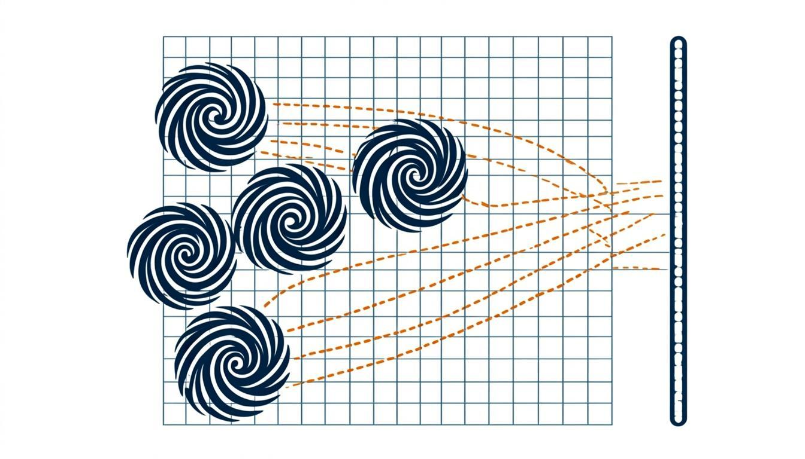

# Monograph v22 — Chinese Edition (中文版)

> **🧭 Navigation:** [monographs/](../README.md) · [Root README](../../README.md)

<picture>
  <source media="(prefers-color-scheme: dark)" srcset="../../assets/visuals/ai/ab_cloud_concept_dark.png">
  
</picture>

*Conceptual illustration — not raw data.*

The Chinese edition of the rewritten monograph, kept fully parallel to the
RU and EN editions: same 37-test base, same appendices, figures re-labelled
in Chinese. Typesetting uses `ctex`-aware XeLaTeX for the `.tex` source.

## Files (everything in `text/` unless noted)

| File | What it is |
|---|---|
| `AB_Cloud_Monograph_v22_ZH.md` | canonical Markdown source (Chinese) |
| `AB_Cloud_Monograph_v22_ZH.tex` | LaTeX source (added in v22.1; build with xelatex + ctex) |
| `AB_Cloud_Monograph_v22_ZH.html` | interactive version: sticky TOC, MathJax, figure lightbox |
| `AB_Cloud_Monograph_v22_ZH.docx` | editable manuscript with auto-TOC |
| `AB_Cloud_Monograph_v22_ZH.pdf` | typeset monograph, vector PDF |
| `AB_Cloud_Monograph_v22_ZH_v221.docx / _v221.html / _v221.pdf` | v22.1 build: Appendix B → `run_20260902_134759`, new Appendix D (spinor64) |
| `AB_Cloud_Monograph_v22_ZH_presentation.pptx` | 14-slide deck, dark scientific theme |
| `preprint/preprint_v22_ZH.tex` + `.pdf` | arXiv-style preprint |
| `figures/fig01…fig20_*.png` | 19–20 figures, 600 dpi, Chinese labels |

## What the text contains

Identical scientific content to the EN edition: the AB-cloud mechanism and
its GUE agreement with the zeta zeros; the 37-test suite narrative
(b(50000) = 1.2126, Montgomery KS = 0.047 / p = 0.27, Byers–Yang defect
3.5·10⁻¹⁵, Dirac cone v_F ≈ 0.125); Appendix B documenting the two-pass run
`run_20260902_134759` (Julia 1.12.0, 50 000 Odlyzko zeros, 96×96 HARDCORE
pass 2); Appendix D with the spinor64 result — all 64 spinor structures
GUE-consistent, PSL(2,7) orbits 28/21/7/7/1, isospectrality ≈ 1e-14.

## How to read / rebuild

- Read: `text/AB_Cloud_Monograph_v22_ZH_v221.pdf` — the freshest build.
- Edit: `.md` / `.tex`; rebuild PDF with `xelatex` (ctex class handling for
  Chinese typography; run twice).

---

*English note:* this folder holds the **Chinese edition** of the rewritten
monograph (v22 + the updated v22.1 build). See the repository-root README
for the trilingual overview.

## 📁 Complete file inventory

| Entry | Size | Kind |
|---|---|---|
| `figures/` | 20 files, 4.2 MB | directory — 19 figures + README |
| `text/` | 12 files, 44.0 MB | directory — incl. `preprint/` |
| `README.md` | 2.4 KB | file |
| **Total (recursive)** | **33 files, ≈48 MB** | |

## 🔬 Deep dive — working with the Chinese edition

The ZH edition is a full parallel translation, not a summary: identical
chapter structure, identical appendices, and the same 37-test numeric
backbone as RU and EN, with all 19–20 figure labels re-set in Chinese.
Two typesetting specifics are worth knowing. First, the `.tex` source
requires a `ctex`-aware XeLaTeX toolchain — compile with `xelatex` twice
so the TOC and cross-references settle; pdfLaTeX will not handle the CJK
punctuation correctly. Second, the HTML build keeps MathJax for formulas
while relying on system CJK fonts, so it renders identically on desktop
and mobile without webfont downloads.

Content-wise the edition carries the same headline results: the
AB-cloud mechanism reproducing GUE statistics of the zeta zeros, the
pair-correlation KS distance 0.047 (p = 0.27), the Byers–Yang flux
defect 3.5e-15, the Dirac cone v_F ≈ 0.125 with R² = 0.9997, and the
spinor64 appendix — all 64 Klein-quartic spinor structures
GUE-consistent, PSL(2,7) orbits 28/21/7/7/1. Every number links back to
a named test of the verification suite, and the two-pass run
`run_20260902_134759` documented in Appendix B is committed under
`results/`, so Chinese-reading referees verify claims exactly as
English-reading ones do.
