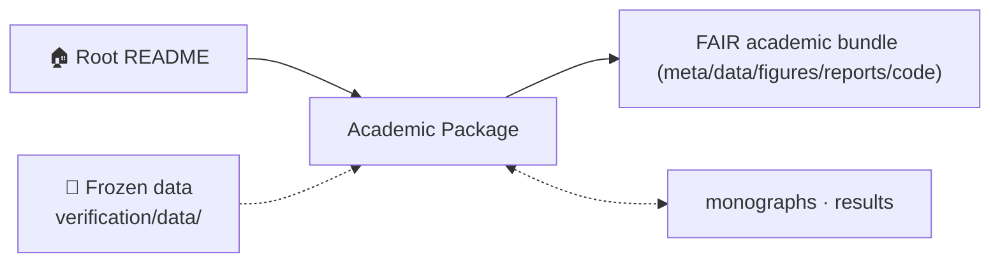
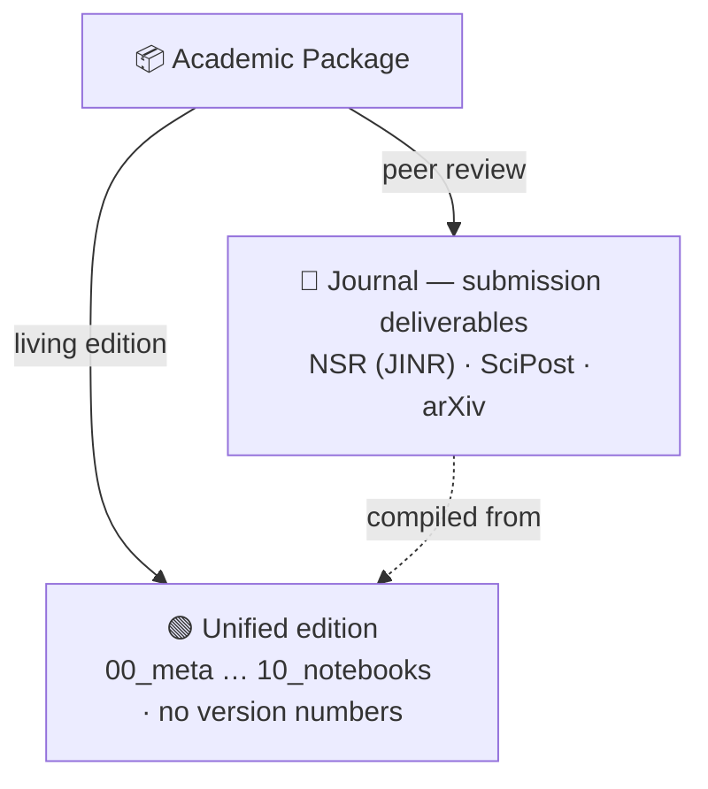

<!-- AB-ENRICHED:v1 · section=AB_Cloud_Academic_Package -->
<div align="center">


</div>
<details>
<summary><strong>🗺️ How <code>AB_Cloud_Academic_Package/</code> connects to the repository (click)</strong></summary>



</details>

<div align="center">



# AB-Cloud Research — Academic Package

**The packaged submission layer of the repository: the living unified edition and
the journal deliverables — one programme, two shelves.**

*Unified edition · NSR (JINR) / SciPost / arXiv packages*

<picture>
  <source media="(prefers-color-scheme: dark)" srcset="https://readme-typing-svg.demolab.com?font=Fira+Code&size=15&pause=1400&color=E8DDB8&center=true&vCenter=true&random=false&width=660&height=34&lines=Two+shelves+%C2%B7+one+research+programme;Unified+edition%3A+the+academic+package+00%E2%80%A610;Journal%3A+NSR+%C2%B7+SciPost+%C2%B7+arXiv+packages">
  
</picture>

[](#-the-two-shelves)
[](EDITION.md)
[](Journal/README.md)

[](01_monographs/README.md)
[](AB_Cloud_Academic_Package/09_tests/README.md)
[](https://doi.org/10.5281/zenodo.21825394)
[](https://orcid.org/0009-0003-7299-0701)
[](#-license)

</div>


> [!IMPORTANT]
> **Honest boundary.** Everything on these shelves is a numerical and formal
> study of a mathematical model. It does **not** prove the Riemann hypothesis:
> the V13 obligation machine of the unified edition keeps the RH conclusion
> **unlocked** (`verdict: certified`, v1.2.1): the path O01→O12 carries no
> assumptions — the classical Li criterion (O12) plus certified convergence
> (O08/O09/O11); RH as a theorem still requires O11 for all n.
> This honesty layer is part of the scientific record and is protected by the
> licence — see [§ License](#-license).

## 📖 What this folder is

This folder is the **packaged, self-contained layer** of the AB-Cloud research
programme. Where the repository root holds the living laboratories — the spectral
core, the Dirac skeleton, the Hilbert–Pólya bridge, the observatory and the
satellite studies — this folder holds what has been **bound, sealed and shipped**:
the unified academic edition that consolidates the whole programme into one
numbered structure, and the per-journal deliverables prepared for peer review.

The two shelves serve different moments of the same research life-cycle. The
**unified edition** (in the `AB_Cloud_Academic_Package/AB_Cloud_Academic_Package/`
folder) is where the programme currently *lives* as a citable academic object:
monographs in full and MAX editions, curated data with schemas and checksums, a
six-language CLI, a web laboratory and a machine-readable honesty ledger — plus
the preserved heritage of the earlier submission package (the standalone Julia
codes, the v19 reference-run artifacts and the original package READMEs).
**Journal** is where the programme *travels*: three sealed submission packages,
each tailored to its venue's class files and wizard, with preview PDFs for the
eye and SHA-256 sums inside for the audit.

<p align="center">
<picture>
  <source media="(prefers-color-scheme: dark)" srcset="../assets/visuals/ai/ab_cloud_concept_dark.png">
  
</picture>
</p>

*Conceptual illustration of the packaged object (AI-generated, not raw data):
the Hofstadter lattice with ζ-zero vortices, bound and shipped as one
auditable artefact.*

## 🏛️ The two shelves



| Shelf | Status | What lives there | Landing |
|---|---|---|---|
|  **Unified edition** | living · unversioned | the unified academic edition: monographs (RU/EN + MAX ~100k words), curated data, figures, reports, six-language CLI, web laboratory, 410+ tests, honesty ledger — plus the preserved heritage of the earlier v23/v34 submission package | [`EDITION.md`](EDITION.md) |
|  **Journal** | shipping · sealed | three submission packages (NSR JINR `nsr.cls`, SciPost `scipost.cls`, arXiv `article.cls`), 48 figures each, supplemental, cover letters, wizard guides inside the zips, preview PDFs | [`Journal/README.md`](Journal/README.md) |

<div align="center">

</div>

## 🗺️ Which shelf do you need?

- **«I want the current monograph and the evidence.»** — the unified edition:
  start at [`01_monographs/`](01_monographs/README.md), then the campaign
  ledger [`02_data/processed/research_registry.json`](02_data/processed/research_registry.json).
- **«I must verify a number from the earlier papers.»** — the heritage lives
  inside the unified edition: the v19 reference-run artifacts
  [`02_data/raw/results_run/`](02_data/raw/results_run/README_source.md)
  and the standalone codes [`06_code/lab_standalone/`](06_code/lab_standalone/README.md).
- **«I am a reviewer/editor handling a submission.»** — [`Journal/`](Journal/README.md):
  your venue's zip (each one carries its own step-by-step wizard guide inside).
- **«I want the one-page story.»** — [`04_reports/one_pager/one_pager.md`](04_reports/one_pager/one_pager.md)
  or the lay summary [`04_reports/lay_summary.md`](04_reports/lay_summary.md).
- **«I want to run everything myself.»** — [`reproduce.sh`](reproduce.sh)
  and [`06_code/`](06_code/README.md).

## 🚀 Quick start

```bash
# 1. Open the unified edition's landing page
$PAGER AB_Cloud_Academic_Package/EDITION.md

# 2. Open the interactive web laboratory (fully offline)
open AB_Cloud_Academic_Package/AB_Cloud_Academic_Package/07_web_lab/index.html

# 3. Run the unified edition's package-integrity tests
python3 -m pytest AB_Cloud_Academic_Package/AB_Cloud_Academic_Package/09_tests/python -q
```


## 🔒 License

**Everything on both shelves is proprietary — the strictly personal licence
of the Author.** All copyright, related and neighbouring rights belong fully and
exclusively to **Isaev Iskhak Khamzatovich**. You may view, read, run locally for
scholarly verification and cite with attribution (quote limit ≤ 400 characters
per excerpt, with the DOI). Redistribution, republishing, mirroring, public
forks, derivative publications, commercial use and ML training on the content are
**not licensed** without the Author's separate written consent.

- Unified edition: [`LICENSE`](LICENSE) — umbrella, plus component
  addenda [`LICENSE-CODE`](LICENSE-CODE),
  [`LICENSE-TEXT`](LICENSE-TEXT), [`LICENSE-DATA`](LICENSE-DATA);
- Journal packages: the repository-wide
  [`../../LICENSE`](../../LICENSE) (Custom Research License) applies;
- Contact for any use beyond viewing/reading/citing:
  **Isaev Iskhak Khamzatovich** · AB-Cloud Research Laboratory, Independent
  Researcher, Prospekt Lenina 29, Apt. 140, Nalchik, Kabardino-Balkarian
  Republic, Russian Federation · [aslan08_05@mail.ru](mailto:aslan08_05@mail.ru) ·
  [ORCID 0009-0003-7299-0701](https://orcid.org/0009-0003-7299-0701).

The honesty layer (`does_not_prove` fields, exact verdicts) is part of the
scientific record and must be preserved verbatim in any permitted quotation.

## 📜 Citation

```bibtex
@dataset{isaev_abcloud_unified,
  author  = {Isaev, Iskhak Khamzatovich},
  title   = {{AB-Cloud Research Programme: Unified Academic Package}},
  year    = {2026},
  doi     = {10.5281/zenodo.21825394},
  url     = {https://github.com/wild8highlander/ab-cloud-research/tree/main/AB_Cloud_Academic_Package},
  note    = {Unified edition: spectral core, Dirac skeleton, Hilbert-Polya bridge,
             blind verification. RH status: certified (V13, unlocked).}
}
```

---

<div align="center">


*Two shelves, one programme: the living edition and the travelling packages —
every number checkable on every shelf.*

**[↑ back to top](#-what-this-folder-is)** · [Repository root](../README.md)

</div>

<div align="center">


<!-- AI end-cap — prompt P-10, registry: assets/prompts/AI_PROMPTS.md -->


<sub>🖼️ Section art: <a href="../assets/prompts/AI_PROMPTS.md">P-10</a> · palette <code>#05060f · #00e5ff · #ff2ec4 · #a78bfa · #ffd60a</code></sub>

<sub>⚡ Part of <a href="../README.md">AB-Cloud Research</a> — phase resonator for the zeros of the Riemann zeta function · <a href="../README.md">🏠 Root README</a></sub>
</div>
