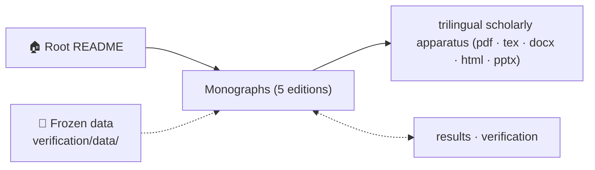
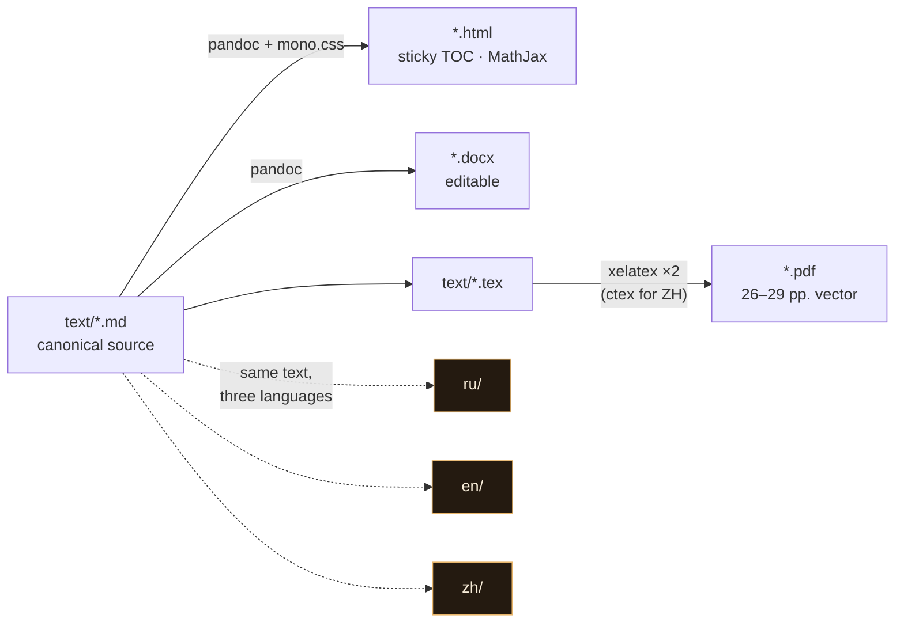

<!-- AB-ENRICHED:v1 · section=monographs -->

<strong>🗺️ How <code>monographs/</code> connects to the repository (click)</strong>

# 📖 Monographs — Five Editions, Trilingual Core

> **🧭 Navigation:** [Root README](../README.md) · [AB_Cloud_Academic_Package](../academic-package/README.md)

**All written outcomes of the project: the rewritten trilingual monograph v22 (Russian,
English, Chinese), the original author monograph v21 with its English edition, and the
corrected v21.1 editions with the errata note — every number bound to a named test.**

[Edition map](#-edition-map) · [Formats](#-what-is-stored-in-the-editions-per-language) · [The physics inside](#-the-physics-stored-inside-what-the-documents-actually-claim) · [Which file to open](#-which-file-should-i-open) · [Rebuilding](#-rebuilding-the-formats)

---

## 🗂 Table of contents

<strong>Expand / collapse</strong>

1. [🗺 Edition map](#-edition-map)
2. [📦 What is stored in the editions (per language)](#-what-is-stored-in-the-editions-per-language)
3. [🧠 The physics stored inside (what the documents actually claim)](#-the-physics-stored-inside-what-the-documents-actually-claim)
4. [🧭 Which file should I open?](#-which-file-should-i-open)
5. [🔧 Rebuilding the formats](#-rebuilding-the-formats)
6. [🔬 Deep dive — how the five editions relate](#-deep-dive--how-the-five-editions-relate)
7. [📁 Complete file inventory](#-complete-file-inventory)

---

## 🗺 Edition map

| Edition | Path | Languages | Status |
|---|---|---|---|
| Monograph v22 (rewritten on the verified suite) | [`ru/`](ru) · [`en/`](en) · [`zh/`](zh) | RU, EN, ZH | canonical, cite these |
| Original author monograph v21 + verification | [`original-v21/`](original-v21) | RU, EN | preserved as supplied; **superseded** by the v21.1 corrections |
| Corrected v21.1 editions | [`original-v21/`](original-v21) (`*_corrected.*`) | RU, EN | errata of v21 — use instead of the originals |
| Rebuilt v22.1 (updated Appendix B, new Appendix D, LaTeX sources) | `*/text/*_v221.*` + `*/text/*.tex` | RU, EN, ZH | current build |

Every number printed in any of these documents traces to a named test of the 37-test
verification suite ([`code/ab_cloud_full.jl`](../../code/README.md)) or to the spinor64
experiment ([`verification/spinor64/`](../../verification/spinor64/README.md)) with a full
computation log.

---

## 📦 What is stored in the editions (per language)

| Format | File pattern | Purpose |
|---|---|---|
| Markdown source | `text/AB_Cloud_Monograph_v22_<LANG>.md` | canonical text, figures referenced relatively — the file to diff/cite |
| LaTeX source | `text/AB_Cloud_Monograph_v22_<LANG>.tex` | typesettable source (added in v22.1) |
| Interactive HTML | `text/AB_Cloud_Monograph_v22_<LANG>.html` | sticky TOC, MathJax, figure lightbox, print stylesheet |
| Word | `text/AB_Cloud_Monograph_v22_<LANG>.docx` | editable manuscript with auto-TOC |
| PDF | `text/AB_Cloud_Monograph_v22_<LANG>.pdf` | typeset monograph (26–29 pp.), vector |
| Updated build | `text/AB_Cloud_Monograph_v22_<LANG>_v221.{docx,html,pdf}` | Appendix B → run `run_20260902_134759`; new Appendix D (spinor64) |
| Presentation | `text/AB_Cloud_Monograph_v22_<LANG>_presentation.pptx` | 14 slides, dark scientific theme |
| Preprint | `text/preprint/preprint_v22_<LANG>.{tex,pdf}` | arXiv-style preprint with bibliography |
| Figures | `figures/fig01…fig20_*.png` | 19–20 figures, 600 dpi, labels in the edition's language |

---

## 🧠 The physics stored inside (what the documents actually claim)

1. **The AB-cloud mechanism** — a Hofstadter lattice with Aharonov–Bohm flux and topological
   vortices whose level spacings reproduce the GUE statistics of the Riemann-zero sequence
   (⟨r⟩, Σ²(L), Δ₃(L), K(τ) — all within Monte-Carlo error of GUE).
2. **The 37-test verification suite** — every headline number (Montgomery–Odlyzko KS = 0.047
   with p = 0.27; Byers–Yang flux defect 3.5·10⁻¹⁵; Connes self-duality zero modes; Dirac
   cone v_F ≈ 0.125 with R² = 0.9997; b(50000) = 1.2126 …) is bound to a named test and a log.
3. **Spinor structures of the Klein quartic** — v22 Appendix D (and corrected v21.1 §3.2.5)
   report the spinor64 result: all 64 structures GUE-consistent, PSL(2,7) orbits 28/21/7/7/1,
   exact isospectrality ≈ 1e-14.
4. **Two-pass protocol** — Appendix B documents the run `run_20260902_134759` (Julia 1.12.0,
   50 000 Odlyzko zeros, 72×72 → 96×96 HARDCORE pass 2), whose raw artifacts live in
   [`results/`](../../results/README.md).

---

## 🧭 Which file should I open?

- *Reading for the physics* → `text/AB_Cloud_Monograph_v22_EN.pdf` (or `_v221.pdf` for the
  updated appendices).
- *Editing / reusing text* → the `.md` or `.tex` source.
- *Citing the corrected spinor result* → v22.1 Appendix D, or `original-v21/*_corrected.pdf`
  §3.2.5.
- *The author's original narrative (V01–V115 runs, Appendix F)* → [`original-v21/`](original-v21).

---

## 🔧 Rebuilding the formats

The `.md` → `.html/.docx` chain uses pandoc + a shared stylesheet
(`original-v21/*/text/mono.css` holds the CSS used for the HTML builds); `.tex` → `.pdf` uses
any LaTeX engine with `polyglossia`/`ctex` support (`xelatex` recommended for the ZH edition;
run twice for TOC/refs). The committed binaries were produced with exactly these tools — no
hidden pre-processing step exists.

---

## 🔬 Deep dive — how the five editions relate

The library is deliberately versioned as **editions**, not as a pile of PDFs. The canonical
line is **v22 → v22.1** (three parallel languages), rewritten from scratch on the verified
37-test suite so that every printed number resolves to a named test in `code/ab_cloud_full.jl`
or to the spinor64 experiment with its full log. **v22.1** is the current build of the same
text: Appendix B now documents the two-pass run `run_20260902_134759` (Julia 1.12.0,
50 000 Odlyzko zeros, pass 2 "HARDCORE" at 96×96), and the new Appendix D integrates the
spinor64 result — all 64 spinor structures of the Klein quartic GUE-consistent, PSL(2,7)
orbits 28/21/7/7/1, exact isospectrality at the 1e-14 level.

The **original v21** is preserved untouched as the author's historical record: its Appendix F
carries the V01–V115 verification-run narrative that led to the project, and its analytical
interpretations belong to the author alone. The v21.1 editions carry minimal errata relative
to the original text. Practical citation rule: cite v22/v22.1 for the physics, cite v21 only
when discussing the project's history.

Every edition ships in seven synchronized formats — Markdown and LaTeX sources (the files to
diff and to typeset), interactive HTML (sticky TOC, MathJax, figure lightbox, print
stylesheet), editable Word, typeset PDF (26–29 pages, vector), a 14-slide presentation, an
arXiv-style preprint with bibliography, and 19–20 figures at 600 dpi with labels in the
edition's language. The `.md → .html/.docx` chain runs through pandoc with the shared
stylesheet `original-v21/*/text/mono.css`; the `.tex → .pdf` chain runs through any
`polyglossia`/`ctex`-capable engine (`xelatex`, twice for TOC and cross-references; `ctex` is
mandatory for the ZH edition). No hidden pre-processing step exists anywhere in the chain —
what is committed is exactly what was built.

---

## 📁 Complete file inventory

| Entry | Size | Kind |
|---|---|---|
| `assets/` | 3 files | directory — banner + avatar art used by this README |
| `en/` | 33 files, ≈54 MB | directory |
| `original-v21/` | 96 files, ≈186 MB | directory — incl. `media/`, 75 extracted page figures |
| `ru/` | 33 files, ≈55 MB | directory |
| `zh/` | 33 files, ≈48 MB | directory |
| `PACKAGE_README.md` | 4.3 KB | file |
| `README.md` | 5.1 KB | file |
| **Total (recursive)** | **200 files, ≈341 MB** | |

---

  <em>Five editions, three languages, seven formats — one verified text.</em>

<!-- AI end-cap — prompt P-04, registry: assets/prompts/AI_PROMPTS.md -->

🖼️ Section art: <a href="../assets/prompts/AI_PROMPTS.md">P-04</a> · palette <code>#05060f · #00e5ff · #ff2ec4 · #a78bfa · #ffd60a</code>

⚡ Part of <a href="../README.md">AB-Cloud Research</a> — phase resonator for the zeros of the Riemann zeta function · <a href="../README.md">🏠 Root README</a>

