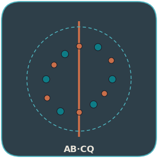
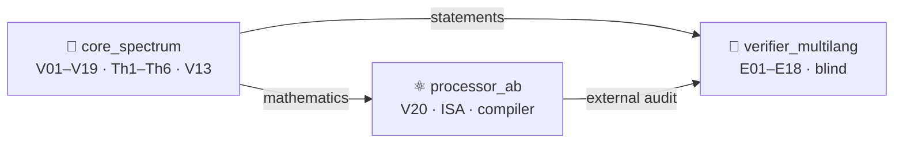

<!-- AB-ENRICHED:v1 · sub -->

**🧭 [⬆ AB_Cloud_Quantum_Research/](../README.md) · [🏠 Root README](../../README.md)**

<!-- enriched 1.1.0 -->

<picture>
  <source media="(prefers-color-scheme: dark)" srcset="../assets/logo_abcloud_dark.png">
  
</picture>

### 🧧 Modules — three levels of one machine

`AB Cloud Quantum Research` · v1.1.0 · part of one machine

> 🧭 **Navigation:** [↑ main README](../README.md) · [📚 monographs](../MONOGRAPH_ARCHIVE/README.md) · [🧪 hypothesis lab](../HYPOTHESIS_LAB/README.md) · [🎞 animations](../VISUAL_ANIMATIONS/README.md)
# 🧩 modules/ — the levels of one study

**AB Cloud Quantum Research** — one study, three working levels.
Each module is a complete layer of the shared machine with its own campaigns,
data, monographs and web laboratory, but they all work toward one goal:
*the AB (Aharonov–Bohm) architecture as a computer that reads mathematics
in real time and stores nothing*.

| | Module | Campaigns | Essence |
|---|--------|----------|------|
| 🧠 | [`core_spectrum/`](core_spectrum/README.md) | **V01–V19** | Spectral core: blind spectrum, null models, critical line, the obligation machine **V13** (RH = `blocked`), branch stitching **V19**; theorems **Th1–Th6**, the formal Lean 4 / Coq layer; a 10-tab web laboratory |
| ⚛️ | [`processor_ab/`](processor_ab/README.md) | **V20** (phase P0) | AB processor: the ISA of AB clouds, the exact Givens-QR compiler (1−F ≤ 4.4e−16), the **"reads, does not carry"** principle, no-signaling nonlocality; an 8-tab web laboratory |

| 🔬 | [`verifier_multilang/`](verifier_multilang/README.md) | **E01–E18** | Verification platform on Julia: blind reading of all **649+639** ζ zeros up to T=1000 by two engines, independent Riemann–Siegel, class B — the compiler against 5 baselines (**×59,000**); 18/18 pre-registered verdicts PASS |

## How the levels connect

- The core supplies the mathematics: the operator H_ξ, the trace formula (Th6), the
  obligation machine V13, the claim-file discipline.
- The processor executes it: the same ISA as in the core campaigns; zero
  reading (the V23 preview) is built on the trace formula Th6.
- Verification re-checks both layers with independent engines: the blind
  detectors E11/E17 read the zeros without hints; E18 compares the compiler
  with strong baselines under equal constraints.
- The formal layer (`core_spectrum/formal/`, reductions A1–A6)
  fixes the statements of Th1–Th6; the theorem layer [`../theorems_lemmas/`](../theorems_lemmas/README.md)
  makes them readable (24 documents RU/EN × PDF/DOCX).
- The supplementary study [`../research/realtime_spinor_memory/`](../research/realtime_spinor_memory/README.md)
  reduces the central claim to models: the machine has no long-term
  memory — only volatile state executing steps in real time.

The level map and data flow: [`../docs/ARCHITECTURE.md`](../docs/ARCHITECTURE.md).

## English summary

`modules/` holds the three working levels of one study: the spectral
core (V01–V19, Th1–Th6, V13), the AB processor (V20/P0, exact
compilation, "reads, does not carry"), and the Julia verification
platform (E01–E18). Levels share one ISA, one claim discipline and one
obligation machine; the theorem layer and the supplementary spinor
memory study build on them.

---

*Part of the discipline: pre-registration · blind protocols · replication ·
negative results published*

**AB Cloud Quantum Research** · v1.1.0 ·
[license](../../../LICENSE) · © Isaev Iskhak Khamzatovich

