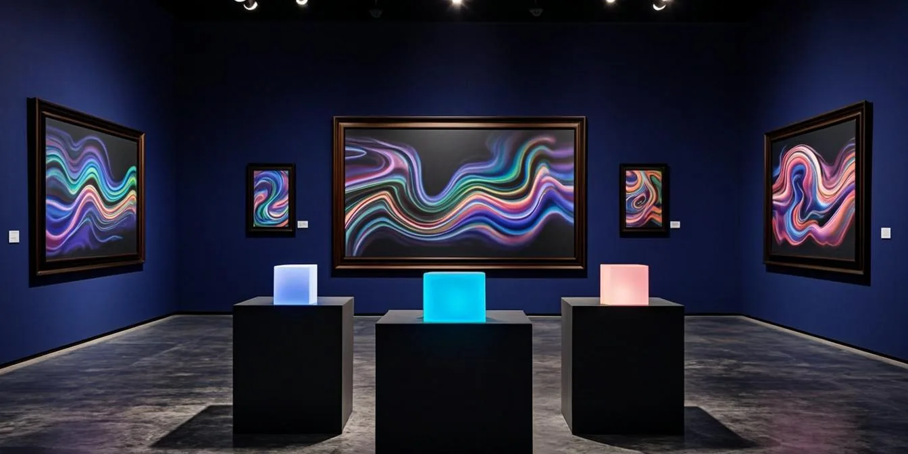
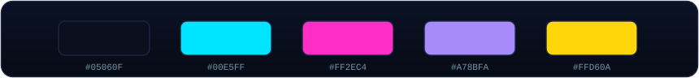
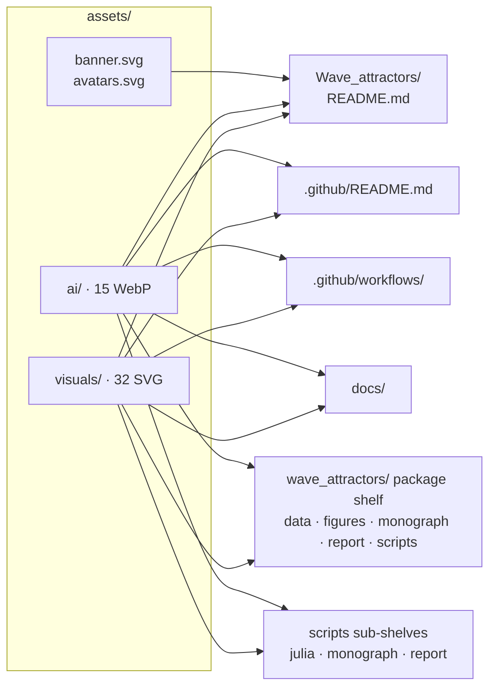

<!-- AB-ENRICHED:v2 · wave-deep-dive · visual identity shelf -->

**🧭 [⬆ Wave_attractors/](../README.md) · [🏠 Root README](../../README.md)**

# 🎨 `assets/` — every pixel study W1 wears

> **The visual-identity shelf of the Hyperbolic Wave Attractors folder.** Nothing here
> carries numerical content — these are artworks, animations and layout pieces, referenced
> relatively by the fourteen README pages of the folder. Everything is committed, so every
> README renders identically on GitHub, in a local clone and inside the archived package:
> no external CDN except the two explicitly shared services (capsule-render,
> readme-typing-svg).

> **🧭 Navigation:** [⬆ Wave_attractors/](../README.md) · [🏠 Root README](../../README.md)

---

## 🌈 The folder palette

## 🗂 What lives here

| Family | Files | What they are |
|---|---|---|
| `banner.svg` · `avatars.svg` | 2 | the original hand-written animated banner and the study cast (rays, attractors, battery, Py↔Julia parity) |
| [`visuals/`](visuals/) | 32 | the v2 SMIL animation family: 4 wave dividers, 13 folder glyphs, hero cascade, chiral pair, cone sweep, E1–E7 pipeline, data lattice, seal, book, frames, parity, press, stamp, circuit, gear, swatches, blueprint |
| [`ai/`](ai/) | 15 | AI-rendered art: the W1 hero, 13 unique folder banners (one per README) and the study avatar — all WebP, all from registered prompts |

**Total: 49 committed visual assets**, every one referenced by at least one README page
of this folder (see the map below).

<strong>🗺️ Consumption map — who wears what (click)</strong>

Every page picks its **accent color** from the folder palette — gold for infrastructure,
magenta for CI and the report, violet for assets and the code layer, cyan for the
physics — so the fourteen pages read as one family without being clones.

<strong>🛠 Craft rules of this shelf (click)</strong>

* **SMIL, not CSS/JS** — all animations in `visuals/` are declarative SMIL
  (`<animate>`, `<animateTransform>`, `<animateMotion>`): they run inside ``
  tags on GitHub, need no build step and no external fonts, and stay view-source friendly.
* **No inline `<svg>` in READMEs** — the repository markdownlint forbids inline SVG HTML;
  every animation is referenced through an `` tag with a descriptive `alt` text.
* **AI art is registered** — each render in `ai/` corresponds to a prompt ID
  (P-W1 … P-W16) in the central registry [`assets/prompts/AI_PROMPTS.md`](../../../assets/prompts/AI_PROMPTS.md)
  of the repository, so every image can be regenerated byte-consistently in spirit.
* **WebP over PNG** — AI renders ship as WebP (≈5–10× smaller than PNG at equal quality);
  the PNG originals stay in the generation staging, not in the repository.

## 🧭 Where to go next

[🌀 Section README](../README.md) · [📦 Package shelf](../wave_attractors/README.md) ·
[🏗 Infrastructure](../.github/README.md)

---

🌀 <strong>Hyperbolic Wave Attractors — study W1</strong> · part of
<a href="../../README.md">AB-Cloud Research</a> ·
DOI <a href="https://doi.org/10.5281/zenodo.21825394">10.5281/zenodo.21825394</a> ·
<a href="../README.md">⬆ section</a>

