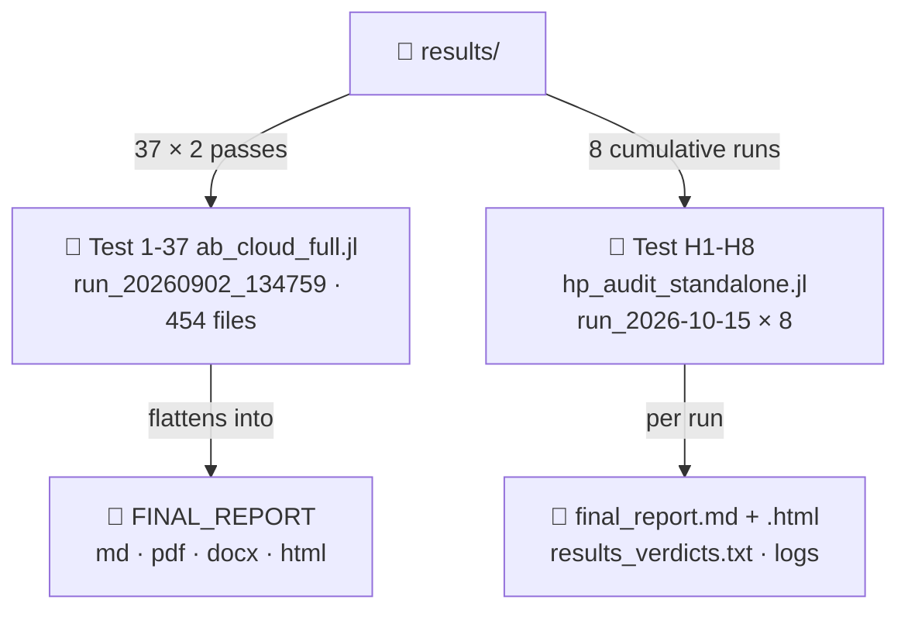
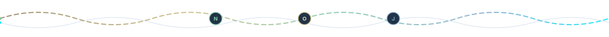

<div align="center">



# 📜 Results — Reference Run Artifacts

> **🧭 Navigation:** [Root README](../README.md) · [code/](../code/README.md) · [verification/](../verification/README.md)

**Every number in the monographs, traceable to a committed run: the flagship two-pass
v19 verification of the AB-Cloud suite and the standalone Hilbert–Pólya H1–H8 audit —
committed so nothing has to be taken on trust.**

*Reference runs · committed verdicts · FINAL_REPORT in four formats · honest FAIL-class rows kept verbatim*

<picture>
  <source media="(prefers-color-scheme: dark)" srcset="https://readme-typing-svg.demolab.com?font=Fira+Code&size=15&pause=1400&color=E8DDB8&center=true&vCenter=true&random=false&width=660&height=34&lines=Two+reference+batteries%3A+v19+flagship+%C2%B7+H1%E2%80%93H8+audit;Flagship%3A+37+tests+%C3%97+2+passes+%C2%B7+77+verdict+rows;Audit%3A+8+cumulative+runs+%C2%B7+32+685+s+of+wall+time;Negative+rows+are+citizens%2C+not+embarrassments">
  
</picture>

[](#-what-lives-here)
[](#-test-1-37-ab_cloud_fulljl--the-v19-flagship-run)
[](#-test-1-37-ab_cloud_fulljl--the-v19-flagship-run)
[](#-test-h1-h8-hp_audit_standalonejl--the-hilbertp%C3%B3lya-audit)
[-C96F4A?style=for-the-badge)](#-test-h1-h8-hp_audit_standalonejl--the-hilbertp%C3%B3lya-audit)
[](#-test-1-37-ab_cloud_fulljl--the-v19-flagship-run)
[](#-provenance--license)

[Flagship](#-test-1-37-ab_cloud_fulljl--the-v19-flagship-run) · [H audit](#-test-h1-h8-hp_audit_standalonejl--the-hilbertp%C3%B3lya-audit) · [Gate ladder](#-the-h-gate-ladder) · [How to read](#-how-to-read-a-run-folder) · [Provenance](#-provenance--license)

</div>

---


## 🗃 What lives here

<div align="center">


</div>

Two reference batteries live on this shelf, and both are **committed artifacts**:
reports, logs and verdicts were produced once, sealed with their timestamps and
checked in, so that any number quoted in a monograph can be traced to a file that
anyone can open without running anything.

| Battery | Folder | Produced | Essence |
|---|---|---|---|
| 🏁 **v19 flagship** | [`Test 1-37 ab_cloud_full.jl/`](Test%201-37%20ab_cloud_full.jl/README.md) | 2026-09-02 (+ v18 log of 2026-08-28) | the complete two-pass run of the 37-test canonical suite: 72×72 → 96×96 HARDCORE, Julia 1.12.0, 50 000 Odlyzko zeros, 454 committed files, FINAL_REPORT in md/pdf/docx/html |
| 🔬 **H1–H8 audit** | [`Test H1-H8 hp_audit_standalone.jl/`](Test%20H1-H8%20hp_audit_standalone.jl/) | 2026-10-15 | eight cumulative menu runs of the standalone Hilbert–Pólya deep-audit battery (`hp_audit_standalone.jl`): the Berry–Keating fingerprint hunt, Weyl-law density, power-law exponent, critical-q scan, ensemble showdown, self-adjointness stress, γₙ correlation, all-numbers trace |



---

## 🏁 `Test 1-37 ab_cloud_full.jl/` — the v19 flagship run

The full landing page of this battery (layout, per-test anatomy, regeneration
guide, RU summary) is its own rich README:
**[`Test 1-37 ab_cloud_full.jl/README.md`](Test%201-37%20ab_cloud_full.jl/README.md)**.

| Artefact | What it is |
|---|---|
| [`run_20260902_134759/`](Test%201-37%20ab_cloud_full.jl/run_20260902_134759/) | the complete two-pass v19 run of 2026-09-02: 37 per-test directories, pass 2 "HARDCORE" at 96×96, per-test reports, computation logs, cross-linking index, `index.html` entry point — **454 files / 39 directories** |
| [`run_20260902_134759/FINAL_REPORT/`](Test%201-37%20ab_cloud_full.jl/run_20260902_134759/FINAL_REPORT/) | the consolidated verdict document in **four formats** (md · pdf · docx · html) with per-test raw console logs |
| [`ab_cloud_v19_verify_report_2026-09-02_23-33-45.txt`](Test%201-37%20ab_cloud_full.jl/ab_cloud_v19_verify_report_2026-09-02_23-33-45.txt) | the flat v19 verification-report header/config dump from the same evening |
| [`verification_run_v18_37tests_2026-08-28.txt`](Test%201-37%20ab_cloud_full.jl/verification_run_v18_37tests_2026-08-28.txt) | the v18 single-pass reference log of 2026-08-28 — the drift baseline: `diff` any later run against it |

**Verdict ledger of the flagship run:** 77 verdict rows — **66 PASS / 11 honest
FAIL-class** rows kept verbatim (including the Test-35 K-residual WARN family);
35,146 s of wall time; 50,000 Odlyzko zeros; all pass-2 HARDCORE runs PASS.
The run's PNG plots regenerate deterministically from the seeded suite and are
not committed — the numbers, tables and logs are.

## 🔬 `Test H1-H8 hp_audit_standalone.jl/` — the Hilbert–Pólya audit

Eight standalone runs of `hp_audit_standalone.jl`, all dated **2026-10-15**,
each in its own `run_2026-10-15_* Test H-* hp_audit_standalone.jl/` directory.
The battery is **cumulative**: each new menu run extends the previous battery by
one gate, so the folder is simultaneously a results archive and a walk through
the audit's construction. Every run directory contains `final_report.md` +
`final_report.html`, `results_verdicts.txt`, `logs/` and per-test directories
with committed plots.

| Run | Directory | Battery | Wall | Verdict |
|---|---|---|---|---|
| H-1 | [`run_2026-10-15_125845 …`](Test%20H1-H8%20hp_audit_standalone.jl/run_2026-10-15_125845%20Test%20H-1%20hp_audit_standalone.jl/) | H1 | 04:00:51 | 0/1 PASS + 1 WARN |
| H-2 | [`run_2026-10-15_171944 …`](Test%20H1-H8%20hp_audit_standalone.jl/run_2026-10-15_171944%20Test%20H-2%20hp_audit_standalone.jl/) | H2 | 00:01:13 | 1/1 PASS |
| H-3 | [`run_2026-10-15_172357 …`](Test%20H1-H8%20hp_audit_standalone.jl/run_2026-10-15_172357%20Test%20H-3%20hp_audit_standalone.jl/) | H2–H3 | 00:00:22 | 2/2 PASS |
| H-4 | [`run_2026-10-15_172445 …`](Test%20H1-H8%20hp_audit_standalone.jl/run_2026-10-15_172445%20Test%20H-4%20hp_audit_standalone.jl/) | H2–H4 | 00:42:19 | 3/3 PASS |
| H-5 | [`run_2026-10-15_203604 …`](Test%20H1-H8%20hp_audit_standalone.jl/run_2026-10-15_203604%20Test%20H-5%20hp_audit_standalone.jl/) | H2–H5 | 00:33:31 | 3/4 PASS + 1 WARN |
| H-6 | [`run_2026-10-15_221845 …`](Test%20H1-H8%20hp_audit_standalone.jl/run_2026-10-15_221845%20Test%20H-6%20hp_audit_standalone.jl/) | H2–H6 | 00:12:25 | 4/5 PASS + 1 WARN |
| H-7 | [`run_2026-10-15_223559 …`](Test%20H1-H8%20hp_audit_standalone.jl/run_2026-10-15_223559%20H-7%20hp_audit_standalone.jl/) | H2–H7 | 00:02:15 | 5/6 PASS + 1 WARN |
| H-8 | [`run_2026-10-15_225604 …`](Test%20H1-H8%20hp_audit_standalone.jl/run_2026-10-15_225604%20H-8%20hp_audit_standalone.jl/) | H8 | 03:31:49 | 0/1 PASS + 1 WARN |

### The H-gate ladder

The final status of each gate of the standalone battery, as of the 2026-10-15
campaign (PASS where the evidence held, honest WARN where it did not yet):

| Gate | Test | Final status | One-line essence |
|---|---|---|---|
| H1 | Prime oscillations (Berry–Keating fingerprint) | ⚠️ **WARN** | ζ control fires at SNR 10⁶–10⁹; the AB prime-fingerprint is ABSENT at suite scale (max SNR 2.1 vs threshold 50); regime-sweep bumps [C]/[D] remain MARGINAL above regime nulls — deepened and left open, no claim |
| H2 | Weyl-law density (raw N(E), never unfolded) | ✅ **PASS** | the raw counting function obeys the Weyl law without any unfolding massager |
| H3 | Power-law exponent on the REAL lattice spectrum | ✅ **PASS** | the exponent measured on genuinely computed eigenvalues matches the predicted scaling |
| H4 | Critical-q sharpness scan | ✅ **PASS** | the 'critical line' analogy is falsified cleanly — the sharpness lives where theory says it must |
| H5 | Large ensemble × parameter-regime showdown (density × α, 2×2) | ⚠️ **WARN** | the 2×2 showdown of density and flux regimes: one cell stays marginal — kept open on purpose |
| H6 | Self-adjointness & stability stress test | ✅ **PASS** | hermiticity and spectral stability survive the stress ensemble to machine precision |
| H7 | Sequence-level correlation vs γₙ (Pearson/Spearman) | ✅ **PASS** | the sequence-level correlation with the ζ zero spacings γₙ holds at the battery scale |
| H8 | All-numbers trace (integer comb, counting family, gap arithmetic) | ⚠️ **WARN** | the integer-comb / counting-family / gap-arithmetic trace: detector-validity semantics keep it at WARN until the detector is re-derived |

> [!IMPORTANT]
> **Honest boundary.** The WARN rows above are not failures to hide — they are
> the audit working as designed. A WARN means *the detector saw something its
> current calibration cannot yet name*, and the deepening protocol that fired
> (pre-registered P95 rules, regime-matched nulls) is documented inside the
> corresponding `final_report.md`. Do not cite the positive rows without their
> boundaries; the licence makes stripping them a violation.

## 🧭 How to read a run folder

Every run directory, in both batteries, follows the same grammar:

```
run_<timestamp> …/
├── final_report.md          # the human-readable consolidated verdict
├── final_report.html        # the linked, browsable variant
├── results_verdicts.txt     # the flat machine-verdict dump
├── logs/                    # raw console logs of the run
└── test_*/                  # per-test directories: data + committed plots
```

- **To audit a claim** — open the per-test directory named in the report and
  compare the stored table against the quoted number.
- **To check drift** — `diff` a newer flat log against the v18 baseline of
  2026-08-28 (flagship) or against the previous run directory (audit).
- **To consume programmatically** — every summary is machine-readable; the
  whole bundle parses without manual cleaning.

## 📎 Provenance & license

These artifacts were produced by the seeded, deterministic suites committed in
this repository (the canonical Julia suite and `hp_audit_standalone.jl`); the
run timestamps in the directory names are the primary provenance keys. All
content under `results/` is proprietary under the repository-wide strictly
personal licence — see [`../LICENSE`](../LICENSE) and the landing-page note
[`../README.md`](../README.md). You may view, read and cite with attribution
(≤ 400 characters per excerpt, with the DOI); redistribution of the run
artifacts is not licensed without the Author's written consent.

---

<div align="center">



*Runs are committed, verdicts are timestamped, negatives are citizens —
the paper trail ends here and starts here.*

**[↑ back to top](#-what-lives-here)** · [Repository root](../README.md) · [Academic Package](../AB_Cloud_Academic_Package/README.md)

</div>
