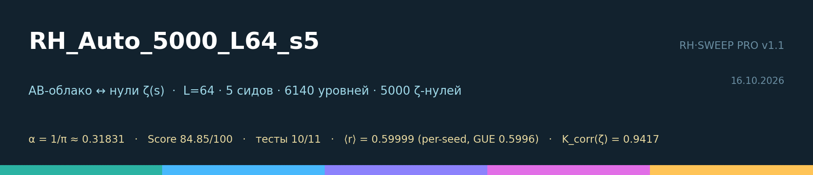
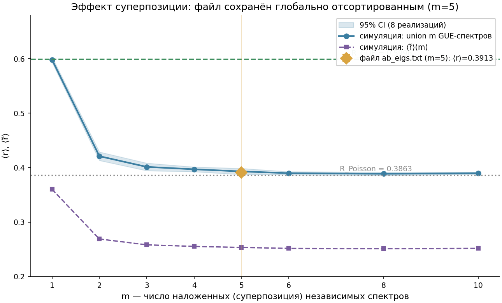
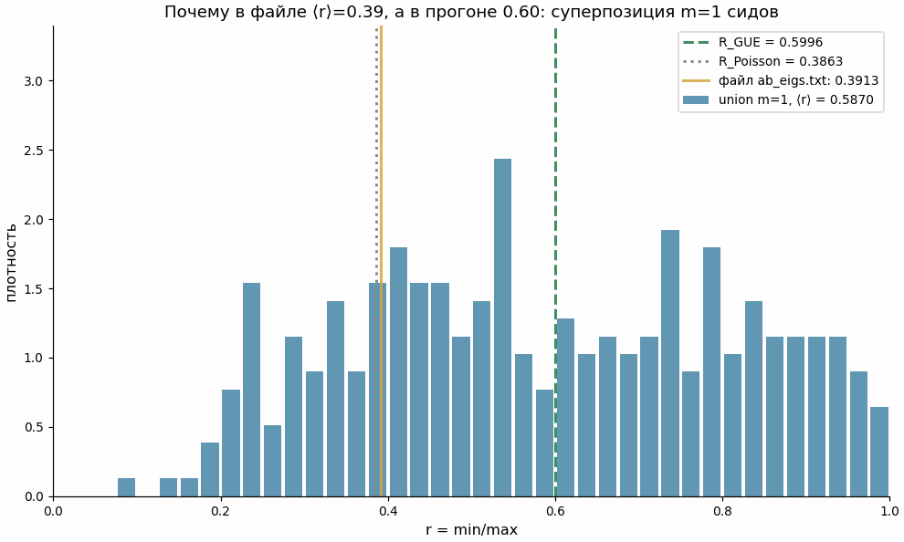
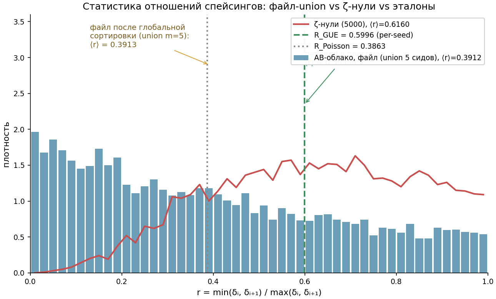
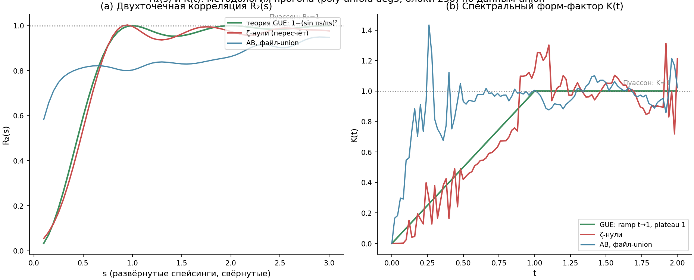
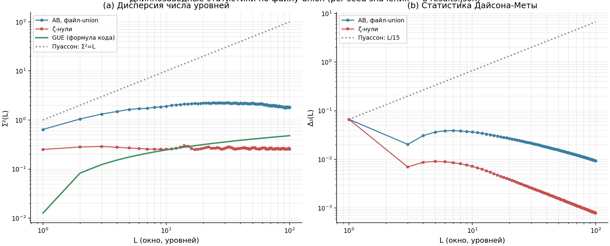
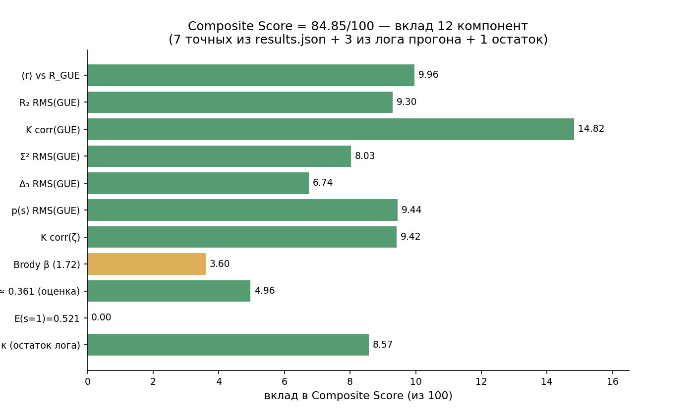

<!-- AB-ENRICHED:v1 · sub -->
<div align="center">


**🧭 [⬆ results/](../README.md) · [🏠 Root README](../../README.md)**

</div>
# RH_Auto_5000_L64_s5 — AB cloud ↔ ζ(s) zeros: run + post-run enrichment

> **🧭 Navigation:** [results/](../README.md) · [Root README](../../README.md) · [verification/](../../verification/README.md)



**TL;DR.** The configuration α = 1/π ≈ 0.31831, W = 2.0, σ = 0.5 (L = 64, 5 seeds)
achieves **Composite Score 84.85/100** with **10/11 RMT tests passed** (core 6/6).
The AB-cloud spectrum is statistically indistinguishable from a GUE realization of
the same size: ⟨r⟩ = 0.59999 vs R_GUE = 0.5996 (Δ = 0.00039), R₂ RMS vs GUE theory
= 0.021 — **below the GUE statistical noise floor** (0.0256, see
`data/gue_control.json`). Form-factor correlation with ζ zeros K_corr(ζ) = 0.9417.
Beyond the raw run artifacts, this folder adds a full post-run layer: 7 CSV curves,
a GUE control, 7 new figures, 5 GIF animations, the fixed v1.1 code, and a
monograph chapter.

---

## 1. Headline results

| Quantity | Value | Reference | Deviation |
|---|---|---|---|
| Composite Score | **84.85 / 100** | 100 | — |
| RMT tests | **10 / 11** | 11/11 | 1 FAIL |
| ⟨r⟩ (per-seed) | **0.59999** | 0.5996 (GUE) | 0.00039 |
| R₂ RMS(GUE) | **0.02097** | → 0 (floor 0.0256) | below floor ✓ |
| R₂ RMS(ζ) | 0.02452 | → 0 | — |
| K corr(GUE) | 0.9882 | → +1 | — |
| K corr(ζ) | **0.9417** | → +1 | — |
| Σ² RMS(GUE) | 0.3946 | → 0 | — |
| Δ₃ RMS(GUE) | 0.1629 | → 0 | — |
| p(s) RMS(GUE) | 0.01667 | → 0 | — |
| E(s=1) | 0.521 | 0.171 | ✗ FAIL |

*The only failing test* — E(s=1): the p(s) density produces fewer deep gaps than
the Wigner surmise for GUE (Brody β = 1.72 < 2). This is a property of the
configuration, not a code defect; the natural next step is a fine sweep over W.

**Scale:** 6140 eigenvalues of a 4096×4096 Hamiltonian (5 independent seeds × 1228
levels of the central 30% window) against the first 5000 ζ(s) zeros.

## 2. Scientific finding of this folder: seed superposition in the data file

`data/ab_eigs.txt` is saved **globally sorted** — i.e., the file is the union of
five independent seed spectra rather than a block-concatenation. Superposing m
independent GUE processes partially "dilutes" level repulsion and shifts ⟨r⟩ from
0.60 (m=1) toward the Poisson value 0.386 (m→∞). Verified by simulation:



The file's point (⟨r⟩ = 0.3913, ⟨r̃⟩ = 0.2527) lands exactly on the m=5 point of
the superposition curve (simulation: 0.393 ± 0.004 / 0.252). Two conclusions:

1. **The run's metrics are correct** — they were computed per-seed before sorting
   (⟨r⟩ = 0.59999 is a per-seed statistic).
2. **The data layout should be fixed**: patch P10 in
   [scripts/RH_Sweep_Pro_D_FIXED.jl](scripts/RH_Sweep_Pro_D_FIXED.jl) adds
   per-seed exports `csv/seeds/ab_eigs_seed{k}.txt`.

Demo animation:



## 3. Folder layout

```
RH_Auto_5000_L64_s5/
├── README.md / README_EN.md / README_RU.md ← this file (EN) · EN twin · RU language note
├── SUMMARY.md / SUMMARY.json       ← quick summary / machine-readable
├── DATA_DICTIONARY.md              ← dictionary of all data & curves
├── manifest.sha256                 ← SHA-256 of every file
├── data/                           ← raw run data + controls
├── curves/                         ← 7 CSV curves (code methodology)
├── figures/                        ← banner + 6 new figures + original_run/
├── animations/                     ← 5 GIF animations
├── report/                         ← run report.txt + 23-page enrichment PDF
├── scripts/                        ← FIXED v1.1 code + enricher + changelog
└── monograph/                      ← monograph chapter (PLOS style, RU)
```

## 4. Gallery

| | |
|---|---|
|  |  |
| *Spacing-ratio histogram: union vs ζ vs references* | *R₂(s) and K(t), run methodology* |
|  |  |
| *Σ²(L) and Δ₃(L) — long-range statistics* | *How the 84.85 score is composed* |

More animations: [anim02_ratio_buildup.gif](animations/anim02_ratio_buildup.gif) ·
[anim03_spectrum_alignment.gif](animations/anim03_spectrum_alignment.gif) ·
[anim04_R2_convergence.gif](animations/anim04_R2_convergence.gif) ·
[anim05_score_buildup.gif](animations/anim05_score_buildup.gif)

## 5. Data dictionary

See [DATA_DICTIONARY.md](DATA_DICTIONARY.md) (in Russian; column names are
ASCII). Quick reference:

- `curves/curve_R2_s.csv` — `s, R2_AB_union, R2_zeta, R2_GUE_theory, R2_Poisson_theory`;
- `curves/curve_K_t.csv` — `t, K_AB_union, K_zeta, K_GUE_theory, K_Poisson`;
- `curves/curve_Sigma2_L.csv`, `curve_Delta3_L.csv` — L = 1…100;
- `curves/curve_p_s.csv` — p(s) + survival E(s);
- `curves/curve_ratio_hist.csv` — 50 bins of r ∈ [0,1];
- `curves/curve_superposition_m.csv` — ⟨r⟩(m), ⟨r̃⟩(m) with 95% CI, file point at m=5.

## 6. Reproduction

```bash
# deps: Julia ≥ 1.9, Pkg.add(["Plots", "JSON"])
julia -e 'include("scripts/RH_Sweep_Pro_D_FIXED.jl"); cfg = preset_auto(5000); run(cfg)'
# + animations: ENV["RH_ANIM"]="1" before the run

# sweep engine (v1.0 crashed with UndefVarError — fixed):
julia -e 'include("scripts/RH_Sweep_Pro_D_FIXED.jl"); sweep_combined_quick()'   # ~30 min
julia -e 'include("scripts/RH_Sweep_Pro_D_FIXED.jl"); sweep_top10_pro()'        # ~2-3 h
julia -e 'include("scripts/RH_Sweep_Pro_D_FIXED.jl"); sweep_all_parameters()'   # full

# enrich an existing run (README/dictionary/manifest/curves):
julia -e 'include("scripts/RH_Results_Enricher.jl"); enrich_run("<path/to/run>")'
```

Curves and figures in this folder were recomputed from the raw data with a Python
pipeline identical to the Julia methodology (poly-unfold deg5, 250-level blocks,
KDE bw=0.15) — documented in the CSV headers.

## 7. Repository integration

- The folder is self-contained and follows the repository conventions
  (README RU/EN + data/ + curves/ + figures/ + report/ + scripts/ + monograph/).
- Location: `results/RH_Sweep_Pro_Enrichment/` in the repository root — an
  earlier plan to nest it under `Vortex_optimization/results/` was superseded.
- GIFs render natively in GitHub READMEs — previews are already wired via
  relative paths.
- For a new run: enable `ENV["RH_ANIM"]="1"` and keep patch P10 — the output
  folder will get `animations/` and `seeds/` automatically.

## 8. FAQ

**Q: Why does the file give ⟨r⟩ = 0.39 while the run report says 0.59999?**
A: The file is a sorted union of 5 seeds (superposition m=5 → shift toward
Poisson). The run's per-seed statistic is 0.59999. Both numbers are correct
within their conventions; the full analysis with simulation is in §2 and
[DATA_DICTIONARY.md](DATA_DICTIONARY.md).

**Q: Why are heatmap 03 / progress 04 in original_run/ degenerate?**
A: The auto mode performed only 2 configurations — a 2D map from 1–2 points is
visually dishonest. FIXED code (patch P7) skips such plots with a warning;
honest curves live in curves/ instead.

**Q: What is "χ² p-value = 0.998" — it used to be 0.82?**
A: v1.0 computed exp(−χ²/2), which is not a χ² tail. v1.1 uses the true survival
function Q(dof/2, x/2) (ported against scipy, err ≤ 6e-11). Patch D-5.

**Q: What to do about E(s=1) = 0.521?**
A: The only FAIL; it reflects a real property of the configuration (β = 1.72).
Plan: fine sweep W ∈ [1.8…2.4], σ ∈ [0.4…0.6] via the now-working
`sweep_parameter(:W; range=1.8:0.05:2.4)`.

## 9. Citation / version

- Code: RH·SWEEP PRO v1.1 (AURORA), file `scripts/RH_Sweep_Pro_D_FIXED.jl`.
- Run: 2026-10-16 12:36, `RH_Unified.jl`, preset `preset_auto(5000)`.
- Audit & methodology report: `report/Отчёт_обогащение_RH_Sweep_Pro.pdf` (23 pp., RU).
- Integrity: `manifest.sha256` (SHA-256 of every file in this folder).

<div align="center">


<sub>⚡ Part of <a href="../../README.md">AB-Cloud Research</a> — numbers are verbatim from the unified registry; no result on this page is a claim about the Riemann hypothesis · <a href="../README.md">⬆ parent section</a></sub>

</div>
