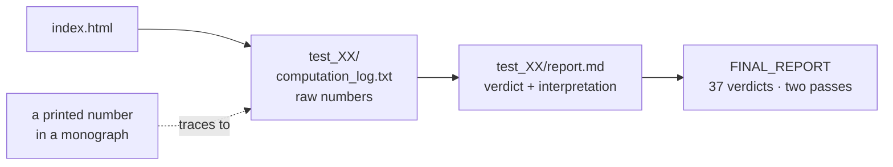

<div align="center">



# 📜 Results — Run Artifacts and Reference Logs

**Everything the Julia suite produced on paper-worthy runs, committed so the numbers in the
monographs are checkable without running anything.**

[](#-complete-file-inventory)
[](#-run_202609022026134759--layout)
[](#-run_202609022026134759--layout)
[](#-run_202609022026134759--layout)
[](#-run_202609022026134759--layout)
[](#-the-37-tests-folder-names-are-self-describing)
[](#-regenerating-the-plots)

[Layout](#-run_202609022026134759--layout) · [The 37 tests](#-the-37-tests-folder-names-are-self-describing) · [Regenerating plots](#-regenerating-the-plots) · [Flat logs](#-flat-reference-logs) · [How to read](#-how-to-read-a-run-folder) · [Deep dive](#-deep-dive--anatomy-of-the-flagship-run) · [Кратко](#-кратко-по-русски)

</div>

---

## 🗂 Table of contents

<details open>
<summary><strong>Expand / collapse</strong></summary>

1. [🗃 What lives here](#-what-lives-here)
2. [🗺 `run_20260902_134759/` — layout](#-run_202609022026134759--layout)
3. [🧪 The 37 tests (folder names are self-describing)](#-the-37-tests-folder-names-are-self-describing)
4. [♻️ Regenerating the plots](#-regenerating-the-plots)
5. [📋 Flat reference logs](#-flat-reference-logs)
6. [🧭 How to read a run folder](#-how-to-read-a-run-folder)
7. [🔬 Deep dive — anatomy of the flagship run](#-deep-dive--anatomy-of-the-flagship-run)
8. [📁 Complete file inventory](#-complete-file-inventory)
9. [🇷🇺 Кратко (по-русски)](#-кратко-по-русски)

</details>

---

## 🗃 What lives here

<div align="center">


</div>

Two kinds of content live here:

1. **[`run_20260902_134759/`](run_20260902_134759/)** — the complete two-pass v19 run of
   2026-09-02 (37 tests, Julia 1.12.0, 50 000 Odlyzko zeros, pass 2 "HARDCORE" at 96×96):
   per-test reports, logs, final report, cross-linking index. The run's PNG plots are not
   committed (the directory ships 453 files of reports, tables and logs) — the plots
   regenerate deterministically from the suite.
2. **Two flat reference logs** — the 2026-08-28 37-test run (v18) and the v19
   verification-report header/config dump from 2026-09-02.

---

## 🗺 `run_20260902_134759/` — layout

```
run_20260902_134759/
├── index.html                  # browser index cross-linking all 37 tests + final report
├── FINAL_REPORT/               # aggregated two-pass verdict
│   ├── final_report.md / .pdf / .docx / .html
│   ├── logs/                   # run-level logs
│   └── reports/                # aggregated per-test blocks
├── test_01_bN_convergence/     # one folder per test (37 total)
│   ├── report.md / .pdf / .docx / .html
│   └── logs/
│       ├── computation_log.txt # the actual numbers: fits, statistics, thresholds
│       └── stdout_capture.txt  # raw console output of the test
├── test_02_bN_monotonicity/
│   …
└── test_37_half_factorial_gamma/
```

Every `report.md` opens with the verdict line
(`Verdict: PASS | Generated: … | Suite: AB-Cloud v19 (Julia 1.12.0)`), explains what the test
verifies, states the raw result (e.g. `8 sub-checks, 0 failed, b(50000)=1.2126 → PASS`) and
lists the plots that the suite regenerates.

---

## 🧪 The 37 tests (folder names are self-describing)

| # | Test | # | Test |
|---|---|---|---|
| 01 | bN_convergence | 20 | … |
| 02 | bN_monotonicity | … | full list: `ls results/run_20260902_134759/` |
| 03 | bN_rate | … | the suite's own docs: `code/ab_cloud_v19.jl` header |
| 04 | gue_ks_full | … | |
| … | | 36 | byte_robust |
| … | | 37 | half_factorial_gamma |

Highlights: GUE statistics of the 50 000-zero sample (⟨r⟩, KS, Σ², Δ₃), Byers–Yang flux
defect 3.5·10⁻¹⁵, Connes self-duality, Dirac cone v_F ≈ 0.125 (R² = 0.9997), Berry R₂(0),
Arf/orbit checks, robustness battery.

---

## ♻️ Regenerating the plots

The plots were stripped from the committed run to keep the repository light (the run writes
~600 dpi PNG + SVG + PDF + GIF per figure). Reproduce the whole run including plots:

```bash
julia code/ab_cloud_v19.jl --test all      # 30–60 min; writes a NEW timestamped run folder
```

The committed `run_20260902_134759` numbers are reproducible because the suite is seeded and
reads the frozen data in [`verification/data/`](../verification/data/).

---

## 📋 Flat reference logs

| File | What it is |
|---|---|
| [`verification_run_v18_37tests_2026-08-28.txt`](verification_run_v18_37tests_2026-08-28.txt) | full console log of the 2026-08-28 v18 37-test run — the historical basis of monograph v22; includes the b(N) fit (b(N) ≈ 7.0312·N^(−0.1685), R² = 0.9895; alternative 1/log N fit R² = 0.9994) and the v23-notation caveat that α = 1/2 refers to the AB-phase, not the convergence rate |
| [`ab_cloud_v19_verify_report_2026-09-02_23-33-45.txt`](ab_cloud_v19_verify_report_2026-09-02_23-33-45.txt) | header/config dump of the v19 verification report: zeros = 50000, n_bootstrap = 1000, chi2_bins = 300, gue_matrix_size = 12000 (seed 112), rmt CDF table 32 768-pt (max\|ΔF\| = 4.9e-9), embedded-dataset note |

---

## 🧭 How to read a run folder

1. Open `index.html` in a browser — it links every test and the final report.
2. For a single test, read `test_XX_*/logs/computation_log.txt` first (raw numbers), then
   `report.md` (verdict + interpretation).
3. `FINAL_REPORT/final_report.md` aggregates all 37 verdicts of both passes.



---

## 🔬 Deep dive — anatomy of the flagship run

`run_20260902_134759/` is the complete artifact set of the two-pass v19 run: 37 tests,
Julia 1.12.0, 50 000 Odlyzko zeros, pass 2 in "HARDCORE" mode on a 96×96 lattice (pass 1 runs
72×72). The folder carries a `FINAL_REPORT` with the consolidated verdicts, an `index.html`
that cross-links every test to its own directory, and per-test directories
`test_01_bN_convergence` … `test_37_*`, each holding the test's report and raw log. The run's
PNG plots are intentionally **not** committed: every plot regenerates deterministically from
the suite, and excluding them keeps the repository clone-able — the numbers, which are what
the monographs cite, are all here as text.

How to check a printed number. Take any figure quoted in the monographs — say the
pair-correlation KS distance 0.047 with p = 0.27, the Byers–Yang flux defect 3.5e-15, the
Dirac slope v_F ≈ 0.125 with R² = 0.9997, or b(50000) = 1.2126. Open `FINAL_REPORT`, find the
test row, follow the `index.html` link into the test directory and read the report and log:
inputs, parameters, statistic, p-value. Nothing is hidden behind a rerun; the chain
printed-page → test → log is complete and committed.

The two flat logs beside the run directory serve as the historical baseline: the 2026-08-28
v18 37-test run (the first full-suite pass, referenced by the earlier monograph builds) and
the v19 verification report header/config dump from 2026-09-02 (the exact configuration of
the flagship run). To reproduce rather than just read: install Julia 1.12, point the suite at
`verification/data/` and run `code/ab_cloud_v19.jl` — the frozen inputs guarantee
byte-identical statistics.

---

## 📁 Complete file inventory

| Entry | Size | Kind |
|---|---|---|
| `run_20260902_134759/` | 453 files, 7.3 MB | directory |
| `README.md` | 4.5 KB | file |
| `ab_cloud_v19_verify_report_2026-09-02_23-33-45.txt` | 986.5 KB | file |
| `verification_run_v18_37tests_2026-08-28.txt` | 58.3 KB | file |
| **Total (recursive)** | **456 files, 8.4 MB** | |

---

## 🇷🇺 Кратко (по-русски)

- Артефакты прогона v19 от 2026-09-02: 37 тестов, два прохода (второй — HARDCORE 96×96),
  Julia 1.12.0, 50 000 нулей Одлыжко.
- Структура: по папке на тест (report md/pdf/docx/html + computation_log + stdout),
  FINAL_REPORT, index.html; графики из прогона исключены и воспроизводятся набором
  `julia code/ab_cloud_v19.jl --test all`.
- Плюс два плоских журнала: прогон v18 от 2026-08-28 (основа монографии v22) и конфиг-дамп
  верификационного отчёта v19.
- Читать так: index.html → computation_log.txt теста → report.md → FINAL_REPORT.
- `run_20260902_134759/` — полный артефакт-сет двухпроходного прогона v19; PNG-графики
  прогона сознательно не закоммичены (в каталоге 453 текстовых файла — отчёты, таблицы,
  логи): детерминированно пересоздаются набором; все цитируемые числа хранятся текстом.
- Проверка числа: FINAL_REPORT → index.html → каталог теста → отчёт/лог. Рядом два
  плоских лога-бейслайна (v18 от 2026-08-28 и конфиг v19).

---

<p align="center">
  <sub><em>Printed page → test → log: the chain is complete and committed.</em></sub>
</p>
