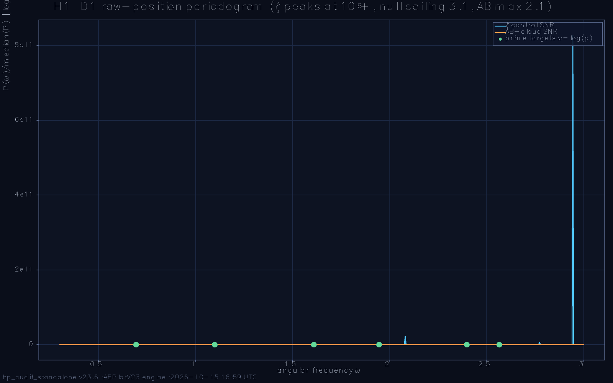
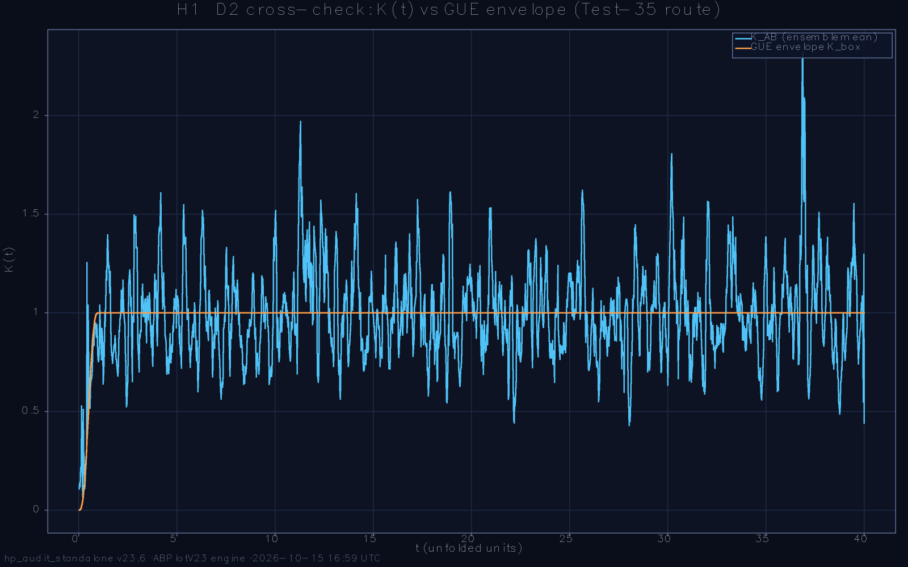
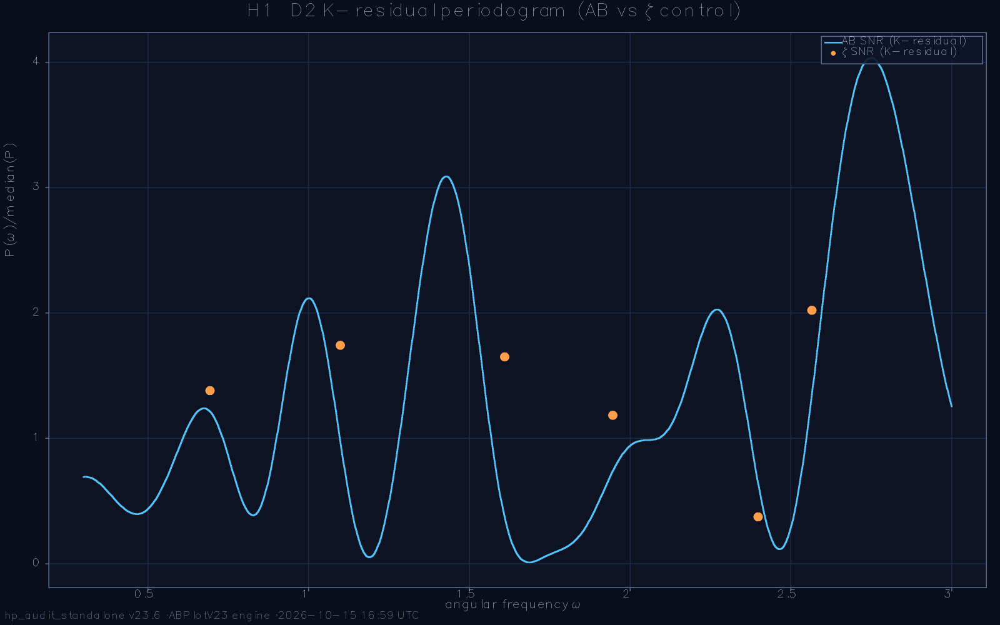
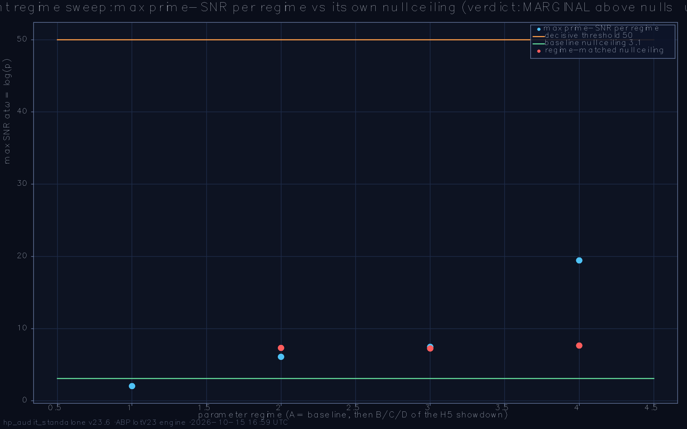

# Hilbert-Pólya Deep Audit — standalone battery report

**Run:** `run_2026-10-15_125845` · **preset:** menu · **date:** 2026-10-15 16:59:36 · **wall:** 04:00:51

ζ zeros loaded: **yes**

## Parameters
```
L=72  L_weyl=72  ensemble=100  seed=2026
α=0.5  W_eff=1.0  sweep=:showdown
deep-nulls=20  deep-configs=10  α-profile=true (n=40)
primes=2,3,5,7,11,13  q-grid=21 on [0.05, 1.0]
ladder=28→36→44→52→60  t_max=40.0  dt=0.025
```

**Battery verdict:** 0/1 PASS + 1 WARN (detector-validity semantics; the physics headlines live inside the tests)

---

## H1. Prime oscillations (Berry–Keating fingerprint)  — **WARN**

>  Test H1: ζ control validated, null ceiling 3.1, AB max prime-SNR 2.1 (threshold 50) → fingerprint absent; sweep: MARGINAL above regime nulls (unexplained → WARN, deepen) → deepened: [B] 6.1 vs P95 7.3 → absent, [C] 7.5 vs P95 7.3 → MARGINAL, [D] 19.4 vs P95 7.7 → MARGINAL → WARN

| sub-check | status | detail |
|---|---|---|
| ζ control fires (D1) | PASS | 6/6 prime Bragg peaks with SNR ≥ 100 (Riemann–Weil expectation) |
| nulls silent (D1) | PASS | vortex-free + GUE ceiling = 3.1 (abs limit 10; weakest ζ peak 2.3e+07 — 100× margin ok) |
| AB fingerprint verdict | PASS | ABSENT — max SNR 2.1 < threshold 50 |
| fingerprint regime-robust (sweep) | WARN | max SNR per regime (own null ceiling in parens): [B] 6.1 (7.3) [C] 7.5 (7.3) [D] 19.4 (7.7) → MARGINAL above regime nulls at [C] 7.5 vs ceiling 7.3, [D] 19.4 vs ceiling 7.7 → NOT explained by non-arithmetic spectra at the same parameters — deepen before any claim (reviewer round 2) DEEPENED (v23.6, pre-registered P95 rule): [B] deep AB 6.1 vs P95 7.3 → absent; [C] deep AB 7.5 vs P95 7.3 → MARGINAL; [D] deep AB 19.4 vs P95 7.7 → MARGINAL |
| Envelope cross-check (D2) | WARN | RMS(K−K_box, t≥0.3) = 0.3172 (Test-35 family target < 0.30; gates the test status) |






_Note:_ D1 (primary) is the 1-level raw-position Fourier transform: the Riemann–Weil explicit formula puts the arithmetic information into pure tones ω = k·log(p) of the RAW density, so a spectrum carrying it shows Bragg peaks there. Empirical calibration at v23.3 defaults: ζ control fires at SNR 10⁶–10⁹ (log 2, log 3, log 5, log 13 AND harmonics 3·log 2, 4·log 2 — the explicit-formula signature), vortex-free Hofstadter nulls ≤ 2.1, GUE nulls ≤ 5.2. D2 (the K(t)-residual route) is the two-level cross-check: intrinsically less sensitive because the 1-level explicit-formula signal enters the 2-level statistic only at subleading order — its ζ control honestly does NOT fire at suite scale, which the report states explicitly. The AB verdict compares against the EMPIRICAL null ceiling with a 10× margin. REGIME SWEEP (reviewer actions 2026-09-06, rounds 1+2): the AB spectra are re-measured at the H5 showdown's parameter points — monograph density Nv = L²/36, sharp-flux α = 25/900, and both combined — because an ABSENT fingerprint counts as a model-class statement only if it survives the model's best-faith points. Round 2: each extra regime ALSO runs its own regime-matched null controls (vortex-free lattice at the same α + GUE at matched size, fresh seeds), and the regime bump is judged against THAT ceiling: an isolated log(2) bump that the nulls reproduce at the same parameters is a generic lattice/flux-geometry artifact (the ζ signature is a simultaneous comb on ALL primes at SNR 10⁷+, not a single-prime bump), while a bump above the regime nulls earns an honest WARN and deeper study; the sweep status enters the test status — no PASS painted over MARGINAL content. v23.6 (reviewer round 3): (a) the D1 window AUTO-EXTENDS to every target and the target list SPLITS into primes vs composite DECOYS — the ζ Bragg comb must be silent on the decoys (specificity clause folded into zeta_ok), and the AB decoy SNR is reported alongside; (b) a MARGINAL/PRESENT regime triggers the DEEPEN protocol: the regime null ceiling is re-estimated from hp_deep_nulls vortex-free + hp_deep_nulls GUE realizations (the round-2 ceiling came from ONE of each — an extreme-value statistic whose single-draw noise is comparable to the observed 7.6-vs-6.8 margin), the AB ensemble is extended by hp_deep_configs configs, and the pre-registered rule fires: deep bump ≤ P95(null maxima) → generic flux-geometry artifact → regime absent (question closed by data); bump > P95 → unexplained even vs deep nulls → honest WARN with escalation.

