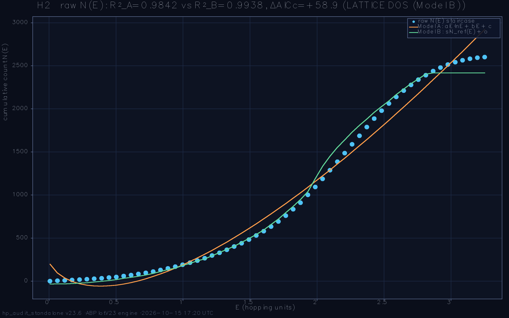

# Hilbert-Pólya Deep Audit — standalone battery report

**Run:** `run_2026-10-15_171944` · **preset:** menu · **date:** 2026-10-15 17:20:57 · **wall:** 00:01:13

ζ zeros loaded: **yes**

## Parameters
```
L=72  L_weyl=72  ensemble=100  seed=2026
α=0.5  W_eff=1.0  sweep=:showdown
deep-nulls=20  deep-configs=10  α-profile=true (n=40)
primes=2,3,5,7,11,13  q-grid=21 on [0.05, 1.0]
ladder=28→36→44→52→60  t_max=40.0  dt=0.025
```

**Battery verdict:** 1/1 PASS + 0 WARN (detector-validity semantics; the physics headlines live inside the tests)

---

## H2. Weyl-law density test (raw N(E), never unfolded)  — **PASS**

>  Test H2: R²_A=0.98416, R²_B=0.99384, ΔAICc=+58.9 → LATTICE DOS (Model B) → PASS

| sub-check | status | detail |
|---|---|---|
| both fits computed | PASS | n = 60 grid points, models A (3-par) / B (2-par) |
| fit quality floor | PASS | R²_A = 0.98416, R²_B = 0.99384 (floor 0.95) |
| decisive separation | PASS | ΔAICc = +58.9 |
| winner (headline) | PASS | lattice DOS wins by 58.9 AICc — raw density is ORDINARY lattice physics |



_Note:_ Model A embeds the Riemann–Weil smooth counting form N̄(T)=(T/2π)ln(T/2π)−T/2+7/8 with free coefficients — a pure shape test. Model B is the vortex-free Hofstadter cumulative spectrum (same L, α, t; W=0): the 'ordinary lattice' hypothesis. The everywhere-used local-mean unfolding would force unit mean spacing and make this comparison impossible — that is why the test runs on the raw spectrum.

