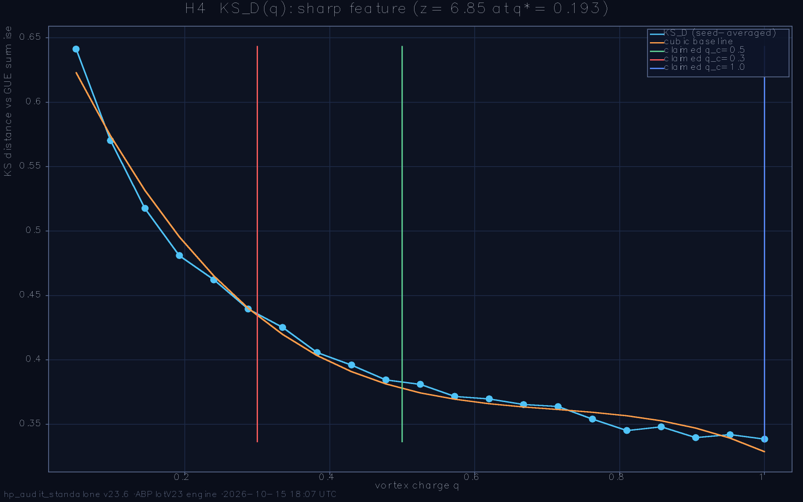
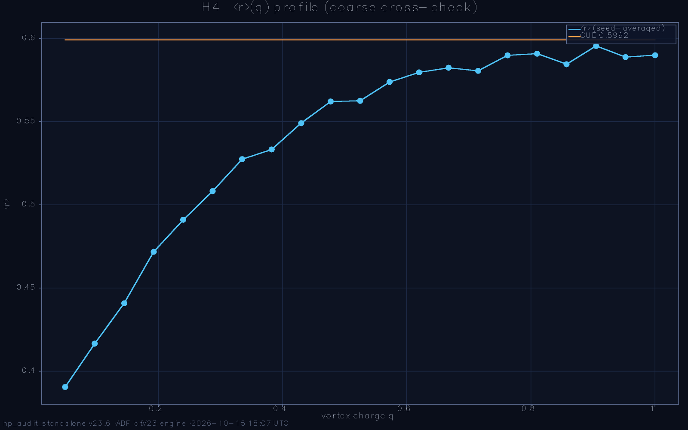

# Hilbert-Pólya Deep Audit — standalone battery report

**Run:** `run_2026-10-15_172445` · **preset:** menu · **date:** 2026-10-15 18:07:04 · **wall:** 00:42:19

ζ zeros loaded: **yes**

## Parameters
```
L=72  L_weyl=72  ensemble=100  seed=2026
α=0.5  W_eff=1.0  sweep=:showdown
deep-nulls=20  deep-configs=10  α-profile=true (n=40)
primes=2,3,5,7,11,13  q-grid=21 on [0.05, 1.0]
ladder=28→36→44→52→60  t_max=40.0  dt=0.025
```

**Battery verdict:** 3/3 PASS + 0 WARN (detector-validity semantics; the physics headlines live inside the tests)

---

## H2. Weyl-law density test (raw N(E), never unfolded)  — **PASS**

>  Test H2: R²_A=0.98416, R²_B=0.99384, ΔAICc=+58.9 → LATTICE DOS (Model B) → PASS

| sub-check | status | detail |
|---|---|---|
| both fits computed | PASS | n = 60 grid points, models A (3-par) / B (2-par) |
| fit quality floor | PASS | R²_A = 0.98416, R²_B = 0.99384 (floor 0.95) |
| decisive separation | PASS | ΔAICc = +58.9 |
| winner (headline) | PASS | lattice DOS wins by 58.9 AICc — raw density is ORDINARY lattice physics |


_Note:_ Model A embeds the Riemann–Weil smooth counting form N̄(T)=(T/2π)ln(T/2π)−T/2+7/8 with free coefficients — a pure shape test. Model B is the vortex-free Hofstadter cumulative spectrum (same L, α, t; W=0): the 'ordinary lattice' hypothesis. The everywhere-used local-mean unfolding would force unit mean spacing and make this comparison impossible — that is why the test runs on the raw spectrum.

---

## H3. Power-law exponent on the REAL lattice spectrum  — **PASS**

>  Test H3: per-L min|p̂−2| = 1.328 (≥ 155σ), p_∞ note: low=0.524±7.547 / bulk=0.396±6.280 → dictionary REJECTED (expected negative) → PASS

| sub-check | status | detail |
|---|---|---|
| low-window fit quality | PASS | min R² over ladder = 0.98166 (floor 0.98) |
| bulk-window fit quality | PASS | min R² over ladder = 0.99812 (floor 0.98) |
| per-L falsification (decisive) | PASS | min \|p̂−2\| = 1.328 at ≥ 155σ (every rung/window; se ≤ 0.0086) — the rejection does NOT rest on the L→∞ extrapolation |
| L→∞ extrapolation (note) | PASS | UNSTABLE (informational): p_∞ = 0.3958 ± 6.2795, se ≫ estimate — non-monotone rung scatter; the verdict rests on the per-L fits, NOT on this extrapolation (reviewer sync 2026-09-06) |
| dictionary verdict | PASS | REJECTED (expected honest negative, status synced with H1/H7) — \|p_∞−2\|: low 1.476 / bulk 1.604; the real 2D spectrum is not (n−q)² lattice physics |
| Dirac-cone readout (low window) | PASS | mean \|p̂−1/2\|: low 0.077 < bulk 0.106 → the near-edge (vortex-dominated) spectrum is Dirac-cone-like, not dictionary-like — reviewer observation 2026-09-06, promoted to a headline |


_Note:_ Fitting the REAL spectrum (not the toy ring of lab E8) answers the reviewer's question directly: if the (n−q)² dictionary were the lattice physics, p̂(L) would extrapolate to 2. The honest 2D alternatives are p = 1/2 (Dirac cone: N(E) ∝ E² near E = 0) in the low window and p ≈ 1 (constant DOS of a quadratic band) in the bulk — both falsify the dictionary claim. VERDICT SEMANTICS (reviewer sync 2026-09-06): a REJECTED dictionary is the EXPECTED honest negative and PASSES the audit exactly like H1's absent fingerprint and H7's zero correlation (one and the same outcome class must not split into PASS and WARN across tests); the test fails only on method grounds — fit quality below floor, too few rungs, or the spectrum actually approaching p = 2. The unstable L→∞ extrapolation (5 rungs, non-monotone scatter, se ≫ estimate) is reported as an INFORMATIONAL note because the verdict rests on the per-L fits, each ≫5σ from the dictionary anchor; the Dirac-cone proximity of the low window is stated as its own physics headline rather than being buried inside the rejection.

---

## H4. Critical-q sharpness scan (falsifying the 'critical line' analogy)  — **PASS**

>  Test H4: 21 q-points, KS_D min 0.4810 at q*=0.193, z=6.85 → sharp, NOT at a claimed critical (real but unpredicted) → PASS

| sub-check | status | detail |
|---|---|---|
| scan completed | PASS | 21 q-points × 2 seeds, all metrics finite |
| noise floor resolved | PASS | σ(noise) = 0.00211 from per-point seed pairs |
| sharp-feature verdict | PASS | SHARP: z = 6.85 at q* = 0.193, width 0.10 span (nearest claimed 0.3) |
| location vs claimed criticals | PASS | resonance at q* = 0.193 does NOT coincide with any claimed critical (nearest 0.3, off by 0.107 = 11% of span) → the sharp feature is real but UNPREDICTED — the analogy is NOT corroborated (reviewer sync 2026-09-06) |
| ⟨r⟩ scan range | PASS | 0.3905 … 0.5955 across the grid |




_Note:_ Design: vortex POSITIONS are frozen across the grid so the profile responds only to the charge; two disorder seeds per point give the honest noise floor. Prominence = largest baseline-corrected dip of the cubic-smoothed profile in units of that floor, AND the half-prominence width must stay below 35% of the scan span — a wide residual hump is baseline curvature, not a critical point. A smooth profile is the expected outcome for a generic vortex model and FALSIFIES the 'q plays the role of 1/2' analogy. LOCATION HONESTY (reviewer sync 2026-09-06): the scan answers 'is there sharp structure' — it does NOT answer 'does the structure sit where the theory needs it'; a resonance away from every claimed critical is reported as real-but-unpredicted, and the analog claim is scored by the dedicated location row. Noise-floor caveat: 2 seeds per point make σ a 1-parameter estimate — z is indicative, not distribution-level proof.

