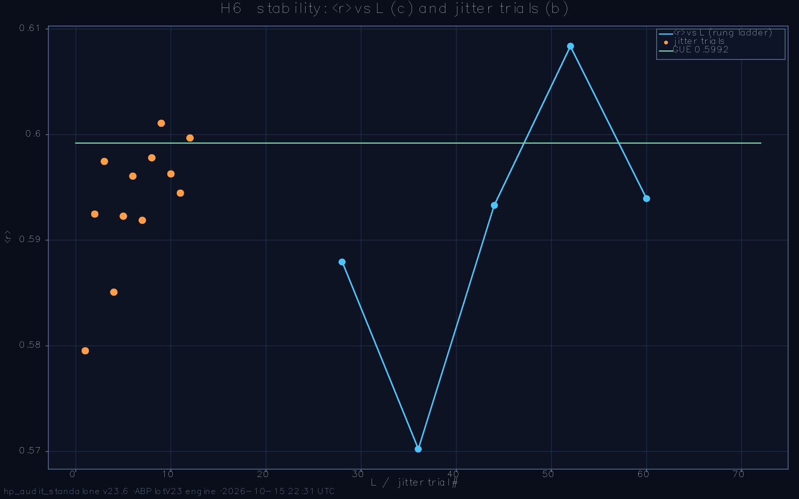

# Hilbert-Pólya Deep Audit — standalone battery report

**Run:** `run_2026-10-15_221845` · **preset:** menu · **date:** 2026-10-15 22:31:10 · **wall:** 00:12:25

ζ zeros loaded: **yes**

## Parameters
```
L=72  L_weyl=72  ensemble=100  seed=2026
α=0.5  W_eff=1.0  sweep=:showdown
deep-nulls=20  deep-configs=10  α-profile=true (n=40)
primes=2,3,5,7,11,13  q-grid=21 on [0.05, 1.0]
ladder=28→36→44→52→60  t_max=40.0  dt=0.025
```

**Battery verdict:** 4/5 PASS + 1 WARN (detector-validity semantics; the physics headlines live inside the tests)

---

## H2. Weyl-law density test (raw N(E), never unfolded)  — **PASS**

>  Test H2: R²_A=0.98416, R²_B=0.99384, ΔAICc=+58.9 → LATTICE DOS (Model B) → PASS

| sub-check | status | detail |
|---|---|---|
| both fits computed | PASS | n = 60 grid points, models A (3-par) / B (2-par) |
| fit quality floor | PASS | R²_A = 0.98416, R²_B = 0.99384 (floor 0.95) |
| decisive separation | PASS | ΔAICc = +58.9 |
| winner (headline) | PASS | lattice DOS wins by 58.9 AICc — raw density is ORDINARY lattice physics |


_Note:_ Model A embeds the Riemann–Weil smooth counting form N̄(T)=(T/2π)ln(T/2π)−T/2+7/8 with free coefficients — a pure shape test. Model B is the vortex-free Hofstadter cumulative spectrum (same L, α, t; W=0): the 'ordinary lattice' hypothesis. The everywhere-used local-mean unfolding would force unit mean spacing and make this comparison impossible — that is why the test runs on the raw spectrum.

---

## H3. Power-law exponent on the REAL lattice spectrum  — **PASS**

>  Test H3: per-L min|p̂−2| = 1.328 (≥ 155σ), p_∞ note: low=0.524±7.547 / bulk=0.396±6.280 → dictionary REJECTED (expected negative) → PASS

| sub-check | status | detail |
|---|---|---|
| low-window fit quality | PASS | min R² over ladder = 0.98166 (floor 0.98) |
| bulk-window fit quality | PASS | min R² over ladder = 0.99812 (floor 0.98) |
| per-L falsification (decisive) | PASS | min \|p̂−2\| = 1.328 at ≥ 155σ (every rung/window; se ≤ 0.0086) — the rejection does NOT rest on the L→∞ extrapolation |
| L→∞ extrapolation (note) | PASS | UNSTABLE (informational): p_∞ = 0.3958 ± 6.2795, se ≫ estimate — non-monotone rung scatter; the verdict rests on the per-L fits, NOT on this extrapolation (reviewer sync 2026-09-06) |
| dictionary verdict | PASS | REJECTED (expected honest negative, status synced with H1/H7) — \|p_∞−2\|: low 1.476 / bulk 1.604; the real 2D spectrum is not (n−q)² lattice physics |
| Dirac-cone readout (low window) | PASS | mean \|p̂−1/2\|: low 0.077 < bulk 0.106 → the near-edge (vortex-dominated) spectrum is Dirac-cone-like, not dictionary-like — reviewer observation 2026-09-06, promoted to a headline |


_Note:_ Fitting the REAL spectrum (not the toy ring of lab E8) answers the reviewer's question directly: if the (n−q)² dictionary were the lattice physics, p̂(L) would extrapolate to 2. The honest 2D alternatives are p = 1/2 (Dirac cone: N(E) ∝ E² near E = 0) in the low window and p ≈ 1 (constant DOS of a quadratic band) in the bulk — both falsify the dictionary claim. VERDICT SEMANTICS (reviewer sync 2026-09-06): a REJECTED dictionary is the EXPECTED honest negative and PASSES the audit exactly like H1's absent fingerprint and H7's zero correlation (one and the same outcome class must not split into PASS and WARN across tests); the test fails only on method grounds — fit quality below floor, too few rungs, or the spectrum actually approaching p = 2. The unstable L→∞ extrapolation (5 rungs, non-monotone scatter, se ≫ estimate) is reported as an INFORMATIONAL note because the verdict rests on the per-L fits, each ≫5σ from the dictionary anchor; the Dirac-cone proximity of the low window is stated as its own physics headline rather than being buried inside the rejection.

---

## H4. Critical-q sharpness scan (falsifying the 'critical line' analogy)  — **PASS**

>  Test H4: 21 q-points, KS_D min 0.4810 at q*=0.193, z=6.85 → sharp, NOT at a claimed critical (real but unpredicted) → PASS

| sub-check | status | detail |
|---|---|---|
| scan completed | PASS | 21 q-points × 2 seeds, all metrics finite |
| noise floor resolved | PASS | σ(noise) = 0.00211 from per-point seed pairs |
| sharp-feature verdict | PASS | SHARP: z = 6.85 at q* = 0.193, width 0.10 span (nearest claimed 0.3) |
| location vs claimed criticals | PASS | resonance at q* = 0.193 does NOT coincide with any claimed critical (nearest 0.3, off by 0.107 = 11% of span) → the sharp feature is real but UNPREDICTED — the analogy is NOT corroborated (reviewer sync 2026-09-06) |
| ⟨r⟩ scan range | PASS | 0.3905 … 0.5955 across the grid |


_Note:_ Design: vortex POSITIONS are frozen across the grid so the profile responds only to the charge; two disorder seeds per point give the honest noise floor. Prominence = largest baseline-corrected dip of the cubic-smoothed profile in units of that floor, AND the half-prominence width must stay below 35% of the scan span — a wide residual hump is baseline curvature, not a critical point. A smooth profile is the expected outcome for a generic vortex model and FALSIFIES the 'q plays the role of 1/2' analogy. LOCATION HONESTY (reviewer sync 2026-09-06): the scan answers 'is there sharp structure' — it does NOT answer 'does the structure sit where the theory needs it'; a resonance away from every claimed critical is reported as real-but-unpredicted, and the analog claim is scored by the dedicated location row. Noise-floor caveat: 2 seeds per point make σ a 1-parameter estimate — z is indicative, not distribution-level proof.

---

## H5. Large ensemble × parameter-regime showdown (density × α, 2×2)  — **WARN**

>  Test H5: 4 regime(s) × N=7, GUE reached in 3/4 (clean: D; OR-clause only: B,C) → failure PARAMETER-DEPENDENT (finetuning-flavored); α-profile: NONE — no clean pass anywhere on the α-line (contradicts regime C's clean pass?! check seeds/protocol) → WARN

| sub-check | status | detail |
|---|---|---|
| solve plan ≤ 40 eigensolves (v24.1 budget) | PASS | plan: 7 config(s) × 4 regime(s) + 12 α-profile = 40 diagonalizations (user cap 2026-09-09 — the old «N ≥ 30» row retired: a cap must not be a silent auto-FAIL; per-config KS granularity 1/7) |
| [A] baseline (published run) | WARN | ⟨r⟩ 0.5898±0.0102, in-band 85.7% (6/7, CI 59.8–100.0%) \| RAW individual KS-pass 0.0% (0/7) \| median D 0.3531 → misses GUE |
| [B] monograph density Nv=L²/36 | PASS | ⟨r⟩ 0.6000±0.0052, in-band 100.0% (7/7, CI 100.0–100.0%) \| RAW individual KS-pass 14.3% (1/7) \| median D 0.0559 → GUE reached via OR-clause ONLY — median D < 0.10 hides a systematic per-realization shift (raw KS-pass tells the truth) |
| [C] sharp-flux α=25/900 | PASS | ⟨r⟩ 0.5937±0.0041, in-band 100.0% (7/7, CI 100.0–100.0%) \| RAW individual KS-pass 0.0% (0/7) \| median D 0.0646 → GUE reached via OR-clause ONLY — median D < 0.10 hides a systematic per-realization shift (raw KS-pass tells the truth) |
| [D] combined (density + sharp-flux) | PASS | ⟨r⟩ 0.6003±0.0050, in-band 100.0% (7/7, CI 100.0–100.0%) \| RAW individual KS-pass 100.0% (7/7) \| median D 0.0148 → GUE reached (clean) |
| ⟨r⟩ scatter (worst regime) | PASS | max σ = 0.0102 over 4 regime(s) (limit 0.02 — a lucky seed would show σ ≈ its own deviation) |
| clean GUE pass (no OR-clause) | PASS | clean at [D] (raw individual KS-pass ≥ 90%); OR-clause-only at [B,C] |
| synthesis (headline, never scored) | PASS | PARAMETER-DEPENDENT — GUE recovers at regime(s) B,C,D, but CLEAN pass (raw individual KS-pass ≥ 90%, no OR-clause) only at [D] = Nv=144 (2.78% of sites, L²/36 anchor), α=0.0278, 25/900 sharp-flux; OR-clause-only: B,C → GUE quality appears only at a specifically tuned parameter point — a finetuning story (Test-38 flavor), NOT evidence against it |
| α-profile (headline, never scored) | PASS | NONE — no clean pass anywhere on the α-line (contradicts regime C's clean pass?! check seeds/protocol) — α=0.0278: KS-pass 0% (0/2), median D 0.0584, in-band 100%; α=0.0500: KS-pass 0% (0/2), median D 0.0846, in-band 100%; α=0.1000: KS-pass 0% (0/2), median D 0.1843, in-band 50%; α=0.2000: KS-pass 0% (0/2), median D 0.3701, in-band 100%; α=0.3500: KS-pass 0% (0/2), median D 0.5258, in-band 100%; α=0.5000: KS-pass 0% (0/2), median D 0.3447, in-band 100% |


_Note:_ Placement AND residual-disorder patterns vary across realizations (independent MersenneTwister streams), so the scatter σ is the honest realization noise of the model, not a bootstrap resample of one configuration; the Wald CI quantifies the binomial uncertainty of each in-band fraction. REGIME DESIGN (reviewer action 2026-09-06): a PRE-REGISTERED 2×2 factorial — {sparse Nv | monograph density Nv = L²/36 (the 25/900 = 2.78% anchor; the same lever that lifted the Test-32 comparison row to GUE)} × {α = ab_alpha_test16 | sharp-flux α = 25/900 ≈ 0.0278 (the ORIGINAL design default of ab_alpha_test16)}; regime A reproduces the published baseline bit-for-bit (identical seed streams) and W stays at the HP standard everywhere. The headline contrasts a REGIME-ROBUST failure (model-class property at every tested point) against a PARAMETER-DEPENDENT outcome; the regime TABLE is the evidence, the 'best' regime is reported for orientation, and best-of-4 selection is pre-registered, not post hoc. A model-class property needs ≥ 90% of realizations inside the band at a regime. STATUS SEMANTICS v23.5 (reviewer round 2): the test status is the strict AND of all scored rows — a regime that misses GUE (e.g. the published baseline) propagates to the test status instead of being silently overridden by the synthesis ('1 failed → WARN' and the final line now always agree). A 'GUE reached' via the median-D OR-clause is flagged separately from a CLEAN pass, because 0/40→near-0% individual KS passes is a systematic, reproducible deviation, not noise; and the only clean pass in the 2×2 sits at the doubly-tuned point (density AND sharp-flux together), which reads as finetuning — consistent with the Test-38 story — rather than as evidence against it. v23.6 α-PROFILE (reviewer round 3): run 185208 showed the clean pass rides on α = 25/900 in BOTH densities ([C],[D]), so the missing experiment is the GUE-quality profile ALONG the screening axis at fixed sparse Nv — α ∈ {25/900, 0.05, 0.1, 0.2, 0.35, 0.5} × ≤2 configs under the v24.1 ≤40-solve budget on a disjoint seed stream. PLATEAU-LOW (clean for all α ≤ α*) reads as 'the sharp-flux side is GUE-universal — the published α = 0.5 baseline is the outlier'; NARROW (clean only at 25/900) confirms finetuning along the axis; the α = 0.5 endpoint independently replicates regime A from a different stream (internal consistency check). The α-profile is a READOUT row (never scored) — the regime table remains the scored evidence.

---

## H6. Self-adjointness & stability stress test  — **PASS**

>  Test H6: boundary ok, jitter ok, hermiticity 0.0e+00 → PASS

| sub-check | status | detail |
|---|---|---|
| (a) open↔torus bulk | PASS | \|Δ⟨r⟩\| = 0.0061 ≤ 0.022 |
| (b) jitter stability | PASS | ⟨r⟩ drift 0.0195, spectral drift 0.0019·BW over 12 trials |
| (c) hermiticity every rung | PASS | worst max\|H−H†\| = 0.00e+00 (machine-ε limit 1e-9) |
| (c) ⟨r⟩ bounded on ladder | PASS | 0.5702 … 0.6084 over L = 28,36,44,52,60 |



_Note:_ A Hilbert–Pólya operator must survive the three probes that would break a fine-tuned artifact: a boundary switch (edge states must stay OUTSIDE the bulk window), parameter jitter (the spectrum may shift rigidly but must not deform — measured as the aligned-quantile drift in units of the bandwidth), and lattice growth with the hermiticity defect max|H−H†| re-verified at machine ε on EVERY rung (the systematic version of the one-off 3D hardcore H1 check).

