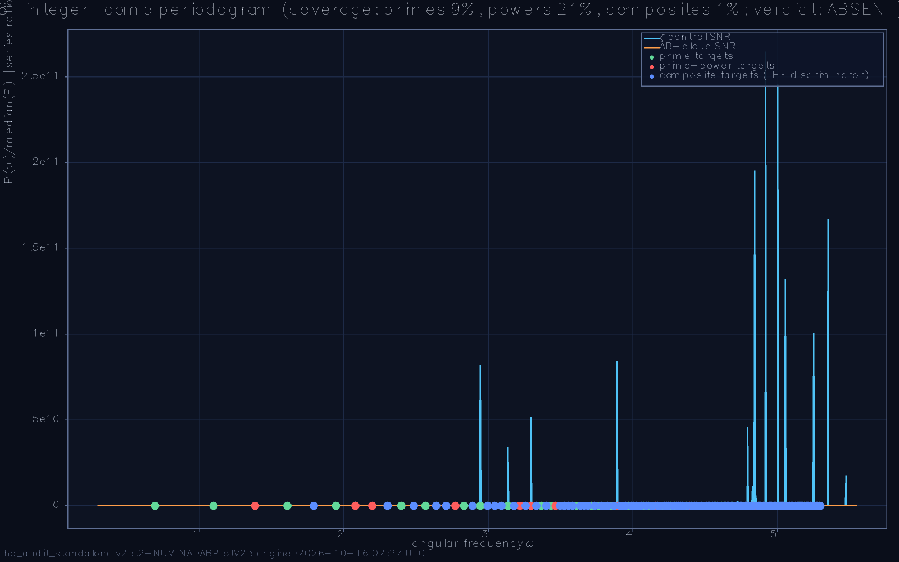
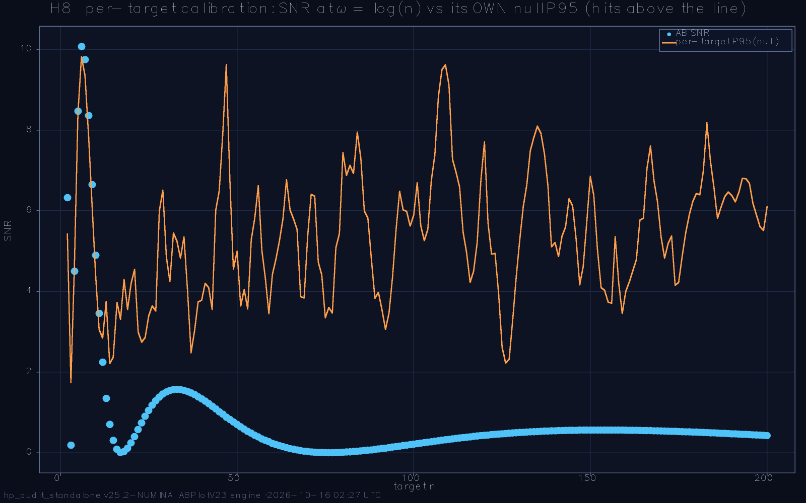
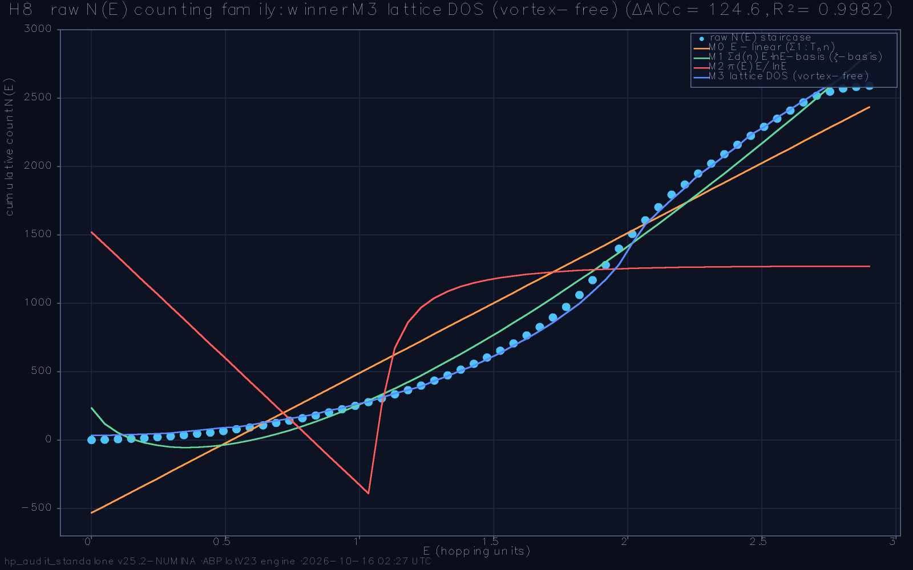
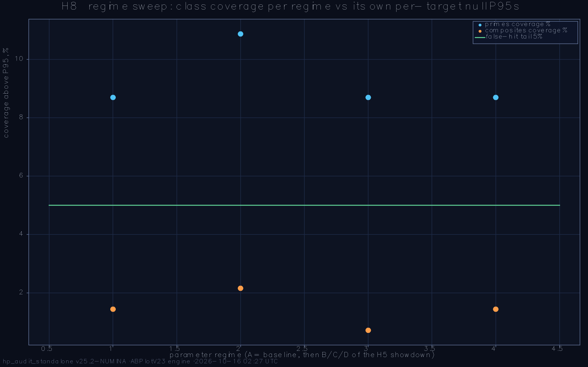
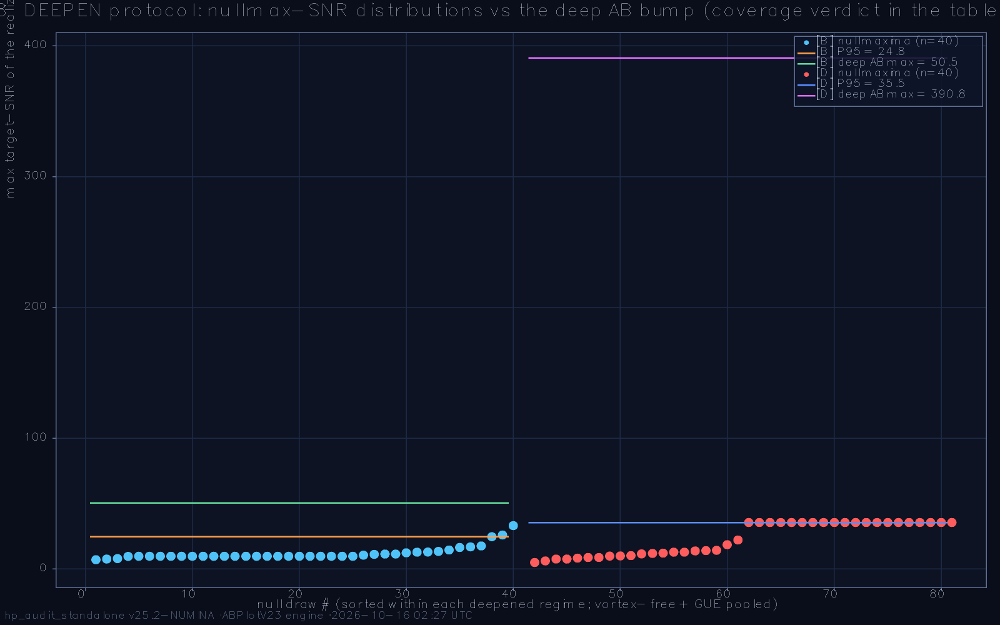

# Hilbert-Pólya Deep Audit — standalone battery report

**Run:** `run_2026-10-15_225604` · **preset:** menu · **date:** 2026-10-16 02:27:53 · **wall:** 03:31:49

ζ zeros loaded: **yes**

## Parameters
```
L=72  L_weyl=72  ensemble=100  seed=2026
α=0.5  W_eff=1.0  sweep=:showdown
deep-nulls=20  deep-configs=10  α-profile=true (n=40)
primes=2,3,5,7,11,13  q-grid=21 on [0.05, 1.0]
ladder=28→36→44→52→60  t_max=40.0  dt=0.025
```

**Battery verdict:** 0/1 PASS + 1 WARN (detector-validity semantics; the physics headlines live inside the tests)

---

## H8. All-numbers trace (integer comb, counting family, gap arithmetic)  — **WARN**

>  Test H8: ζ control validated (disc 1.3e+06), null pool 40 draws (tail 4.8%), AB comb coverage primes 9% / powers 21% / composites 1% → ABSENT; sweep: [B] ISOLATED BUMP, [C] ABSENT, [D] ISOLATED BUMP → WARN

| sub-check | status | detail |
|---|---|---|
| ζ control discriminates (D1) | PASS | prime-class comb confirmed; discrimination ratio 1.3e+06 (composites ≥100× quieter) → detector valid |
| null calibration (per-target P95) | PASS | 40 draws (20 vortex-free + 20 GUE), per-target P95 median 5.37; measured null tail 4.8% (target ≈ 5%) |
| integer comb verdict (headline) | PASS | baseline: ABSENT — primes 9%, powers 21%, composites 1% above their P95s; disc 1.04 |
| comb regime-robust (sweep) | WARN | tokens per regime: [B] ISOLATED BUMP (composites 2%) [C] ABSENT (composites 1%) [D] ISOLATED BUMP (composites 1%) DEEPENED: [B] ISOLATED BUMP, [D] ISOLATED BUMP |
| counting-family fits (N(E)) | PASS | winner M3 lattice DOS (vortex-free) (R² 0.99822) by 124.6 AICc over the runner-up |
| gap↔arithmetic correlations | PASS | max \|ρ\| 0.0440 (σ(n)) vs pooled null band 0.0358 (200 shuffles ∪ 2 GUE anchors); anchors max 0.0288 |







_Note:_ H1 and H8 ask DIFFERENT questions on the SAME detector: H1 — «is there a Bragg comb at ω = log p for PRIMES p?» (the Riemann–Weil zero signature; composite firing there is a specificity FAILURE), H8 — «does the AB cloud encode ALL integers n?» (the user's hypothesis; composite firing is the POSITIVE signal — the decoy semantics are inverted). Under «all numbers» H1's empty prime comb is even EXPECTED, so H1's verdicts neither confirm nor refute this gate. TARGET CLASSES (pre-registered): primes fire under BOTH hypotheses; prime powers p^k are the explicit formula's harmonics k·log p (fire under ζ too); composites with ≥2 DISTINCT prime factors (log 6, log 10, log 21 …) are silent under ζ and loud under «all numbers» — the only class where the predictions differ. CALIBRATION: per-target P95 of each log(n)'s OWN null distribution (vortex-free same-α + size-matched GUE) — with ~200 targets a H1-style 4-draw max ceiling is statistically empty, and per-target percentiles keep the test fair at ANY resolution (the nulls carry the same Hann leakage/merging as the AB spectrum). The measured null tail (~5%) is the calibrated false-hit rate; coverage is judged against it. RESOLUTION HONESTY: the Hann main lobe is 2π/span — at suite L most targets beyond n ≈ 10 are NOT individually separable; COVERAGE stays null-fair, but any POSITIVE headline carries a mandatory L-escalation (span ∝ L ⇒ Δω ∝ 1/L) before individual composite peaks may be claimed. The discrimination ratio (median prime-class SNR / median composite SNR) is the same statistic the ζ control must pass at ≥ 100 to validate the detector — medians, so Hann-skirt bleed of a 10⁷ prime tone into a few neighboring composites cannot flip it. COUNTING FAMILY: M0 (a·E+b) is the ⌊E⌋/Σ1 counting a Tₙ↔n bijection predicts; M1 (a·E·lnE+b·E+c) is the divisor-summatory shape — the SAME basis as H2's ζ-ansatz (the family ordering, not the basis, carries the arithmetic story); M2 (a·E/lnE+b) is the π(E) prime-encoding shape; M3 is the vortex-free lattice DOS. GAP ARITHMETIC: Spearman ρ(gₙ, f(n)) for f ∈ {d, Ω, φ, σ, ln} after a moving-average high-pass on BOTH sides (the slow DOS curvature is common-mode — unfiltered it fakes a trend correlation with the smooth ln n); the null is PERMUTATION (hp_num_shufs shuffles of the feature against the fixed gap series) plus independent GUE gap anchors. REGIME SWEEP + DEEPEN follow H1's reviewer discipline verbatim, with the same seed streams — where H1 deepened a regime, H8's null draws are bit-for-bit the same spectra, so the two gates' headlines are directly comparable.

