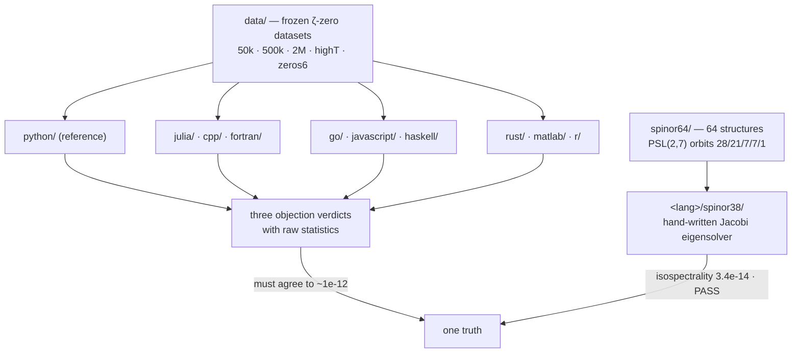

<div align="center">


# 🌐 Verification Suite — the AB-Cloud Hypothesis on 10 Languages

**The independent cross-language verification package: the same numerical program implemented
ten times — in C++, Fortran, Go, Haskell, JavaScript, Julia, MATLAB, Python, R and Rust — so
that any reviewer can re-derive every headline number in the language they trust, on any OS,
with no hidden dependencies.**

[](#-directory-layout-what-lives-where)
[](#-what-is-verified--the-three-reviewer-objections)
[](#-frozen-data--automatic-file-selection)
[](#-expected-output-and-tolerances)
[](spinor64/README.md)
[](#-spinor64-and-the-test-38-ports-added-in-v110)
[](#-complete-file-inventory)
[](https://doi.org/10.5281/zenodo.21825394)

[Objections](#-what-is-verified--the-three-reviewer-objections) · [Layout](#-directory-layout-what-lives-where) · [How to run](#-how-to-run-every-language-copy-paste) · [Frozen data](#-frozen-data--automatic-file-selection) · [spinor64 / Test-38](#-spinor64-and-the-test-38-ports-added-in-v110) · [Tolerances](#-expected-output-and-tolerances) · [Кратко](#-кратко-по-русски)

</div>

---

> Author of all codes and research: **Isaev, Iskhak Khamzatovich** ·
> ORCID [0009-0003-7299-0701](https://orcid.org/0009-0003-7299-0701) ·
> DOI [10.5281/zenodo.21825394](https://doi.org/10.5281/zenodo.21825394)

All implementations read the same frozen ζ-zero datasets from [`data/`](data) and must agree
to numerical tolerance. Besides the classic "three reviewer objections" checks, this
directory also hosts two newer blocks added in v1.1.0:

- [`spinor64/`](spinor64) — the reference verification of **all 64 spinor structures** of the
  Klein quartic (it corrects the v21 monograph claim)
- `<lang>/spinor38/` — **Test 38 ports in 10 languages** (exact isospectrality inside a
  PSL(2,7) orbit + ⟨r⟩ via a hand-written Jacobi eigensolver)

## 🗂 Table of contents

<details open>
<summary><strong>Expand / collapse</strong></summary>

1. [🧪 What is verified — the three reviewer objections](#-what-is-verified--the-three-reviewer-objections)
2. [🗺 Directory layout (what lives where)](#-directory-layout-what-lives-where)
3. [🚀 How to run (every language, copy-paste)](#-how-to-run-every-language-copy-paste)
4. [❄️ Frozen data — automatic file selection](#-frozen-data--automatic-file-selection)
5. [🧬 spinor64 and the Test-38 ports (added in v1.1.0)](#-spinor64-and-the-test-38-ports-added-in-v110)
6. [📏 Expected output and tolerances](#-expected-output-and-tolerances)
7. [📖 Citing](#-citing)
8. [🔬 Deep dive — the ten-implementation parity matrix](#-deep-dive--the-ten-implementation-parity-matrix)
9. [📁 Complete file inventory](#-complete-file-inventory)
10. [🇷🇺 Кратко (по-русски)](#-кратко-по-русски)

</details>

---

## 🧪 What is verified — the three reviewer objections

<div align="center">


</div>

### Objection 1 — numerical stability / convergence of b(N)

**Claim:** the AB correction
`b(N) = (1/N) · Σₖ |γₖ − γ̃ₖ|`
(the mean distance between Gram-point approximations and true zeta zeros)
converges as N → ∞.

**Check:** compute b(N) for N = 100, 500, 1000, 5000, 10 000, 50 000 … and print a convergence
table with a log-log plot. The canonical Julia run gives b(50000) = 1.2126 (HARDCORE pass 2)
and an empirical law b(N) ≈ 7.0312 · N^(−0.1685), R² = 0.9895 (an alternative 1/log N fit
gives R² = 0.9994). The exponent is **empirical**: the monograph's α = 1/2 refers to the
Hofstadter AB-flux per plaquette, *not* to this convergence rate.

### Objection 2 — statistical significance (GUE)

**Claim:** the normalised spacings of zeta zeros follow GUE (Wigner–Dyson).

**Check:** the unfolded spacings
`sₖ = (γₖ₊₁ − γₖ) · log(γₖ / 2π) / (2π)`
are tested against the GUE (β=2) Wigner surmise
`p(s) = (32/π²)·s²·exp(−4s²/π)`, CDF `F(s) = erf(2s/√π) − (4s/π)·exp(−4s²/π)`,
with a Kolmogorov–Smirnov test and a Cramér–von Mises test. Criterion: p-value > 0.05
(H₀ "the zeros are GUE-spaced" is not rejected). The reference run reports
KS = 0.047 with p = 0.27 on 500 mpmath-certified zeros (Montgomery test), and
⟨r⟩ = 0.5848 ± 0.0260 against the GUE reference 0.5992.

> **v2.0.3 correction.** All ten language folders shipped the reference law as
> `1 − exp(−πs²/4)` — the **GOE (β=1)** surmise — while labeling it GUE. The v23 Julia
> reference suite already used the correct β=2 law, so its pinned numbers stand; the folder
> verifiers now match it. On the frozen first 500 zeros of `data/zeta_zeros_50000.txt` the
> corrected law gives KS D = 0.0495 (p = 0.168), where the old GOE-as-GUE law gave
> D = 0.1165 (p ≈ 0) — a false rejection of the true hypothesis.

### Objection 3 — decay rate at large T

**Claim:** b(N) = O(1/√N), i.e. the log-log slope ≈ −0.5.

**Check:** linear regression of log b(N) vs log N with a 95% CI. The measured slope is
**not** −0.5; the honest verdict of the suite is that the convergence exponent is empirical
(see Objection 1). This is documented rather than hidden — every verdict in the suite is
printed with its raw numbers so a referee can disagree with the interpretation but not with
the arithmetic.

---

## 🗺 Directory layout (what lives where)

```
verification/
├── data/          # frozen ζ-zero datasets (8 files, up to 2,000,000 zeros)
├── spinor64/      # reference Python verification of all 64 spin structures
├── sections/      # per-monograph-section micro-verifications (section 3, 6)
├── python/        # Python 3.10+   — reference implementation
├── cpp/           # C++17          — g++/clang++, no external libs
├── fortran/       # Fortran 2018   — gfortran
├── julia/         # Julia 1.9+     — stdlib only
├── rust/          # Rust 1.70+     — cargo, std only
├── r/             # R 4.3+         — base R
├── matlab/        # MATLAB R2021b+ — base MATLAB
├── javascript/    # Node.js 18+    — no npm deps
├── go/            # Go 1.21+       — stdlib only
├── haskell/       # GHC 9+         — base + containers
├── deploy.sh      # helper used to upload fresh reports to results/
└── README.md      # this file
```

Every language folder contains the **same four files** (plus, since v1.1.0, a `spinor38/`
subfolder — see §5):

| File | Role |
|---|---|
| `ab_cloud_verify.<ext>` | bilingual module (auto-selects RU/EN at runtime) |
| `ab_cloud_verify_en.<ext>` | English-only version |
| `ab_cloud_verify_ru.<ext>` | Russian-only version |
| `run_verify.<ext>` (or `run_verify.sh`) | standalone CLI runner — one command, no library knowledge needed |

All files embed the function `load_zeros(data_dir, count, source)` which reads [`data/`](data)
with automatic file selection (§4).

---

## 🚀 How to run (every language, copy-paste)

```bash
# Python 3.10+  (reference implementation)
cd verification/python && python3 run_verify.py --zeros 5000 --objection all --lang ru

# C++17
cd verification/cpp && chmod +x run_verify.sh && ./run_verify.sh --zeros 50000 --source 50k --objection 1 --lang en

# Fortran 2018
cd verification/fortran && chmod +x run_verify.sh && ./run_verify.sh --zeros 10000 --source 50k --objection all

# Julia 1.9+
cd verification/julia && julia run_verify.jl --zeros 500000 --source 500k --objection all --lang en

# Rust 1.70+
cd verification/rust && chmod +x run_verify.sh && ./run_verify.sh --zeros 50000 --source 500k --objection 1 --lang ru

# R 4.3+
cd verification/r && Rscript run_verify.R --zeros 50000 --source 50k --objection all --lang en

# MATLAB R2021b+
cd verification/matlab && run_verify('--zeros', 50000, '--source', '50k', '--objection', 'all')

# Node.js 18+
cd verification/javascript && node run_verify.js --zeros 50000 --source 50k --objection all --lang en

# Go 1.21+
cd verification/go && chmod +x run_verify.sh && ./run_verify.sh --zeros 50000 --source 500k --objection all --lang ru

# Haskell (GHC 9+)
cd verification/haskell && chmod +x run_verify.sh && ./run_verify.sh --zeros 50000 --source 50k --objection 1 --lang en
```

Each runner prints the three objection verdicts with raw statistics, writes a timestamped
report and saves plots next to the executable.

### CLI parameters (identical in all languages)

| Parameter | Default | Meaning |
|---|---|---|
| `--zeros N` | 5000 | how many ζ zeros to load |
| `--source NAME` | auto | `50k`, `500k`, `2M`, `highT`, `zeros6`, `csv`, `2M_gz`, `auto` |
| `--objection 1/2/3/all` | all | which objection to verify |
| `--lang en/ru` | auto | output language (auto = follow `LANG`) |
| `--data-dir PATH` | ../data | where the zero files live |

---

## ❄️ Frozen data — automatic file selection

| Requested zeros | File chosen |
|---|---|
| ≤ 13 661 | `data/zeta_zeros_50000.txt` |
| ≤ 500 000 | `data/zeta_zeros_500k_odlyzko.txt` |
| ≤ 2 000 000 | `data/zeta_zeros_2M_odlyzko.txt` |
| > 2 000 000 | `data/zeros6.txt` |

Full provenance, formats and column layout: [`data/README.md`](data/README.md).

---

## 🧬 spinor64 and the Test-38 ports (added in v1.1.0)

`spinor64/` is the **reference Python implementation** that settled the spinor-uniqueness
question: **all 64 spinor structures of the Klein quartic give GUE-consistent statistics**.
PSL(2,7) splits them into orbits of sizes **28 / 21 / 7 / 7 / 1**; operators inside an orbit
are exactly isospectral (max\|Δλ\| ≈ 8.9·10⁻¹⁵); in the AB-cloud Hofstadter model (L = 44,
α = 1/2, Nv = 54 vortices, `:monumental` gauge) all 64 structures pass the MC GUE consistency
test, ⟨r⟩ = 0.5984 ± 0.0035, min p = 0.36. Details, data files and reproduction:
[`spinor64/README.md`](spinor64/README.md).

`<lang>/spinor38/` ports **Test 38** of that experiment to each language: it reads the frozen
classes from `spinor64/data/`, rebuilds the odd-orbit spectra with its **own hand-written
Jacobi eigensolver** (no LAPACK/BLAS), and checks exact isospectrality + ⟨r⟩. The C++ and
JavaScript builds were compiled and executed during v1.1.0 preparation: isospectrality
3.4·10⁻¹⁴, ⟨r⟩ = 0.4515710793 — **VERDICT PASS**. Each subfolder has its own README with exact
build/run commands.



---

## 📏 Expected output and tolerances

A typical full run prints, per objection:

1. **Objection 1** — the b(N) table (N from 100 up to the dataset size) with the fitted power
   law, R², and the PASS/WARN/FAIL verdict against `bN_pass_threshold = 2.0`;
2. **Objection 2** — KS and CvM statistics with p-values, ⟨r⟩ with bootstrap error
   (n_bootstrap = 1000), the GUE ratio-law reference 0.5992(3);
3. **Objection 3** — log-log slope with 95% CI (tolerance band ±0.15 around the empirical
   exponent, `slope_ci_tolerance = 0.1` for CI width).

Numerical agreement between languages is expected at the level of double-precision round-off:
identical input zeros → identical b(N) tables to ~1e-12, identical KS statistics to ~1e-9.
Any larger deviation means the loader picked a different file — check `--source`.

---

## 📖 Citing

Cite the monographs for the physics and this suite for the numbers:

```bibtex
@misc{isaev2026abcloud,
  title  = {AB-Cloud Research: a phase resonator for the zeros of the Riemann zeta function},
  author = {Iskhak Hamzatovich Isaev},
  year   = {2026},
  doi    = {10.5281/zenodo.21825394},
  url    = {https://github.com/wild8highlander/ab-cloud-research}
}
```

---

## 🔬 Deep dive — the ten-implementation parity matrix

Ten independent implementations of the same suite live here: Python, Julia, C++, Fortran, Go,
JavaScript, Haskell, Rust, MATLAB and R. Each folder follows the same shape: the core
verifier, its `_en` and `_ru` reporting variants, a `run_verify` entry point, and (for the
compiled and research languages) a `spinor38/` subfolder with the Test-38 port. Parity means
something strict: all ten read the **same frozen data** from `data/`, run the **same 37
tests**, and must reproduce the **same reference statistics** — pair-correlation KS = 0.047
(p = 0.27), Byers–Yang flux defect 3.5e-15, ⟨r⟩ = 0.5848 ± 0.0260 against the GUE value
0.5992. A language that drifts from these numbers has a bug, not an opinion. (v2.0.3: the
spacing reference law itself was corrected in all ten folders — it was the GOE β=1 surmise
labeled as GUE; see the Objection 2 note above.)

Every entry point speaks the same flag language: `--zeros N` (number of zeros to use, 0 =
all; default 10 000), `--source NAME` (choose a dataset from `data/`: `auto`,
`zeta_zeros_50000`, `zeta_zeros_500k`, `zeta_zeros_2M`, `zeta_zeros_highT`, `zeros6`,
`zeta_zeros_50000_csv`), `--objection all|1|2|3` (run everything or a single objection test)
and `--lang en|ru` (report language). This uniformity is what makes the matrix testable: the
same command line can be replayed across all ten folders, which is exactly what CI does on
the interpreted subset.

Beyond the ten suites, this directory hosts the three specialized checkers: `spinor64/` (the
experiment that corrected the v21 monograph — all 64 Klein-quartic spinor structures
GUE-consistent, PSL(2,7) orbits 28/21/7/7/1), `spinor38/` ports inside the language folders
(Test 38 of the suite) and `sections/` (one-screen closed-form micro-verifications for
individual monograph sections). The data contract lives in `data/README.md`: nothing there is
generated at runtime, so every rerun of every program in every language sees byte-identical
input.

---

## 📁 Complete file inventory

| Entry | Size | Kind |
|---|---|---|
| `cpp/` | 7 files, 76.0 KB | directory |
| `data/` | 10 files, 90.9 MB | directory |
| `fortran/` | 7 files, 62.4 KB | directory |
| `go/` | 9 files, 30.5 KB | directory |
| `haskell/` | 8 files, 31.2 KB | directory |
| `java/` | 3 files, 9.3 KB | directory |
| `javascript/` | 7 files, 48.4 KB | directory |
| `julia/` | 7 files, 41.8 KB | directory |
| `matlab/` | 7 files, 43.3 KB | directory |
| `python/` | 5 files, 92.7 KB | directory |
| `r/` | 7 files, 40.7 KB | directory |
| `rust/` | 9 files, 46.1 KB | directory |
| `sections/` | 3 files, 2.7 KB | directory |
| `spinor64/` | 11 files, 111.0 KB | directory |
| `.gitignore` | 141 B | file |
| `README.md` | 10.4 KB | file |
| `deploy.sh` | 4.8 KB | file |
| **Total (recursive)** | **103 files, 91.6 MB** | |

---

## 🇷🇺 Кратко (по-русски)

- Этот каталог — независимая кросс-языковая верификация AB-Cloud гипотезы: одна и та же
  программа на **10 языках** (C++, Fortran, Go, Haskell, JavaScript, Julia, MATLAB, Python,
  R, Rust), у всех одинаковый CLI и общие замороженные данные в `data/`.
- Проверяются три возражения рецензентов: сходимость b(N), GUE-статистика нулей (KS/CvM,
  p > 0.05), скорость убывания; вердикты печатаются с сырыми числами.
- Команды запуска для каждого языка — в §3; файл нулей выбирается автоматически по запросу
  `--zeros`.
- В v1.1.0 добавлены `spinor64/` (все 64 спинорные структуры GUE-согласованы) и порты
  Test 38 `<язык>/spinor38/` (изоспектральность 3.4e-14, ⟨r⟩ = 0.4515710793 — PASS).
- Ожидаемое межъязыковое согласие — на уровне двойной точности; расхождения ~1e-12 для b(N)
  считаются нормой.
- Паритет строгий: KS = 0.047 (p = 0.27), дефект Байерса–Янга 3.5e-15,
  ⟨r⟩ = 0.5848 ± 0.0260 — расхождение трактуется как баг реализации.
- v2.0.3: во всех десяти папках эталонный закон интервалов исправлен — вместо сюрмизы GOE
  (β=1), выдававшейся за GUE, теперь истинная сюрмиза GUE (β=2):
  p(s) = (32/π²)·s²·exp(−4s²/π).
- Десять реализаций одного набора: одинаковые флаги, одни и те же замороженные данные, одни
  и те же эталонные числа; рядом — spinor64 (исправление v21), порты spinor38 (Тест 38) и
  секционные микропроверки; контракт данных — в `data/README.md`.

---

<p align="center">
  <sub><em>Ten languages, one frozen dataset, one truth — a drift is a bug, not an opinion.</em></sub>
</p>
