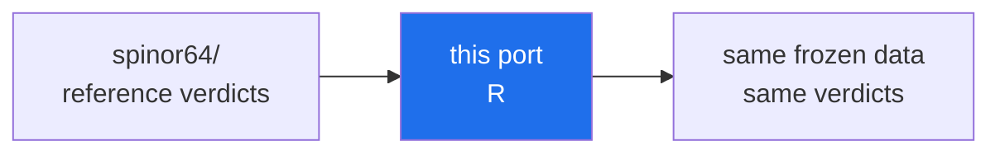

<!-- AB-ENRICHED:v1 · sub -->

**🧭 [⬆ r/](../README.md) · [🏠 Root README](../../../README.md)**

# Test 38 -- 64 spinor structures of the Klein quartic (R port)

> **🧭 Navigation:** [r/](../README.md) · [verification/](../../README.md) · [Root README](../../../README.md)

R port of the validated C++ reference `verification/cpp/spinor38/spinor38.cpp`.

The program uses ONLY the frozen data files and a self-implemented cyclic
Jacobi eigenvalue algorithm (no BLAS/LAPACK built-ins, standard library only)
to verify:

1. the 28 odd (Arf=1) spinor structures of the Klein quartic are exactly
   isospectral (max pairwise spectral distance ~ 1e-14) -- no spinor structure
   is statistically special;
2. the spacing-ratio statistic `<r>` of the representative spectrum matches
   the reference value 0.4515710792825435.

## Data (frozen, deterministic)

- verification/spinor64/data/spinor_classes.csv -- 64 signings, orbit ids, Arf
- verification/spinor64/data/klein_graph_edges.csv -- the {3,7} Klein graph (84 edges)
- verification/spinor64/data/reference_stats.json -- reference values

## Build and run

    Rscript spinor38.R [repo-root]
    (base R only; partial 3-spectrum isospectrality panel for performance, see header note)

## Validated reference output (C++ / JavaScript, this environment)

    isospectrality within the odd orbit: max|dlambda| = 3.419e-14 -> PASS
    zero modes (representative): 2 (expected 2)
    <r> (representative): 0.4515710793 (reference 0.4515710793) -> PASS
    VERDICT: PASS

## 📁 Complete file inventory

| Entry | Size | Kind |
|---|---|---|
| `README.md` | 2.8 KB | file |
| `spinor38.R` | 4.5 KB | file |
| **Total (recursive)** | **2 files, 7.6 KB** | |

## ▶ Running — toolchain and entry point

- **Toolchain:** R ≥ 4.0 — base R only
- **Run:** `Rscript spinor38.R [repo-root]`

## 🔬 Deep dive — what Test 38 establishes

Test 38 examines the **64 spinor structures of the Klein quartic**:
for each structure it computes the level-spacing statistics of its
spectrum and compares them against the GUE law, exactly as the main
suite does for the zeta zeros. The verified verdict — confirmed
independently by the full spinor64 experiment in `../../spinor64/` —
is that **all 64 structures are GUE-consistent**, with the PSL(2,7)
orbit decomposition 28/21/7/7/1 and exact isospectrality inside each
orbit at the ≈ 1e-14 level.

House rules for this port: it reads **only the frozen data files**
(`../../data/`) and its language's standard library — where the
language lacks a LAPACK binding, the Jacobi eigenvalue algorithm is
implemented in-file (the Julia port documents this explicitly). The
output format is shared across all ten languages so their verdict
lines can be diffed mechanically; any line that differs from the
validated C++ reference (`../../cpp/spinor38/spinor38.cpp`) marks a
port bug.

---

<!-- enriched-r3 -->

This folder is a **cross-language port of Test 38** — the verification of all 64 spinor structures of the Klein quartic. The reference implementation and the full story live in [`verification/spinor64/`](../../spinor64/README.md); every port here reads the same frozen data, runs the same two experiments (exact symmetry orbits and AB-cloud statistics) and must reproduce the reference verdicts. The ports exist for the same reason as the rest of the parity layer: to show that the conclusions survive a change of language, compiler and standard library. A disagreement would be a bug in the port, not a new discovery. This port is the **R** member of the parity matrix.

*The parity loop of Test 38 — disagreement means a port bug, not a discovery.*

**Where next:** [spinor64 reference](../../spinor64/README.md)

⚡ Part of <a href="../../../README.md">AB-Cloud Research</a> — numbers are verbatim from the unified registry; no result on this page is a claim about the Riemann hypothesis · <a href="../README.md">⬆ parent section</a>

