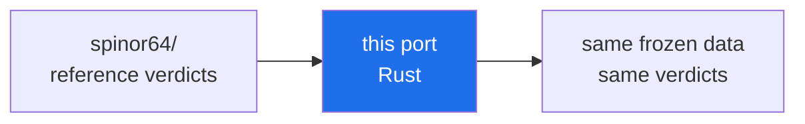

# Test 38 -- 64 spinor structures of the Klein quartic (Rust port)

> **🧭 Navigation:** [rust/](../README.md) · [verification/](../../README.md) · [Root README](../../../README.md)

Rust port of the validated C++ reference `verification/cpp/spinor38/spinor38.cpp`.
The port is a single source file, [`src/main.rs`](src/main.rs).

The program uses ONLY the frozen data files and a self-implemented cyclic
Jacobi eigenvalue algorithm (no external crates, standard library only) to
verify:

1. the 28 odd (Arf=1) spinor structures of the Klein quartic are exactly
   isospectral (max pairwise spectral distance ~ 1e-14) -- no spinor structure
   is statistically special;
2. the spacing-ratio statistic `<r>` of the representative spectrum matches
   the reference value 0.4515710792825435.

## Build and run

    cargo run --release
    # or build first:
    cargo build --release
    ./target/release/spinor38

Optional first argument: path to the repository root. Without it the data
directory is located by walking up from the current working directory (up to
6 levels) looking for `verification/spinor64/data/spinor_classes.csv`:

    cargo run --release -- /path/to/repo/root

Any recent stable Rust toolchain works (std only, `Cargo.toml` has no
dependencies). The program exits 0 on PASS / 1 on FAIL.

## Data files used

- `verification/spinor64/data/spinor_classes.csv` (64 classes, 84 signs each)
- `verification/spinor64/data/klein_graph_edges.csv` (84 edges of the Klein graph)
- `verification/spinor64/data/reference_stats.json` (reference statistics)

## Validated reference output

The C++ port is the validated reference; its output is:

    Test 38 - 64 spinor structures of the Klein quartic (C++ port)
    classes loaded: 64 | odd-orbit members: 28
    isospectrality within the odd orbit: max|dlambda| = 3.419e-14 -> PASS
    zero modes (representative): 2 (expected 2)
    <r> (representative): 0.4515710793 (reference 0.4515710793) -> PASS
    VERDICT: PASS

Note: this Rust port was authored in an environment without a Rust toolchain,
so it was verified by a line-by-line review against the C++ reference (and a
floating point cross-check of the identical algorithm), not by compilation in
place. It prints the same report with "(Rust port)" in the header line.

## 📁 Complete file inventory

| Entry | Size | Kind |
|---|---|---|
| `src/` | 1 files, 6.3 KB | directory |
| `Cargo.toml` | 79 B | file |
| `README.md` | 3.8 KB | file |
| **Total (recursive)** | **3 files, 10.4 KB** | |

## ▶ Running — toolchain and entry point

- **Toolchain:** cargo, edition 2021 — no external crates
- **Run:** `cargo run --release   # from inside this folder`

## 🔬 Deep dive — what Test 38 establishes

Test 38 examines the **64 spinor structures of the Klein quartic**:
for each structure it computes the level-spacing statistics of its
spectrum and compares them against the GUE law, exactly as the main
suite does for the zeta zeros. The verified verdict — confirmed
independently by the full spinor64 experiment in `../../spinor64/` —
is that **all 64 structures are GUE-consistent**, with the PSL(2,7)
orbit decomposition 28/21/7/7/1 and exact isospectrality inside each
orbit at the ≈ 1e-14 level.

House rules for this port: it reads **only the frozen data files**
(`../../data/`) and its language's standard library — where the
language lacks a LAPACK binding, the Jacobi eigenvalue algorithm is
implemented in-file (the Julia port documents this explicitly). The
output format is shared across all ten languages so their verdict
lines can be diffed mechanically; any line that differs from the
validated C++ reference (`../../cpp/spinor38/spinor38.cpp`) marks a
port bug.

---

<!-- enriched-r3 -->

This folder is a **cross-language port of Test 38** — the verification of all 64 spinor structures of the Klein quartic. The reference implementation and the full story live in [`verification/spinor64/`](../../spinor64/README.md); every port here reads the same frozen data, runs the same two experiments (exact symmetry orbits and AB-cloud statistics) and must reproduce the reference verdicts. The ports exist for the same reason as the rest of the parity layer: to show that the conclusions survive a change of language, compiler and standard library. A disagreement would be a bug in the port, not a new discovery. This port is the **Rust** member of the parity matrix.

*The parity loop of Test 38 — disagreement means a port bug, not a discovery.*

**Subfolders:** `src/`

**Where next:** [spinor64 reference](../../spinor64/README.md)
